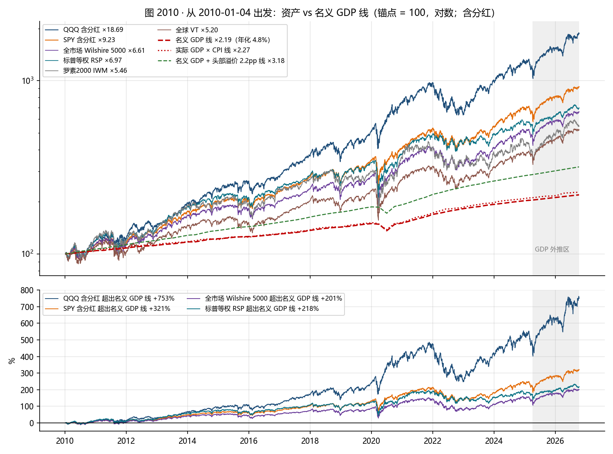
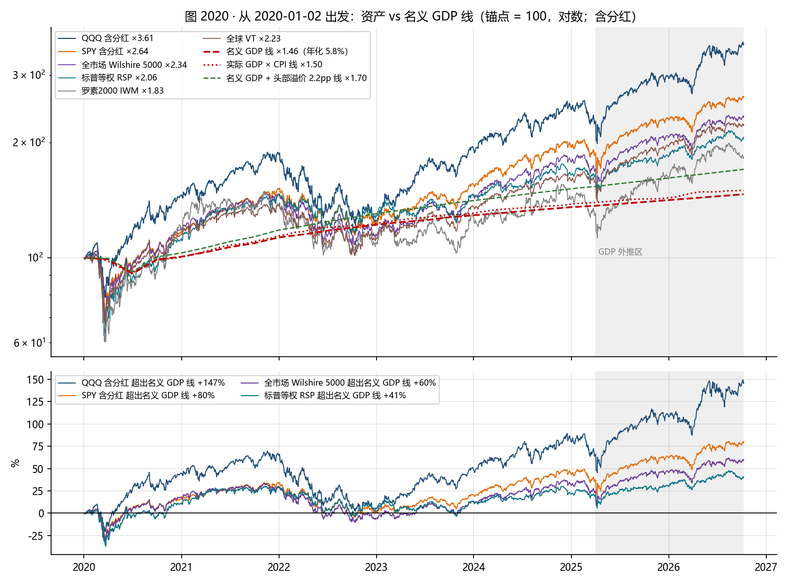
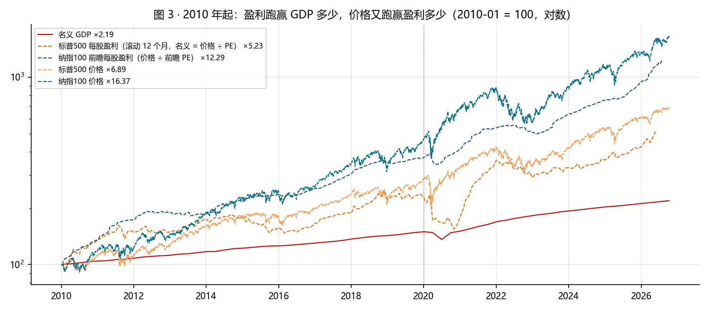
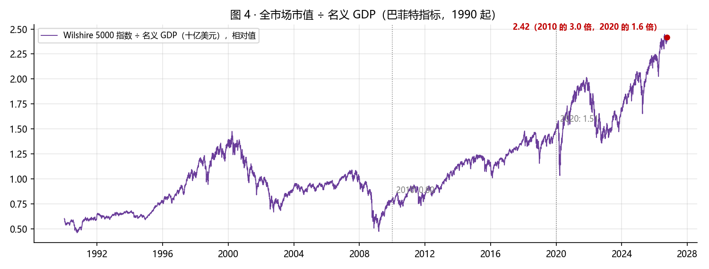
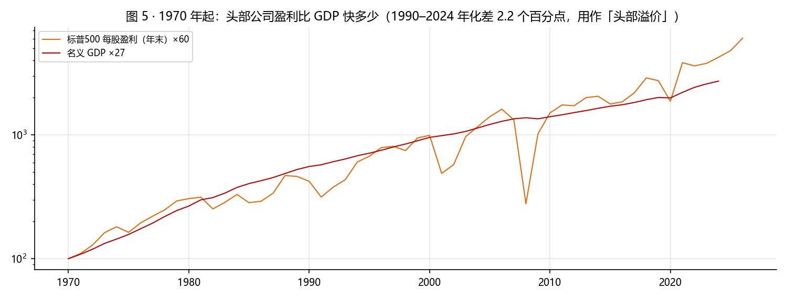

# QQQ 与 SPY 相对「GDP + CPI」基准线：2010 与 2020 两个锚点（截至 2026-10-09）

基准：大盘长期应大致跟着名义 GDP 走，名义 GDP ≈ 实际 GDP 增长 + 通胀（CPI）。QQQ 和 SPY 是筛选过的头部公司，可以比平均快一点，快多少用历史上头部公司盈利超过 GDP 的幅度来定。锚点取 2010 年初（李录的标记点）和 2020 年初（COVID 前夕）。从锚点出发，把名义 GDP 线画在资产自己的起点上，看资产跑在线上多远，再把超出的部分拆成「盈利超过 GDP」和「估值扩张」两块。

## 一页结论

1. **基准线本身不陡。** 2010 年初以来名义 GDP 年化 4.8%（实际 2.3% + CPI 2.6%），2020 年初以来 5.8%（实际 2.2% + CPI 3.9%）。1990–2024 年头部公司（标普500）盈利比名义 GDP 快 2.2 个百分点，这是「头部溢价」。
2. **从 2010 出发，QQQ 跑在 GDP 线上 +753%。** QQQ 含分红 ×18.7，名义 GDP ×2.19；按 GDP 的速度，这段涨幅要 46 年才能走完。SPY +321%（31 年），全市场 +201%（24 年）。加上 2.2 个百分点的头部溢价之后，QQQ 仍超出 +488%，SPY +190%。
3. **从 2020 出发，QQQ 跑在 GDP 线上 +147%，SPY +80%，全市场 +60%。** 加溢价后 QQQ +112%、SPY +55%。
4. **超出的部分几乎全是盈利，不是估值。** 2010 年初到现在：纳指100 价格 ×16.4 = GDP ×2.19 × 盈利相对 GDP ×5.67 × 估值 ×1.24。纳指100 的前瞻盈利涨了 12.4 倍，GDP 只涨 2.2 倍，前瞻 PE 从 17.6 到 21.8。2020 年初到现在：纳指100 ×3.48 = GDP ×1.46 × 盈利相对 GDP ×2.25 × 估值 ×0.99，估值贡献为零。
5. **所以「QQQ 是否超越 GDP+CPI 过多」要拆成两句话。** 价格相对盈利没有过多，PE 和 2010、2020 时差不多；盈利相对 GDP 极多，纳指100 这 100 家公司从美国经济（和全球经济）里拿走的利润份额，16 年扩大了 5.7 倍。要回到 GDP 线，靠估值压缩做不到，只有盈利份额回落才做得到，那是竞争、反垄断、利润率均值回归的问题，不是利率问题。
6. **全市场市值 ÷ GDP（巴菲特指标）是 2010 年的 3.0 倍、2020 年的 1.6 倍**，高于 2000 年顶（1.48）和 2021 年顶（2.02），1990 年以来 100 分位。
7. **这组数字说的是「相对经济体量的高」，不是「相对盈利的高」。** 它比前两份报告的估值读数更严，因为它不承认盈利份额的扩张是永久的。信不信这一点，就是信不信 GDP 线会把价格拉回来。

## 1. 方法与数据

- 名义 GDP：BEA 季度数据（季调年率，十亿美元）到 2025-03；之后 7 个季度按最近四个季度的增速外推（名义 4.7%、实际 2.0%），图中灰色区域为外推区。世界银行 2025 年名义 GDP 30.77 万亿美元用作交叉核对（BEA 2024 年 29.72 万亿）。
- 「实际 GDP × CPI」线：BEA 实际 GDP（2017 年链式美元）乘以 BLS CPI-U（到 2026-08）。它和名义 GDP 线的差别是 GDP 平减指数与 CPI 的差别，两条线都画。
- 资产：Yahoo Finance，QQQ / SPY / RSP / IWM / VT 用含分红复权价，纳指100、标普500、Wilshire 5000 用价格指数。截至 2026-10-09。
- 头部溢价：标普500 名义每股盈利（价格 ÷ multpl 滚动 PE）年化减名义 GDP 年化，见第 6 节。
- 锚点：2010-01-04 和 2020-01-02，各自的第一个交易日。第 3 节另给 2020-03-23（COVID 底）起算的敏感性。
- 拆解：价格 = 名义 GDP × （每股盈利 ÷ GDP）× 市盈率，三项相乘恒等。标普用滚动 PE，纳指用前瞻 PE（前瞻每股盈利 = 价格 ÷ 前瞻 PE）。

## 2. 从 2010 年初出发

| 资产 | 年化 | 名义 GDP 年化 | 超出 GDP（pp） | 总涨幅 | GDP 线 | 超出 GDP 线 | 超出 GDP + 溢价线 | 相当于透支 GDP |
|---|---|---|---|---|---|---|---|---|
| QQQ 含分红 | 19.1% | 4.8% | +14.3 | ×18.69 | ×2.19 | +753% | +488% | 46 年 |
| SPY 含分红 | 14.2% | 4.8% | +9.4 | ×9.23 | ×2.19 | +321% | +190% | 31 年 |
| 纳指100 价格 | 18.1% | 4.8% | +13.4 | ×16.37 | ×2.19 | +647% | +415% | 43 年 |
| 标普500 价格 | 12.2% | 4.8% | +7.4 | ×6.89 | ×2.19 | +215% | +117% | 24 年 |
| 全市场 Wilshire 5000 | 11.9% | 4.8% | +7.1 | ×6.61 | ×2.19 | +202% | +108% | 24 年 |
| 标普等权 RSP | 12.3% | 4.8% | +7.5 | ×6.97 | ×2.19 | +218% | +119% | 25 年 |
| 罗素2000 IWM | 10.7% | 4.8% | +5.9 | ×5.46 | ×2.19 | +149% | +72% | 20 年 |
| 全球 VT | 10.3% | 4.8% | +5.5 | ×5.20 | ×2.19 | +137% | +64% | 18 年 |

- 16.8 年里名义 GDP 涨了 119%，全市场涨了 561%，QQQ 涨了 1769%。
- 等权标普（RSP）、小盘（IWM）、全球（VT）也都在 GDP 线上 1.4 到 2.2 倍，说明超出 GDP 不是纳指独有，是整个美股相对经济的现象；纳指只是把这个现象放大了三倍。
- 下图是超出 GDP 线的幅度随时间的变化。QQQ 的缺口在 2021-11 到过 +486%，2022-12 回到 +247%，现在 +753%；2012 年以后缺口从没有回到过零。

## 3. 从 2020 年初出发

| 资产 | 年化 | 名义 GDP 年化 | 超出 GDP（pp） | 总涨幅 | GDP 线 | 超出 GDP 线 | 超出 GDP + 溢价线 | 相当于透支 GDP |
|---|---|---|---|---|---|---|---|---|
| QQQ 含分红 | 20.9% | 5.8% | +15.1 | ×3.61 | ×1.47 | +147% | +112% | 16 年 |
| SPY 含分红 | 15.4% | 5.8% | +9.6 | ×2.64 | ×1.47 | +80% | +55% | 10 年 |
| 纳指100 价格 | 20.2% | 5.8% | +14.4 | ×3.48 | ×1.47 | +138% | +104% | 15 年 |
| 标普500 价格 | 13.8% | 5.8% | +8.0 | ×2.40 | ×1.47 | +64% | +41% | 9 年 |
| 全市场 Wilshire 5000 | 13.4% | 5.8% | +7.6 | ×2.34 | ×1.47 | +60% | +38% | 8 年 |
| 标普等权 RSP | 11.3% | 5.8% | +5.5 | ×2.06 | ×1.47 | +41% | +21% | 6 年 |
| 罗素2000 IWM | 9.3% | 5.8% | +3.5 | ×1.83 | ×1.47 | +25% | +7% | 4 年 |
| 全球 VT | 12.6% | 5.8% | +6.7 | ×2.23 | ×1.47 | +52% | +31% | 7 年 |

- COVID 以来名义 GDP 年化 5.8%，比 2010 年代快，因为通胀从 2.6% 变成 3.9%。基准线变陡了，QQQ 仍然在线上 +147%。
- 2022 年最低时，SPY 回到 GDP 线上 -5%，等权 RSP -4%，全市场 -10%，QQQ +1%（2022-12-28）。那是这 6 年里唯一一次价格和经济体量重新对齐的时刻。
- 敏感性：若从 2020-03-23 的 COVID 底起算，QQQ 年化 26.1%、超出 GDP 线 +210%；SPY 22.7%、+158%。从底部起算会把缺口放大一倍，所以锚点用年初而不是底部。

## 4. 超出的部分是什么：盈利还是估值

2010 年初至今：

| 指数 | 价格 | = 名义 GDP | × 盈利 ÷ GDP | × 市盈率 | 其中盈利 |
|---|---|---|---|---|---|
| 标普500 | ×6.89 | ×2.19 | ×2.58 | ×1.22（滚动 PE 20.7 → 25.2） | ×5.66 |
| 纳指100 | ×16.37 | ×2.19 | ×5.67 | ×1.24（前瞻 PE 17.6 → 21.8） | ×12.44 |

2020 年初至今：

| 指数 | 价格 | = 名义 GDP | × 盈利 ÷ GDP | × 市盈率 | 其中盈利 |
|---|---|---|---|---|---|
| 标普500 | ×2.40 | ×1.46 | ×1.61 | ×1.01（滚动 PE 24.9 → 25.2） | ×2.37 |
| 纳指100 | ×3.48 | ×1.46 | ×2.25 | ×0.99（前瞻 PE 21.9 → 21.8） | ×3.30 |

- 2010 年初的标普滚动 PE 用的是 2009 年的盈利，略偏高，所以标普这一行的估值贡献 ×1.22 偏保守；纳指用前瞻 PE 不受此影响。
- 两个锚点给出同一个结论：价格跑赢 GDP 的部分，八九成来自盈利份额扩张，一两成来自估值。2020 年以来估值一分没涨。
- 盈利份额扩张的来源：利润率上升、回购（每股盈利快于总盈利）、头部集中（纳指100 的盈利增速是标普的两倍多）、海外收入（纳指100 相当一部分收入来自美国以外，分母却只用美国 GDP）。最后一条意味着用美国 GDP 做基准对纳指天然偏严。前两项的具体幅度本报告未单独验证。

## 5. 全市场市值 ÷ GDP

- Wilshire 5000 指数 ÷ 名义 GDP：现在 2.42，2010 年初 0.80，2020 年初 1.51，2000 年顶 1.48，2009 年底 0.47，2021 年顶 2.02。1990 年以来 100 分位。
- 这个比值的分子包含海外利润的资本化、分母只有美国 GDP，所以它的长期中枢会随海外收入占比和利润率上移。它说明的是「相对 2010 和 2020 高了 3 倍和 1.6 倍」，不说明「应该回到 1」。

## 6. 头部溢价怎么定

| 窗口 | 标普500 每股盈利年化 | 名义 GDP 年化 | 溢价 |
|---|---|---|---|
| 1970-2024 | 7.2% | 6.3% | +0.9 pp |
| 1990-2024 | 7.0% | 4.8% | +2.2 pp |
| 2010-2024 | 7.7% | 4.8% | +2.8 pp |

- 1970–2024 的溢价不到 1 个百分点：拉长看，盈利基本和 GDP 同步。1990 以后盈利比 GDP 快 2 个百分点以上，这正是利润率、回购、集中度、海外收入四件事同时发生的时期。
- 报告用 1990–2024 的 2.2 个百分点作为「头部溢价」。它可能是一个时代的产物而不是永久特征，所以第 2、3 节同时给了不加溢价的线。
- 把溢价抬到 2010–2024 的 2.8 个百分点，QQQ 从 2010 起的超出也只会从 +488% 降到三百多，改不了结论。

## 7. 怎么读、局限

1. 这条基准线回答的是「价格相对经济体量」，不是「价格相对盈利」。前两份报告用 PE 和趋势线，得到的是「估值中偏高、价格高位」；这份报告的读数更严，因为它把盈利份额的扩张也算作「超出」。两者的差，就是你信不信纳指100 拿走的利润份额能维持。
2. GDP 外推：2025Q1 之后按 4.7% 外推了 7 个季度，误差在 1 到 2 个百分点量级，不改变 +753% 这种量级的结论。
3. 纳指100 的前瞻盈利是分析师预期，2001 年以来的序列在盈利塌陷期会失真；2010 和 2020 两个锚点都不在塌陷期。
4. 分母用美国 GDP 对跨国公司偏严，用全球名义 GDP（美元计）做分母会温和一些，但全球 GDP 2010 年以来年化也只有 4% 左右，结论方向不变。
5. 数据：BEA gdplev.xlsx（2025-03）、世界银行 NY.GDP.MKTP.CD/KD、BLS CPI-U、multpl 标普 PE、historyofmarket 纳指前瞻 PE、Yahoo Finance。脚本 build_gdp.py → build_report.py，可复跑。
