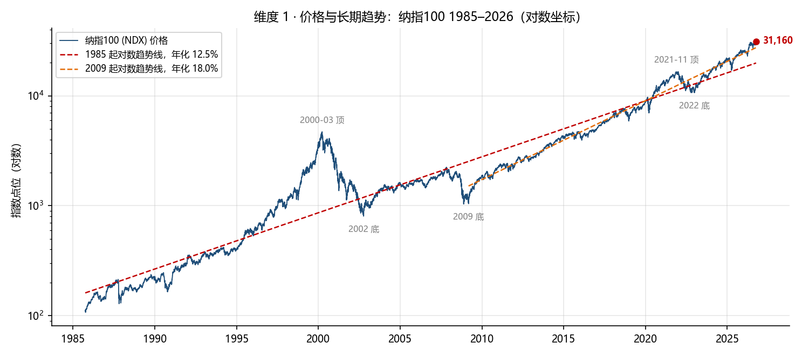
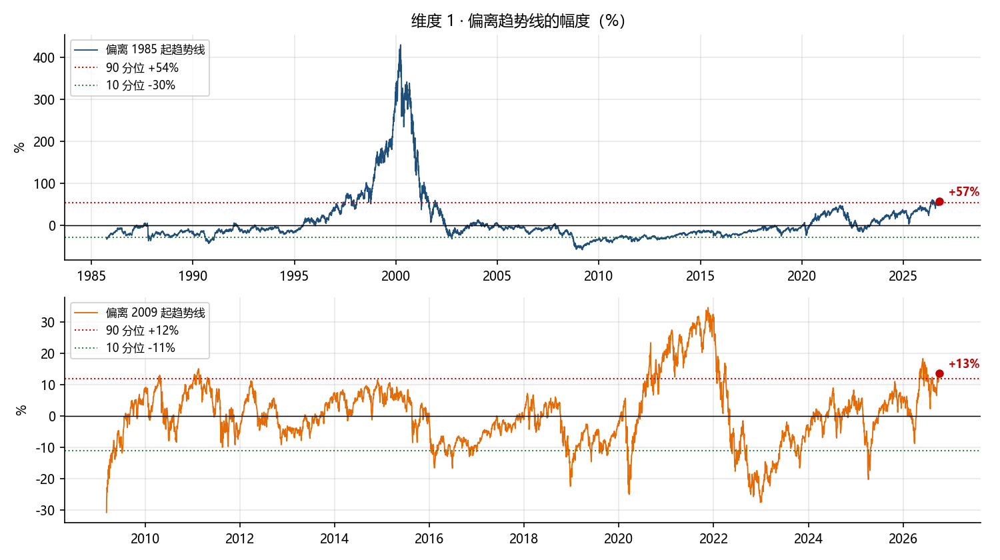
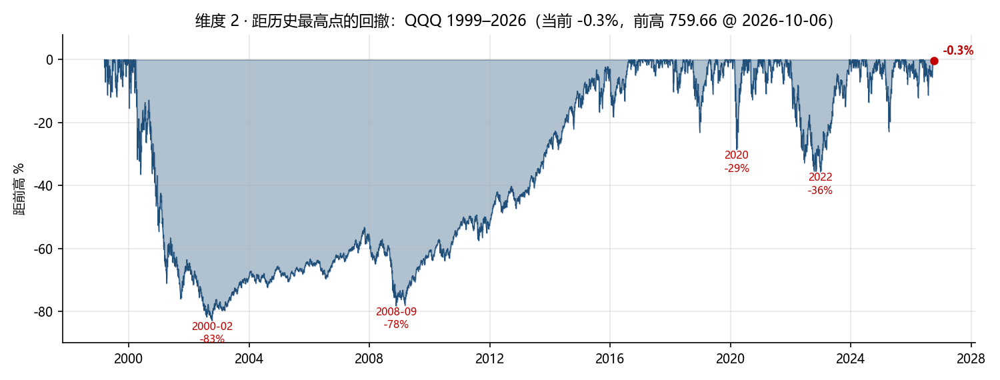
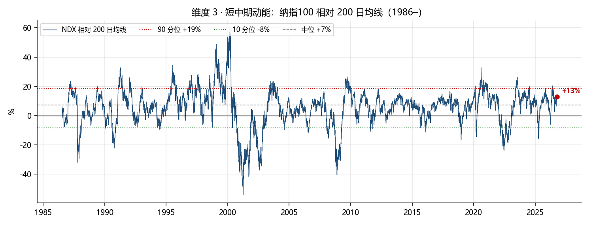
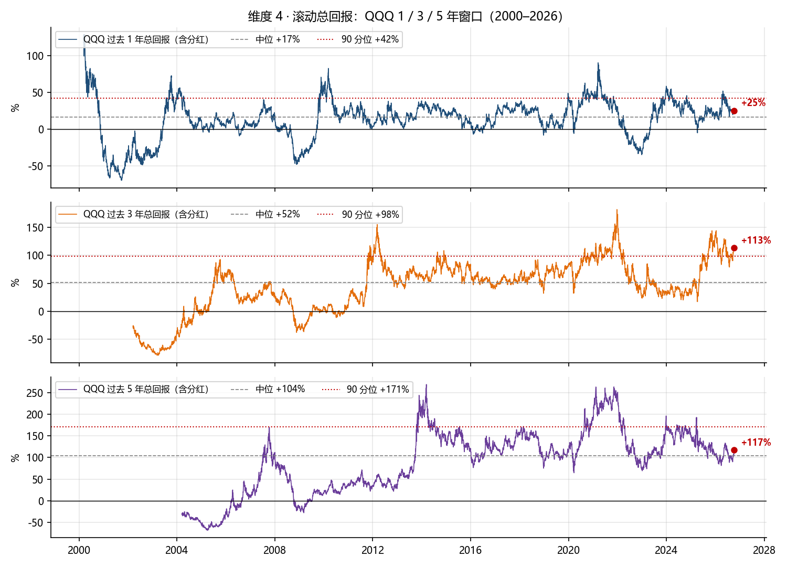
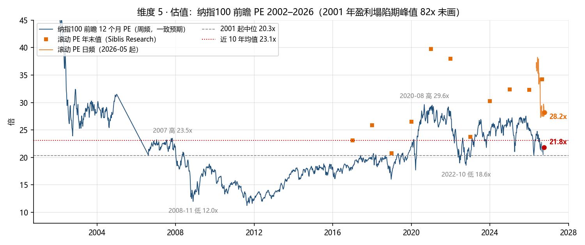
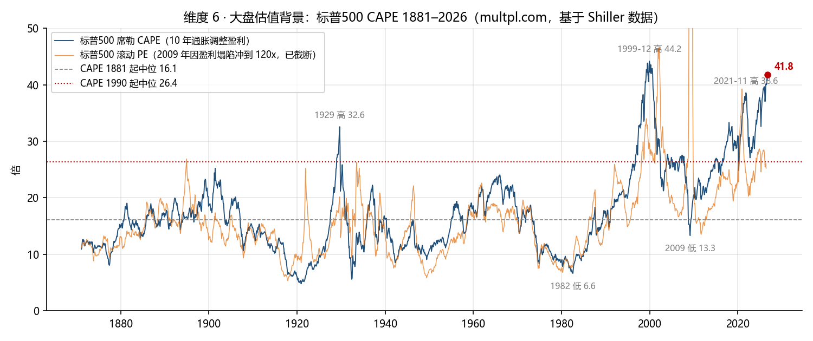
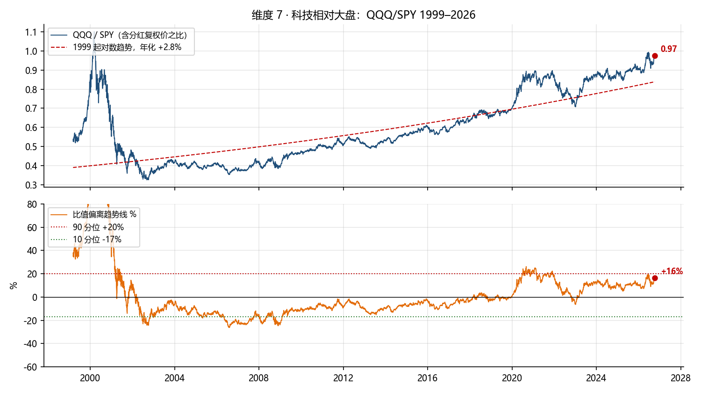
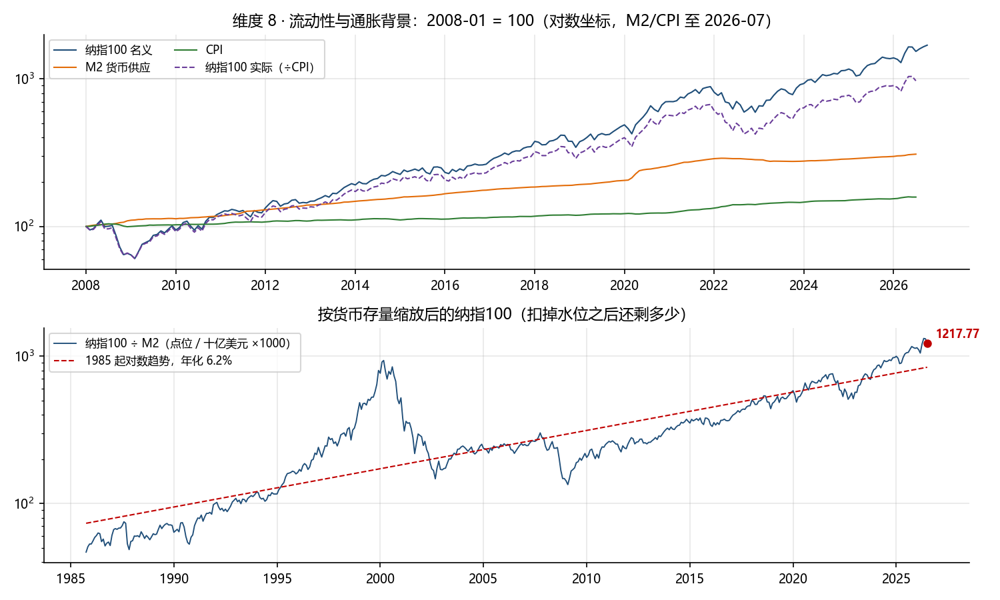
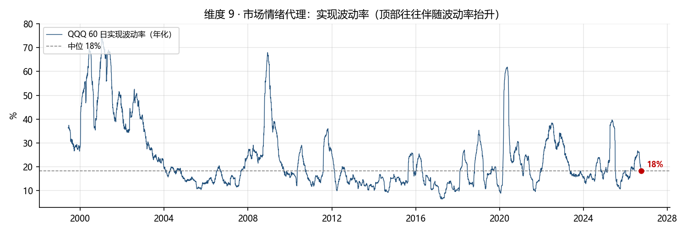

# QQQ 现在高不高：多维度历史对照（截至 2026-10-07）

QQQ 收盘 757.73，纳指100 31,160。历史最高 759.66（2026-10-06），即当前就在新高旁边。
本报告把「高不高」拆成 9 个维度，每个维度一张完整历史折线图，标出趋势线 / 中位数 / 分位带和当前位置，再给出当前值在历史中的分位。所有数字由脚本从数据直接算出，来源与口径见文末。

## 一页结论

**价格维度几乎全在高位区，估值维度分裂。** 价格相对趋势线、相对均线、过去 3 年回报，都在 77–96 分位。估值上，纳指100 前瞻市盈率 21.8 倍只是中间偏上（2001 年以来 59 分位），但大盘 CAPE 41.8 已是 1881 年以来 99 分位，仅次于 2000 年初的 44.2。

两种估值读数的差，就是市场押注的盈利增速：滚动 PE 28.2 倍对前瞻 21.8 倍，等于要求未来 12 个月盈利再增约 29%。盈利兑现，今天就是均值附近；盈利落空，今天就是 2021 年级别的高位。

| 维度 | 当前值 | 历史分位 | 读数 | 参照 |
|---|---|---|---|---|
| 偏离 1985 起趋势线 | +57% | 91 分位 | 高 | 中位 -9% / 2000 顶 +431% |
| 偏离 2009 起趋势线 | +13% | 91 分位 | 高 | 中位 +0% / 2021 顶 +35% |
| 距历史最高 | -0.3% | — |  | 前高 759.66 @ 2026-10-06 |
| 相对 200 日均线 | +13% | 77 分位 | 偏高 | 中位 +7% / 90 分位 +19% |
| 过去 1 年总回报 | +25% | 66 分位 | 中 | 中位 +17% |
| 过去 3 年总回报 | +113% | 96 分位 | 高 | 中位 +52% |
| 过去 5 年总回报 | +117% | 60 分位 | 中 | 中位 +104% |
| 纳指100 前瞻 PE | 21.8x | 59 分位 | 中 | 2001 起中位 20.3x / 近 10 年均 23.1x / 2020 顶 29.6x |
| 纳指100 滚动 PE | 28.2x | — |  | 年末值：2021 38.0x / 2022 23.7x / 2025 32.3x（Siblis） |
| 标普500 CAPE | 41.8 | 99 分位 | 高 | 1881 起中位 16.1 / 2000 顶 44.2 / 2021 顶 38.6 |
| QQQ/SPY 偏离趋势 | +16% | 86 分位 | 高 | 90 分位 +20% / 2000 顶 +174% |
| 纳指100 ÷ M2 偏离趋势 | +45% | 87 分位 | 高 | 2000 顶 +437% / 2021 顶 +19% |
| 60 日实现波动率 | 18% | 49 分位 | 中 | 中位 18% |

和 2021-11 的顶相比：价格偏离 2009 趋势线更低（+13% 对 +35%），前瞻 PE 更低（21.8x 对 28.4x），但 CAPE 更高（41.8 对 38.6），纳指100 除以 M2 也更高（+45% 对 +19%）。一句话：相对下一年的盈利不算贵，相对货币存量和十年平均盈利很贵。
和 2000-03 的顶相比：每一个维度都差一个数量级，2000 年价格高出趋势线 +431%，前瞻 PE 几十倍，CAPE 44.2。

## 维度 1 · 价格与长期趋势

- 1985 年起的对数趋势线年化 12.5%，当前价格高出它 +57%，为 91 分位，刚过 90 分位线（+54%）。历史中位是 -9%，即大多数时间价格在这条线以下。
- 2009 年起的趋势线年化 18.0%，当前高出 +13%（91 分位）。这条线上的历史极值是 2021-11 的 +35%，2022 年底回落到 -28%。
- 2000-03 顶高出 1985 趋势线 +431%，是当前的七八倍。用「偏离趋势」这把尺，现在像 2021，不像 2000。
- 局限：趋势线是用全样本拟合的，终点附近的偏离天然被低估；它衡量的是价格相对历史增速，不是相对盈利。

## 维度 2 · 距历史最高点的回撤

- 当前距前高 -0.3%。QQQ 1999 年以来有 27% 的交易日处于距前高 5% 以内，所以「在新高附近」本身不是稀有事件。
- 四次大回撤的深度：2000–02 -83%，2008–09 -78%，2020 -29%，2022 -36%。这张图的用处是提醒尺度：高位进入后，最近一次的代价是三分之一，最远一次是五分之四。

## 维度 3 · 短中期动能：相对 200 日均线

- 纳指100 高出 200 日均线 +13%，1986 年以来 77 分位；中位 +7%，90 分位 +19%，历史极值 +59%（2000 年）。相对 50 日均线 +5%（77 分位）。
- 读数：偏热但没到极端。超过 90 分位线才算「冲得太快」，现在还差 5 个百分点。

## 维度 4 · 滚动总回报

| 窗口 | 当前 | 分位（2000 起） | 分位（2009 起） | 中位 | 90 分位 | 历史最高 |
|---|---|---|---|---|---|---|
| 过去 1 年 | +25% | 66 | 59 | +17% | +42% | +129%（2000-03） |
| 过去 3 年 | +113% | 96 | 94 | +52% | +98% | +182%（2021-12） |
| 过去 5 年 | +117% | 60 | 50 | +104% | +171% | +269%（2014-03） |

- 三个窗口里只有 3 年窗口是极端的（96 分位），1 年和 5 年都在中位附近。原因是 2022 年那次 -36% 还在 5 年窗口里，而 3 年窗口刚好从 2023 年的低点起算。
- 这和下午那份 5 年滚动报告是同一口径（含分红复权），可以对上。

## 维度 5 · 估值：纳指100 市盈率

| 指标 | 数值 | 说明 |
|---|---|---|
| 前瞻 12 个月 PE（日频） | 21.8x（2026-10-06） | 一致预期，historyofmarket.com |
| 前瞻 12 个月 PE（周频终端数据） | 22.4x（2026-08-05） | 同上，2001 年起的长序列 |
| 滚动 12 个月 PE | 28.2x（2026-10-07） | 市值加权，同一来源 |
| 滚动 PE 年末值（另一口径） | 2016 23.1 / 2017 25.8 / 2018 20.8 / 2019 26.5 / 2020 39.7 / 2021 38.0 / 2022 23.7 / 2023 30.2 / 2024 32.4 / 2025 32.3 / 2026 34.2 | Siblis Research，剔除一次性损益 |
| 前瞻 PE 2001 起中位 / 2010 起中位 | 20.3x / 19.5x | |
| 前瞻 PE 近 10 年均值 / 近 5 年均值 | 23.1x / 24.4x | |
| 当前前瞻 PE 分位 | 2001 起 59 / 2010 起 67 | |
| 历史参照 | 2020-08 高 29.6x，2021 年末 28.4x，2022-10 低 18.6x，2008-11 低 12.0x | 2001-05 盈利塌陷期曾到 82x |
| 隐含盈利增速 | +29% | 滚动 PE ÷ 前瞻 PE − 1 |

- 前瞻 PE 是这份报告里最「不高」的读数：低于近 10 年均值，远低于 2020–21 的 28–30 倍。
- 但它建立在盈利再增 29% 的一致预期上。滚动 PE 28–34 倍（两家口径）则处于 2021 年和 2025 年之间的水平。
- 两家来源的滚动 PE 差 6 倍，原因是 Siblis 剔除一次性损益、historyofmarket 用报告净利，两者都列出，不取平均。

## 维度 6 · 大盘估值背景：席勒 CAPE

- 标普500 CAPE 41.8（2026-10-07），1881 年以来 99 分位。历史上只有 1999–2000 年高于现在（峰值 44.2，1999-12）；2021-11 为 38.6，1929 为 32.6。
- 1881 年起中位 16.1，1990 年起中位 26.4。按 1990 年以后的尺子，现在也高出中位 60%。
- 标普500 滚动 PE 25.2（2026-06），92 分位。
- CAPE 用十年平均实际盈利做分母，天然对「盈利刚刚大增」的市场给出高读数。它和前瞻 PE 的分歧，就是「过去十年的盈利」和「下一年的盈利」之间的差距。

## 维度 7 · 科技相对大盘：QQQ / SPY

- QQQ 与 SPY 的含分红价格之比 0.97，1999 年起年化只有 +2.8%，即长期看科技跑赢大盘的幅度并不大，大部分超额来自 2009 年之后。
- 比值高出趋势线 +16%，86 分位，90 分位线是 +20%。2000-03 顶时比值 1.10，高出趋势 +174%；2002-09 底时比值 0.33。
- 读数：科技相对大盘偏热，但离 2000 年那种「科技独涨」仍远。

## 维度 8 · 流动性与通胀背景

| 2008-01 至今 | 涨幅 |
|---|---|
| 纳指100 名义 | +1592% |
| 纳指100 实际（÷CPI） | +871% |
| M2 货币供应（至 2026-07） | +209% |
| CPI（至 2026-07） | +58% |

- 用 M2 当分母，纳指100 ÷ M2 这条线 1985 年起年化 6.2%，当前高出其趋势 +45%（87 分位）。2021 年顶只有 +19%，2000 年顶 +437%。
- 这是全报告里唯一一个「比 2021 更高」的维度。原因是 M2 从 2022 年起基本走平，而纳指100 又翻了一倍。换句话说，这一轮上涨不是货币放水推的，是盈利和估值推的。

## 维度 9 · 市场情绪代理：实现波动率

- QQQ 60 日实现波动率 18%，中位 18%，49 分位。顶部通常伴随波动率抬升（2000、2008、2020、2022 都是），现在没有这个信号。

## 历史上处于类似位置之后发生了什么

| 条件 | 区间 | 之后 1 年 | 之后 3 年 | 之后 5 年 | 序列 |
|---|---|---|---|---|---|
| 价格高出 1985 趋势线 > 90 分位 | 1997-05-27 → 2001-12-12 | +23% | +223% | +23% | NDX价格 |
| 价格高出 1985 趋势线 > 90 分位 | 2026-05-08 → 2026-10-07 | — | — | — | QQQ含息 |
| 3 年回报 > 90 分位 | 2011-10-25 → 2012-05-11 | +15% | +82% | +118% | QQQ含息 |
| 3 年回报 > 90 分位 | 2014-08-21 → 2014-12-22 | +5% | +50% | +93% | QQQ含息 |
| 3 年回报 > 90 分位 | 2020-08-19 → 2022-04-05 | +32% | +34% | +114% | QQQ含息 |
| 3 年回报 > 90 分位 | 2025-06-24 → 2026-10-07 | +33% | — | — | QQQ含息 |
| 前瞻 PE > 24x（高于 5 年均值） | 2001-04-27 → 2004-12-31 | -34% | -22% | -6% | QQQ含息 |
| 前瞻 PE > 24x（高于 5 年均值） | 2020-05-08 → 2022-04-08 | +46% | +47% | +138% | QQQ含息 |
| 前瞻 PE > 24x（高于 5 年均值） | 2023-03-31 → 2026-06-19 | +39% | +92% | — | QQQ含息 |

- 样本极少且互相重叠，只能当案例读，不能当概率读。
- 「价格高出 1985 趋势线超过 90 分位」历史上只出现过一次完整区间（1997–2001），之后 1 年 +23%、3 年 +223%、5 年 +23%，即泡沫先继续涨了三年再归零。当前区间 2026-05 起，还没有结果。
- 「3 年回报超过 90 分位」出现过 4 次，前三次之后 5 年都是正回报（+93% 到 +118%），其中 2020–22 那次中间经历了 -36%。
- 「前瞻 PE 高于 24 倍」出现过 3 次：2001–04 那次（盈利塌陷期）之后 5 年 -6%，2020–22 和 2023–26 两次之后都是大涨。前瞻 PE 高不高，取决于预期的盈利有没有兑现，这正是今天的问题。

## 综合判断

1. 价格维度（趋势偏离、均线、3 年回报、相对大盘、相对 M2）一致指向高位区，大多在 77–96 分位，但没有一项达到 2000 年的数量级，多数也低于 2021 年顶。
2. 估值维度分裂：前瞻 PE 中间偏上，CAPE 历史第二高。差额就是「未来 12 个月盈利 +29%」这个预期。
3. 情绪维度（波动率）平静，没有顶部特征。
4. 因此「高不高」的答案不在价格里，在盈利里。要跟踪的是三件事：季度财报是否兑现 +29% 量级的增速；前瞻 PE 是否从 22 倍抬向 2021 年的 28 倍（估值扩张而非盈利驱动的上涨）；波动率是否离开中位区。
5. 尺度参照：回到 200 日均线约 -12%，回到 2009 趋势线约 -12%，回到 1985 趋势线约 -36%；2022 年实际跌了 -36%。

## 数据与方法

| 数据 | 来源 | 区间 | 口径 |
|---|---|---|---|
| QQQ / SPY 日线 | Yahoo Finance v8 chart API | 1999-03 / 1993-01 起 | 含分红与拆股的复权价 |
| 纳指100 (^NDX) 日线 | 同上 | 1985-10 起 | 价格指数 |
| 纳指100 前瞻 PE | historyofmarket.com /api/ndx/forward-pe.json | 2001-04 起周频；日频 2026-07 起 | 12 个月混合前瞻一致预期，CC BY 4.0 |
| 纳指100 滚动 PE | historyofmarket.com；Siblis Research | 2026-05 起日频；2016–2026 年末 | 两种口径见维度 5 |
| 标普500 CAPE / PE | multpl.com（基于 Shiller 数据） | 1871 起月频 | 10 年通胀调整盈利 |
| M2 / CPI | 美联储 H.6 / BLS，经本仓库 黄金_货币供应_估值_2026-08-07 批次缓存 | 1959 / 1968 起月频，至 2026-07 | M2 季调；CPI-U 未季调。FRED 本次连接超时，故用缓存 |
| 标普500 前瞻 PE 参照 | FactSet Earnings Insight 2026-10-02 | — | 19.0x，5 年均 19.8，10 年均 19.1（PDF 存 data/） |

- 趋势线：对数价格对时间做最小二乘，全样本拟合。分位数：当前值在该序列全部历史观测中的百分位。
- 滚动回报用 252 个交易日为一年。回撤用 QQQ 未复权收盘价（看价格感受），滚动回报用复权价（看真实回报）。
- 复跑：`python fetch_prices.py` → `python build_charts.py` → `python build_report.py` → `python ../../scripts/md_to_pdf.py report.md <输出.pdf>`。
