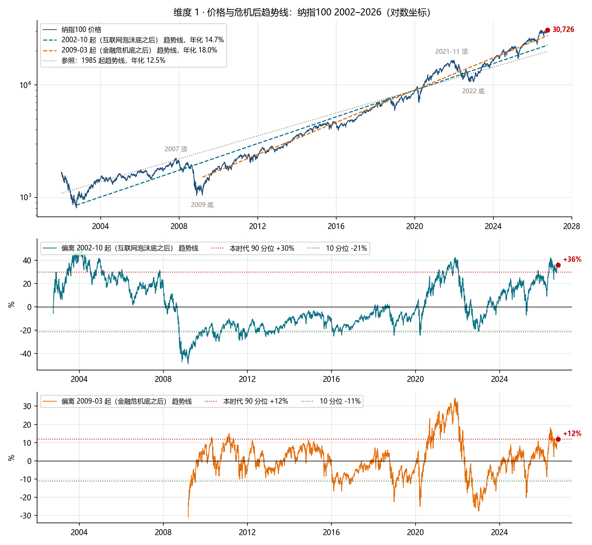
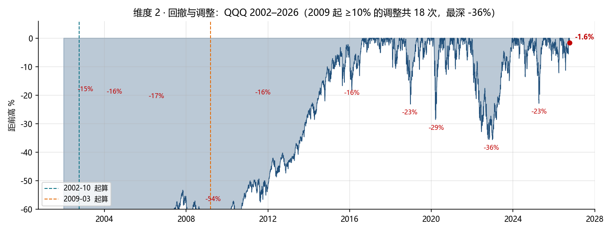
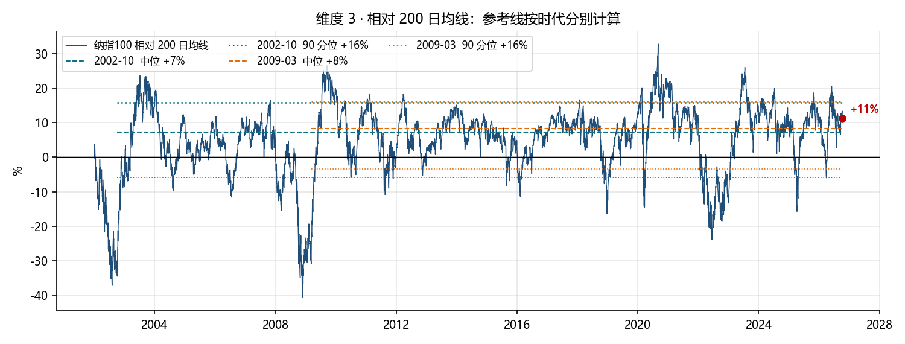
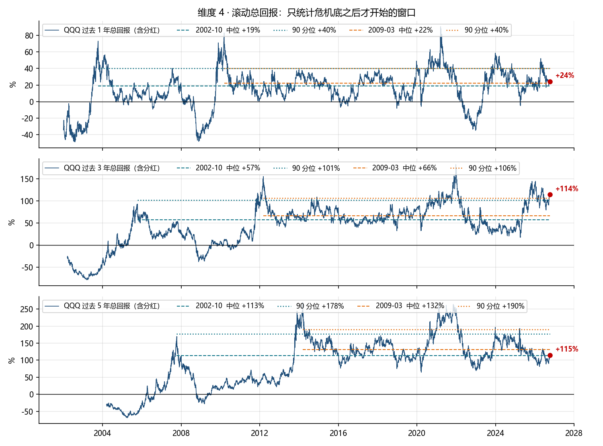
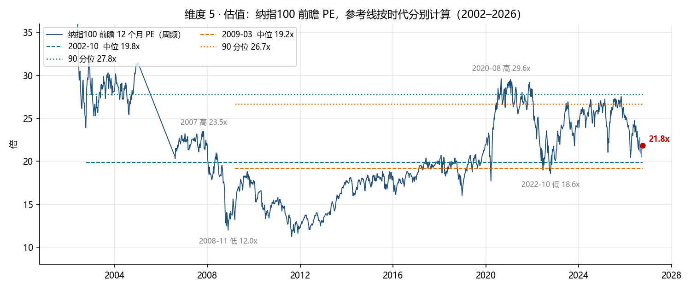
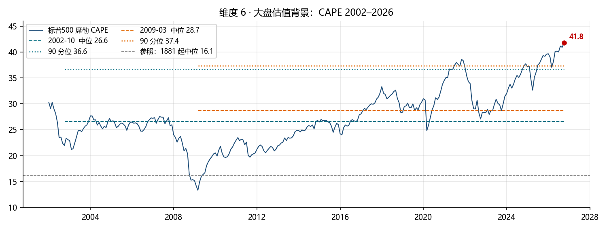
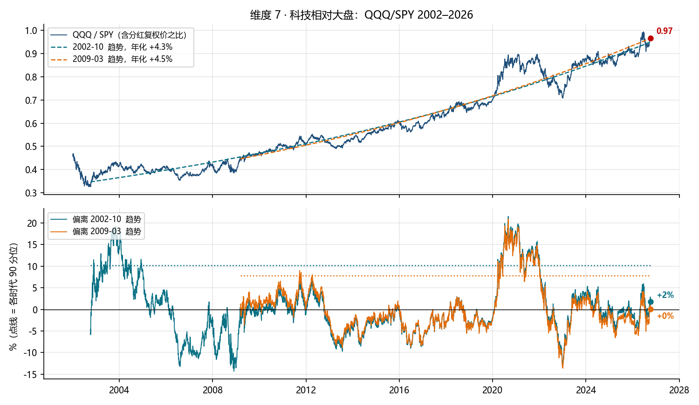
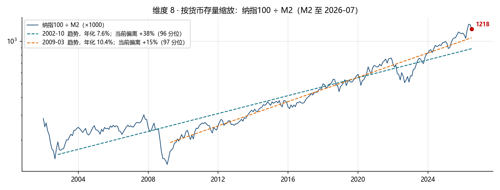
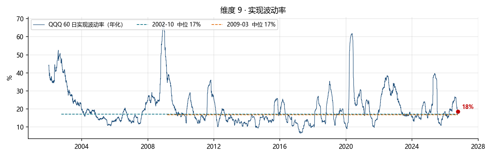

# QQQ 现在高不高：危机后视角（截至 2026-10-08）

QQQ 收盘 747.58，纳指100 30,726。
上一版（2026-10-08）把 1985 年以来的全部历史当作基准。这一版换成「每次经济危机结束、复苏开始之后」的样本：**2002-10-07**（互联网泡沫底）起算，和 **2009-03-09**（金融危机底）起算。每个维度的趋势线、中位数、分位数都只用各自时代内的数据重算，2000 年泡沫和两次崩盘本身不再进入基准。2020 年 3 月那次只用 5 个月就收复，样本太短，不单独成一个时代，只作为 2009 时代内的一次调整。

## 一页结论

**换成危机后的尺子，价格的「高」从 90 分位以上降到 90 分位线上，估值的「高」没有变。**

- 用 2009 起的尺子：价格高出本时代趋势线 +12%，正好踩在本时代 90 分位线（+12%）上；2021-11 顶是 +35%。过去 5 年 +115% 只有 31 分位，因为这个时代 5 年窗口的中位数是 +132%。前瞻 PE 21.8 倍为 67 分位。科技相对大盘正好在趋势线上（+0%）。
- 用 2002 起的尺子：价格高出趋势线 +36%，95 分位，超过本时代 90 分位（+30%），接近 2021 的 +43% 和 2004 年初的时代极值 +53%。
- 两把尺子的差别只有一件事：斜率。2002 起的趋势年化 14.7%，里面装着 2008 年那次 -54%；2009 起的趋势年化 18.0%，里面没有一次经济危机。相信哪条线，等于相信「2008 那种危机会不会再来」。
- 不随尺子变的两项：标普500 CAPE 41.8 是 2009 时代的最高值（时代中位 28.7）；纳指100 除以 M2 高出 2009 时代趋势 +15%，97 分位，超过 2021。

| 维度 | 当前值 | 1985 起分位 | 2002 起分位 | 2009 起分位 | 2009 起读数 | 2009 起参照 |
|---|---|---|---|---|---|---|
| 偏离趋势线（各自样本拟合） | 1985 起 +54% / 2002 起 +36% / 2009 起 +12% | 90 | 95 | 90 | 高 | 2009 起趋势年化 18.0%，2021 顶 +35% |
| 相对 200 日均线 | +11% | 70 | 75 | 71 | 偏高 | 2009 起中位 +8% / 90 分位 +16% |
| 过去 1 年总回报 | +24% | 64 | 62 | 56 | 中 | 2009 起中位 +22% |
| 过去 3 年总回报 | +114% | 96 | 95 | 94 | 高 | 2009 起中位 +66% / 90 分位 +106% |
| 过去 5 年总回报 | +115% | 59 | 51 | 31 | 低 | 2009 起中位 +132%，负窗口 0% |
| 纳指100 前瞻 PE | 21.8x | 56 | 59 | 67 | 中 | 2009 起中位 19.2x / 90 分位 26.7x |
| 标普500 CAPE | 41.8 | 99 | 100 | 100 | 高 | 2009 起中位 28.7 / 90 分位 37.4 |
| QQQ/SPY 偏离趋势（各自拟合） | 2002 起 +2% / 2009 起 +0% | — | 69 | 57 | 中 | 2009 起趋势年化 +4.5% |
| 纳指100 ÷ M2 偏离趋势（各自拟合） | 2002 起 +38% / 2009 起 +15% | — | 96 | 97 | 高 | 2009 起趋势年化 10.4% |
| 60 日实现波动率 | 18% | — | 57 | 61 | 中 | 2009 起中位 17% |

## 两个时代长什么样

| | 2002-10 起（泡沫底之后） | 2009-03 起（危机底之后） |
|---|---|---|
| 时长 | 24.0 年 | 17.6 年 |
| QQQ 总回报（含分红） | +4,305%，年化 17.1% | +3,272%，年化 22.2% |
| 纳指100 趋势线年化 | 14.7% | 18.0% |
| 最深回撤 | -54%（2008-11） | -36%（2022-12） |
| ≥10% 的调整次数 | 22 次 | 18 次，其中 ≥20% 的 4 次 |
| 交易日距前高 5% 以内的占比 | 57% | 67% |
| 3 年 / 5 年窗口为负的比例 | 6% / 3% | 0% / 0% |

2009 时代的特征：年化 22% 的回报，平均每年一次 10% 以上的调整，四次 20% 以上（2018、2020、2022、2025），没有一个 3 年或 5 年窗口亏钱。这就是「复苏后更有代表性」的那段历史的全貌，高回报和频繁调整是一起来的。

## 维度 1 · 价格与危机后趋势线

| 时代 | 趋势年化 | 当前偏离 | 时代分位 | 时代 90 分位 | 时代中位 | 时代极值 |
|---|---|---|---|---|---|---|
| 2002-10 起 | 14.7% | +36% | 95 | +30% | -3% | +53%（2004-01），2007 顶 +32%，2021 顶 +43% |
| 2009-03 起 | 18.0% | +12% | 90 | +12% | +0% | +35%（2021-11），2022 底 -28% |
| 参照 1985 起 | 12.5% | +54% | 90 | +54% | -9% | 2000 顶 +431% |

- 从危机底起算的趋势线有一个已知偏差：起点是极端低点，线会被拉陡，当前偏离会被低估。所以下面做了起点敏感性检验。
- 把起点从危机底往后推 1 年、2 年，2009 时代的结论几乎不动（偏离 +12% 上下，89–90 分位）；2002 时代从 +36% 降到 +29%，分位从 95 降到 87。把起点推到「收复危机前高点」（纳指100 在 2015-11 才收复 2000 年的高点），样本只剩 11 年，偏离 +9%，82 分位。
- 读数：2009 时代的尺子说「到了 90 分位线，没过」；2002 时代的尺子说「过了，接近 2021」。

| 时代 | 起点定义 | 起点 | 趋势年化 | 当前偏离 | 分位 | 90 分位 |
|---|---|---|---|---|---|---|
| 2002-10  | 危机底 | 2002-10-07 | 14.7% | +36% | 95 | +30% |
| 2002-10  | 底后 1 年 | 2003-10-07 | 14.9% | +33% | 93 | +31% |
| 2002-10  | 底后 2 年 | 2004-10-07 | 15.5% | +29% | 87 | +32% |
| 2002-10  | 收复危机前高点 | 2015-11-03 | 18.8% | +9% | 82 | +19% |
| 2009-03  | 危机底 | 2009-03-09 | 18.0% | +12% | 90 | +12% |
| 2009-03  | 底后 1 年 | 2010-03-09 | 17.9% | +12% | 90 | +12% |
| 2009-03  | 底后 2 年 | 2011-03-09 | 18.0% | +12% | 89 | +13% |
| 2009-03  | 收复危机前高点 | 2015-11-03 | 18.8% | +9% | 82 | +19% |

## 维度 2 · 回撤与调整

- 当前距前高 -1.6%。2009 时代 67% 的交易日在距前高 5% 以内，85% 在 10% 以内。
- 2009 时代 ≥10% 的调整 18 次，最深的 8 次：

| 区间 | 深度 |
|---|---|
| 2022-01 → 2023-11 | -36% |
| 2020-02 → 2020-05 | -29% |
| 2018-10 → 2019-02 | -23% |
| 2025-03 → 2025-05 | -23% |
| 2016-01 → 2016-02 | -16% |
| 2011-08 → 2011-11 | -16% |
| 2010-05 → 2010-09 | -16% |
| 2015-08 → 2015-10 | -14% |

- 这张表是 2009 时代的「正常代价」：平均每年一次 10% 以上，每 4 年左右一次 20% 以上。它不预测什么时候来，只说明高位买入后，这个幅度的回撤是基准情形，不是意外。

## 维度 3 · 相对 200 日均线

- 纳指100 高出 200 日均线 +11%。2009 时代中位 +8%，90 分位 +16%，极值 +33%（2020-09）；当前 71 分位。2002 时代 75 分位。
- 读数：偏热，离 90 分位线还差 5 个百分点。这个维度换尺子前后变化很小，因为均线偏离本来就不受长期斜率影响。

## 维度 4 · 滚动总回报（只统计危机底之后才开始的窗口）

| 窗口 | 当前 | 2009 起分位 | 2009 起中位 | 2009 起 90 分位 | 2009 起最差 | 2002 起分位 | 2002 起中位 | 2002 起最差 |
|---|---|---|---|---|---|---|---|---|
| 1 年 | +24% | 56 | +22% | +40% | -35%（2022-12） | 62 | +19% | -48%（2008-11） |
| 3 年 | +114% | 94 | +66% | +106% | +17%（2025-04） | 95 | +57% | -38%（2008-11） |
| 5 年 | +115% | 31 | +132% | +190% | +65%（2020-03） | 51 | +113% | -28%（2009-03） |

- 这是换尺子后变化最大的维度。过去 5 年 +115% 在 1985 起的尺子里是 59 分位，在 2009 起的尺子里只有 31 分位：这个时代 5 年翻 1.3 倍才是中位，最差的 5 年窗口也有 +65%。
- 过去 3 年 +114% 则在两把尺子下都是 94–96 分位。近三年的斜率，比 2009 时代的常态还陡。
- 这和 7 月那份「2009 起所有五年窗口全为正」是同一结论的另一种写法。

## 维度 5 · 估值：纳指100 前瞻 PE

| | 当前 | 2009 起分位 | 2009 起中位 | 2009 起 90 分位 | 2009 起极值 | 2002 起分位 | 2002 起中位 | 2002 起 90 分位 |
|---|---|---|---|---|---|---|---|---|
| 前瞻 12 个月 PE | 21.8x（2026-10-06） | 67 | 19.2x | 26.7x | 高 29.6x（2020-08），低 11.2x（2011-08） | 59 | 19.8x | 27.8x |

- 滚动 PE 28.2x，隐含未来 12 个月盈利增速 +29%。
- 2009 时代的前瞻 PE 中位只有 19.2 倍，因为 2009–2016 长期在 12–18 倍。当前 21.8 倍比时代中位高 14%，但离 90 分位（26.7x）和 2020-08 的极值（29.6x）还有距离。
- 读数：换尺子后前瞻 PE 从「中」变成「中偏高」（67 分位），仍不是极端。

## 维度 6 · 大盘估值背景：CAPE

- 标普500 CAPE 41.8，是 2009 时代的最高值（时代中位 28.7，90 分位 37.4），也是 2002 时代的最高值（中位 26.6）。
- 这个维度不管用哪把尺子都在 99 分位以上，是本报告里唯一「时代内无先例」的读数。它衡量的是价格相对过去十年平均盈利，天然对盈利刚大增的市场给高分，但高分本身是事实。

## 维度 7 · 科技相对大盘：QQQ / SPY

- 2009 时代 QQQ 相对 SPY 的趋势年化 +4.5%，当前比值 0.97 偏离趋势 +0%（57 分位），时代极值 +21%（2020-09），最低 -14%（2023-01）。2002 时代 +2%（69 分位）。
- 读数：在危机后的尺子里，科技相对大盘没有超涨，刚好在它 17 年来的轨道上。上一版用 1999 起的尺子得到 86 分位，是因为 2000–2008 科技长期跑输压低了那条趋势线。

## 维度 8 · 按货币存量缩放：纳指100 ÷ M2

- 2009 时代纳指100 ÷ M2 的趋势年化 10.4%，当前偏离 +15%，97 分位，时代极值 +27%（2026-05），2022 底 -31%。2002 时代偏离 +38%，96 分位。M2 数据至 2026-07。
- 读数：这是换尺子后依然极端的第二项。2022 年以来 M2 走平而指数翻倍，意味着这轮上涨不是货币推的，是盈利和估值推的，相应地也没有「水位」托底。

## 维度 9 · 实现波动率

- QQQ 60 日实现波动率 18%，2009 时代中位 17%，61 分位。没有顶部特征。

## 2009 时代里，处于类似高位之后发生了什么

下表只用 2009 时代的数据和 2009 时代的 90 分位线。「之后 2 年内最大回撤」是从该区间起点算起。

| 条件 | 区间 | 之后 1 年 | 之后 3 年 | 之后 5 年 | 之后 2 年内最大回撤 |
|---|---|---|---|---|---|
| 价格高出本时代趋势线 > 90 分位 | 2010-04-14 → 2011-04-28 | +14% | +44% | +129% | -16% |
| 价格高出本时代趋势线 > 90 分位 | 2020-08-05 → 2022-04-05 | +37% | +40% | +120% | -33% |
| 价格高出本时代趋势线 > 90 分位 | 2026-05-08 → 2026-10-07 | — | — | — | -11% |
| 3 年回报 > 本时代 90 分位 | 2012-03-09 → 2012-04-19 | +7% | +68% | +114% | -12% |
| 3 年回报 > 本时代 90 分位 | 2014-11-28 → 2014-11-28 | +9% | +50% | +101% | -16% |
| 3 年回报 > 本时代 90 分位 | 2020-08-26 → 2022-03-29 | +28% | +31% | +101% | -33% |
| 3 年回报 > 本时代 90 分位 | 2025-09-18 → 2026-10-08 | +25% | — | — | -12% |
| 前瞻 PE > 本时代 90 分位 | 2020-06-19 → 2022-01-14 | +42% | +53% | +131% | -33% |
| 前瞻 PE > 本时代 90 分位 | 2023-06-16 → 2023-07-21 | +33% | +97% | — | -23% |
| 前瞻 PE > 本时代 90 分位 | 2024-07-05 → 2025-10-31 | +13% | — | — | -23% |
| 高出 200 日线 > 本时代 90 分位 | 2009-07-15 → 2010-04-23 | +24% | +76% | +171% | -16% |
| 高出 200 日线 > 本时代 90 分位 | 2011-01-14 → 2011-02-18 | +4% | +59% | +87% | -16% |
| 高出 200 日线 > 本时代 90 分位 | 2012-03-14 → 2012-04-05 | +4% | +69% | +111% | -12% |
| 高出 200 日线 > 本时代 90 分位 | 2018-01-26 → 2018-01-26 | -5% | +92% | +76% | -23% |
| 高出 200 日线 > 本时代 90 分位 | 2020-02-04 → 2021-02-19 | +44% | +37% | +137% | -29% |
| 高出 200 日线 > 本时代 90 分位 | 2023-05-26 → 2024-07-16 | +32% | +117% | — | -23% |
| 高出 200 日线 > 本时代 90 分位 | 2025-10-27 → 2025-11-03 | — | — | — | -12% |
| 高出 200 日线 > 本时代 90 分位 | 2026-05-08 → 2026-06-30 | — | — | — | -11% |

- 已有结果的 13 个区间里，之后 3 年回报 13 个为正，没有一个为负；之后 5 年最低 +76%。
- 之后 1 年的分布很散：从 -5% 到 +44%。之后 2 年内的最大回撤从 -11% 到 -33%。
- 这组样本只覆盖一个没有经济危机的时代，样本间高度重叠（2020–21 一个区间被四个条件同时命中）。它说明的是「在这个时代里，高位之后先跌一截再涨」是常态；它不能说明这个时代会不会结束。

2002 时代同一条件（价格高出本时代趋势线 > 90 分位）的对照：

| 条件 | 区间 | 之后 1 年 | 之后 3 年 | 之后 5 年 | 之后 2 年内最大回撤 |
|---|---|---|---|---|---|
| 价格高出本时代趋势线 > 90 分位 | 2003-06-04 → 2006-01-17 | +18% | +29% | +70% | -16% |
| 价格高出本时代趋势线 > 90 分位 | 2007-10-31 → 2007-11-06 | -40% | -3% | +24% | -53% |
| 价格高出本时代趋势线 > 90 分位 | 2021-02-04 → 2022-01-14 | +8% | +33% | +91% | -35% |
| 价格高出本时代趋势线 > 90 分位 | 2025-10-27 → 2026-10-08 | — | — | — | -12% |

- 2007-10 那个区间就是「时代结束」的样子：之后 1 年 -40%，2 年内最大回撤 -53%，5 年才回到 +24%。2002 时代的尺子之所以更严，就是因为它记得这一次。

## 综合判断

1. 用危机后的尺子，价格类指标从「高位区」退到「90 分位线上」：趋势偏离正好 90 分位，均线 71 分位，1 年回报 56 分位，5 年回报 31 分位。只有 3 年回报（94 分位）仍然极端，说明近三年的斜率比复苏时代的常态还陡。
2. 估值类指标没有因为换尺子而变温和：前瞻 PE 升到 67 分位，CAPE 仍是时代最高，纳指100 ÷ M2 仍是 97 分位。
3. 2002 和 2009 两把尺子的差距就是一次 2008。2009 起 18% 的年化没有包含任何一次经济危机；如果下一次危机来，2002 起的 14.7% 才是基准，届时当前价格高出趋势 36%，和 2021 年差不多。
4. 2009 时代内的经验：高位之后 1 年涨跌都有，3 年和 5 年全部为正，中途要承受 12% 到 33% 的回撤。这是「拿得住」的前提条件，不是「不会跌」的保证。
5. 尺度参照：回到 200 日线约 -10%，回到 2009 趋势线约 -11%，回到 2002 趋势线约 -26%；2009 时代最深回撤 -36%，2002 时代 -54%。

## 数据与方法

- 价格：Yahoo Finance v8 chart API，QQQ / SPY 含分红复权价，纳指100 (^NDX) 价格指数，截至 2026-10-08 收盘（运行时市场开盘中，当日未收盘的行情已剔除）。
- 纳指100 前瞻 PE：historyofmarket.com /api/ndx/forward-pe.json，周频一致预期 2001-04 起，日频 2026-07 起，CC BY 4.0。滚动 PE 同来源。
- CAPE：multpl.com（基于 Shiller 数据），月频。M2：美联储 H.6，经本仓库 黄金_货币供应_估值_2026-08-07 批次缓存，至 2026-07。
- 时代定义：2002-10-07 为纳指100 互联网泡沫后的最低收盘日，2009-03-09 为金融危机后的最低收盘日。趋势线为该时代内对数价格对时间的最小二乘拟合；分位为当前值在该时代全部观测中的百分位。滚动回报只统计起点在危机底之后的窗口。调整定义为自时代内前高回撤 ≥10%，间隔 60 个交易日以上计为两次。
- 复跑：`python fetch_prices.py` → `python build_era_charts.py` → `python build_era_report.py` → `python ../../scripts/md_to_pdf.py report.md <输出.pdf>`。上一版（全历史基准）见 `backtests/QQQ_现在高不高_2026-10-08/`。
