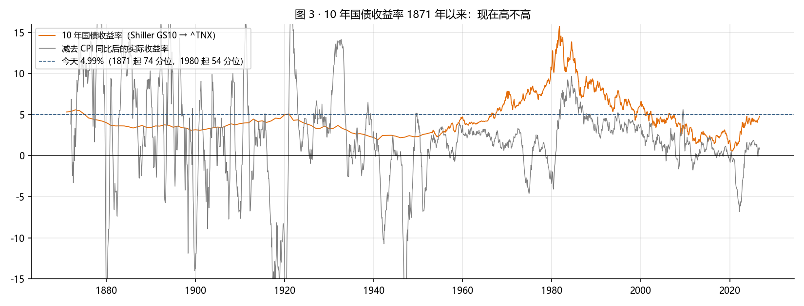
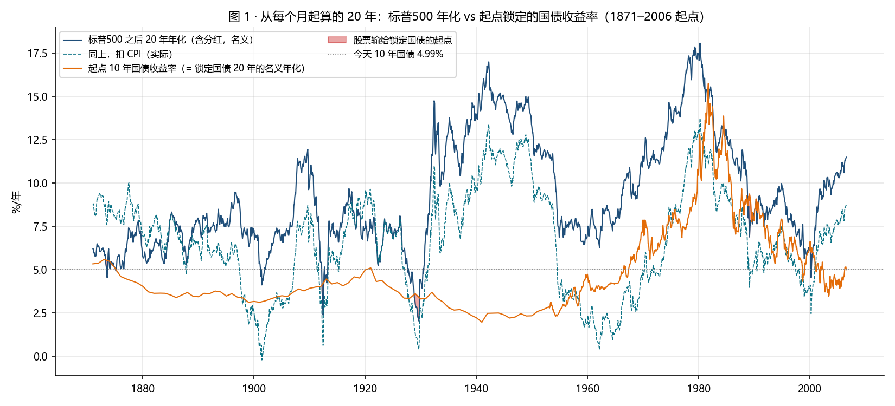
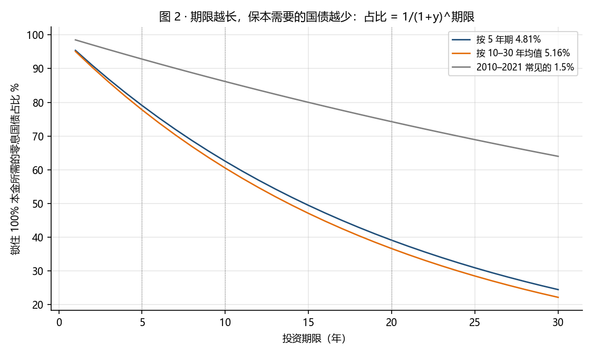

# 期限 20 年时，国债该配多少（2026-10-26）

问题：如果把母亲这笔钱的期限从 5 年拉到 20 年，国债"一般"，是不是没必要配那么多，除非现在国债真的很高。本文只回答数据能回答的部分，不是投资建议。

数据：Shiller 月度 1871–2023（价格、股息、CPI、10 年国债）接 SP500TR / ^TNX 到 2026-09；纳指100 1985 起、QQQ 含分红 1999 起（`data/market_temp`）。脚本 `horizon.py`，结果 `stats.json`、`windows_20y.csv`；本文由 `build_memo.py` 从 `memo_template.md` 生成。

## 1. 国债现在高不高：名义中等，实际偏低

| 指标 | 今天 | 1871 起分位 | 1980 起分位 | 对照 |
|---|---|---|---|---|
| 10 年国债 | 4.99% | 74 | 54 | 1871 起中位 3.8%，1980 起中位 4.7%，1990–2007 中位 5.7%；2009 起 100 分位 |
| 5 年国债 | 4.81% | — | 54 | 1970 起 45 分位 |
| 30 年国债 | 5.32% | — | — | |
| 10 年国债 − CPI 同比（实际） | 1.0% | 35 | 31 | 1871 起中位 2.2%，1980 起中位 2.2% |

读法：5% 只是 1980 年以来的中位数，离 1990–2007 的 5.7% 还差一截；扣掉 4% 的 CPI 后实际收益率 1%，在历史上偏低的三分之一。「现在国债真的很高」不成立，它只是比 2009–2021 的 0.5–3% 高。

## 2. 期限拉长后，股票输给"锁定国债"的频率

每个月起算，股票 = 标普500 含分红（1871 起）或纳指100 价格（1985 起，未含约 0.5–1%/年股息，偏保守）；锁定国债 = 起点的 10 年国债收益率按零息持有到期。

| 期限 | 标普最差年化（起点） | 标普中位 | 标普为负比例 | 输给锁定国债比例 1871 起 / 1980 起 | 纳指最差年化（起点） | 纳指中位 | 纳指为负比例 |
|---|---|---|---|---|---|---|---|
| 5 年 | -17.4%（1929-09） | 9.9% | 10% | 27% / 21% | -18.7%（2000-03） | 15.2% | 12% |
| 10 年 | -4.1%（1929-08） | 8.8% | 3% | 14% / 12% | -8.1%（2000-03） | 14.2% | 7% |
| 20 年 | +2.0%（1929-09） | 8.2% | 0% | 4% / 9% | +3.1%（2000-04） | 11.6% | 0% |

纳指 15 年：最差 +0.1%（2000-09 起），为负比例 0%。

20 年窗口里股票输给锁定国债的几个起点：

| 起点 | 标普 20 年年化 | 当时 10 年国债 | 差 | 20 年倍数 |
|---|---|---|---|---|
| 1929-09 | 2.0% | 3.4% | -1.4 | ×1.5 vs ×1.9 |
| 1965-01 | 7.8% | 4.2% | +3.6 | ×4.5 vs ×2.3 |
| 1972-12 | 11.1% | 6.3% | +4.8 | ×8.2 vs ×3.4 |
| 1981-09 | 15.3% | 15.4% | -0.1 | ×17.2 vs ×17.6 |
| 1989-01 | 8.6% | 9.2% | -0.6 | ×5.2 vs ×5.8 |
| 1999-12 | 6.1% | 6.2% | -0.1 | ×3.3 vs ×3.3 |
| 2000-03 | 6.2% | 6.4% | -0.2 | ×3.3 vs ×3.4 |

读法：20 年期标普从来没有名义亏损，最差是 1929 年顶起算的 2.0%。输给锁定国债只发生在两种起点：国债本身在 6% 以上（1981 年 15.4%、1989 年 9.2%、2000 年 6.4%），或者股票在 1929、2000 那种顶上。两条同时不成立的时候没有输过，输的时候幅度也只有 0.2 到 2.5 个百分点。按今天 5% 的国债和「2008 尺子 64 分位」的股票位置，历史上没有 20 年输给国债的先例；样本只有 1871 年以来一个国家的历史，这句话的分量到此为止。

## 3. 保本结构的成本随期限下降

国债占比 = 1/(1+y)^期限，按今天的收益率：

| 期限 | 用的收益率 | 锁本金所需国债 | 留给股票 |
|---|---|---|---|
| 5 年 | 4.81% | **79%** | 21% |
| 10 年 | 4.99% | **61%** | 39% |
| 15 年 | 5.16% | **47%** | 53% |
| 20 年 | 5.16% | **37%** | 63% |
| 30 年 | 5.32% | **21%** | 79% |

5 年要 79%，20 年只要 **37%**。这就是「20 年不需要配太多国债」的量化版本：不是国债变好了，是本金保障变便宜了。

## 4. 20 年、美元本金 52,548：几种配法的到期值

保本结构 20 年：国债 37%（19,229）按 5.16% 零息持有到期 = 本金；纳指 63%（33,319）按 1985 年以来 20 年窗口的分布：

| 纳指 20 年情形 | 年化 | 到期总值 USD |
|---|---|---|
| 纳指 20 年最差（起点 2000-04-01） | 3.1% | 113,729（×2.2） |
| 纳指 20 年 5 分位 | 6.0% | 159,642（×3.0） |
| 纳指 20 年中位 | 11.6% | 352,739（×6.7） |
| 纳指 20 年最好 | 16.0% | 698,239（×13.3） |

纯国债 20 年：143,600（×2.7）。股债固定比例、不再平衡（国债按 5.16% 锁定）：

| 股/债 | 纳指最差情形 | 纳指 5 分位 | 纳指中位 |
|---|---|---|---|
| 100/0 | 96,489（×1.8） | 168,900 | 473,437（×9.0） |
| 80/20 | 105,912（×2.0） | 163,840 | 407,470（×7.8） |
| 60/40 | 115,334（×2.2） | 158,780 | 341,502（×6.5） |
| 40/60 | 124,756（×2.4） | 153,720 | 275,535（×5.2） |
| 0/100 | 143,600（×2.7） | 143,600 | 143,600（×2.7） |

读法：20 年里国债的作用不是收益（×2.7 对纳指中位 ×9），是两件事：把本金担保从儿子身上拿掉，和压住中途浮亏。纳指 2000-03 顶起算的 20 年年化 3.7%，但前 15 年年化只有 0.1%，中途跌 83%，用了 15 年才回本；这 15 年母亲和担保人都得扛住。

## 5. 对这笔钱意味着什么

1. 期限 20 年是另一份协议：现在的草案是 5 年封闭、到期保本。20 年的版本要改第二条（期限）、第四条（保本只在第 20 年兑现，中途不保）、第六条（中途赎回按市价）；母亲 20 年后的年龄和用钱需求要先写清楚。
2. 若仍要「本金不靠儿子信用」：20 年零息国债（STRIPS，2046 年前后到期）约 37%，其余 63% 放 QQQ/SPY，中途不动。国债部分一次性买入锁定收益率。
3. 若担保人愿意自己担：历史上 20 年纯股没有名义亏损（标普 1871 起、纳指 1985 起），担保触发的概率接近零，但中途 −50% 到 −83% 的浮亏由母亲的耐心承担，这才是 20 年方案的真实风险，不是本金。
4. 折中：5 年一段地做。现在按 5 年保本结构（79/21）锁定，5 年后按当时的收益率和位置再定下一段；国债收益率若回到 1.5%，到时的保本结构就不可用，这是把今天 5% 的价值用掉的方式。
5. 汇率、2028 年非居民身份、保底条款的法律效力三条不随期限变化，见 10-11 与 10-25 两份文件。

## 反方意见

- 美国一个国家 155 年的样本，没有日本 1990 起的 20 年（日经 1989 年顶到 2009 年年化约 −4%）。母亲这笔钱全在美国资产上。
- 纳指 20 年窗口只有 253 个月度起点、实际独立样本不到 2 个周期；「最差 3.1%」是 2000 年那一个起点，不是分布。
- 锁定国债按零息持有到期算，中途不能动；真要动用时按市价，2020–2022 长债跌过 40%。
- CPI 4% 若持续，5% 名义国债的实际回报约 1%，20 年 ×2.7 的名义到期值购买力只有今天的 ×1.2。

脚本：`python horizon.py && python build_memo.py`。不是投资建议。
