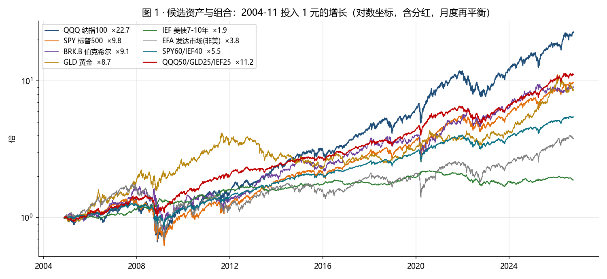
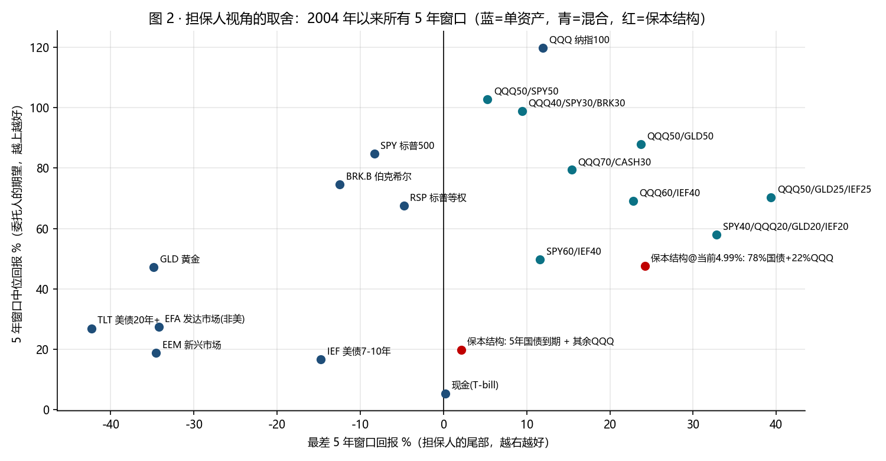
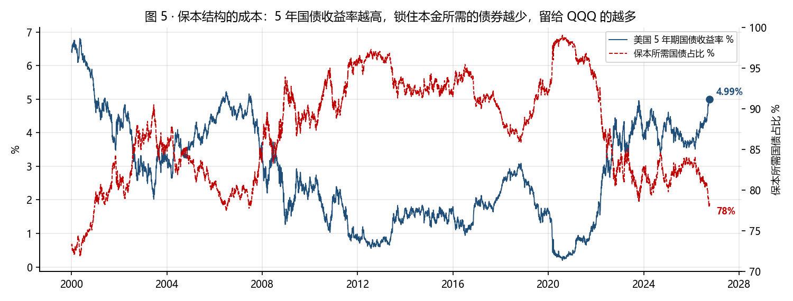
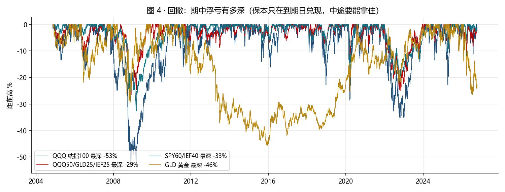
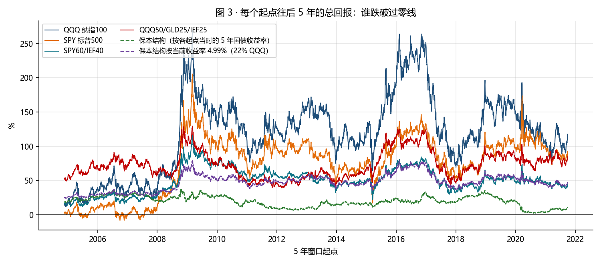
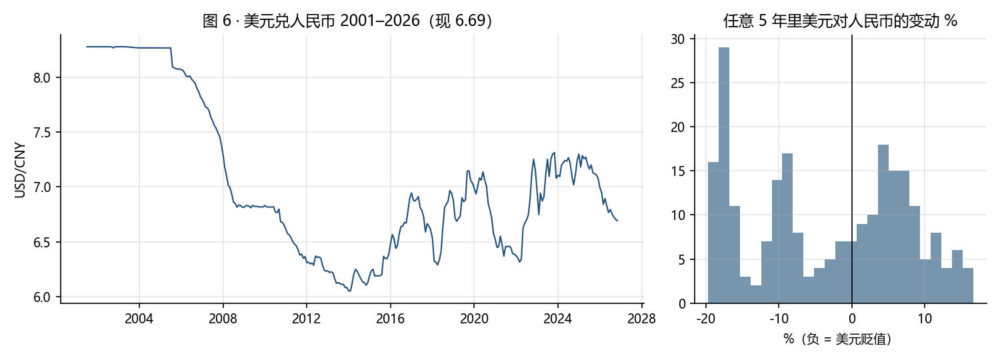

# 代管资金 5 年保本任务 · 配置投研报告（2026-10-11）

任务：代母亲管理约人民币 30 万元（按 6.69 约 44,828 美元，本报告按 42,000 美元计），5 年封闭，本金由管理人（儿子）个人担保，到期分成。
本报告回答一个问题：在「担保人承担全部下行」这个约束下，候选资产和组合各自的历史表现如何，差别在哪。它不替你选，选择取决于担保人愿意承担的最大赔付，那是你们两人要谈的数。本报告不是投资建议。

## 一页结论

1. **任务书改变了问题。** 自己的钱问「QQQ 高不高、期望多少」；担保别人的钱先问「最差的 5 年是多少、我赔得起吗」。图 2 把每个候选放在这两个坐标上。
2. **纯 QQQ 期望最高，尾部全在担保人身上。** 2004 年以来（含 2008）QQQ 的 5 年窗口中位 +120%，最差 +12%；放宽到 2002 年起最差 -28%，1999 年起最差 -69%。按 42,000 美元本金，担保人在这三种最差情形下分别赔 0、11,760、28,980 美元。
3. **加黄金和中期国债，把最差 5 年从正负之间抬到两位数正值。** QQQ50/GLD25/IEF25 在同一窗口最差 5 年 +39%、最大回撤 -29%，代价是 5 年中位从 +120% 降到 +70%。这组数字受益于样本期黄金的两轮牛市，见第 9 节的反方意见。
4. **当前利率让「真保本」便宜。** 5 年期美国国债收益率 4.99%（2026-10-08），78% 本金买 5 年国债持有到期即可锁住 100% 本金，剩下 22% 买 QQQ。QQQ 5 年中位情形下整体 +48%，QQQ -69% 的极端情形下整体仍 +7%。担保人赔付为零，母亲的本金不靠儿子的信用，靠美国国债。2010–2021 年 5 年国债中位只有 1.5%，那时这个结构留给股票的只有 5–10%，现在是 22%。
5. **三类方案进入讨论：** A 保本结构（担保人零赔付，期望约为纯 QQQ 的四成）；B 股债金混合（历史无负 5 年窗口，回撤约 -30%，担保人赔付接近零）；C 纯股（期望最高，担保人承担 1 到 3 万美元量级的尾部）。先定担保人的赔付上限，再在图 2 上选。
6. **与你自己那本书的关系：** 你现有持仓（BTC、GOOGL、NBIS、QQQ 定投）全压在同一个「AI + 流动性」因子上，股票桶计划里已记录过这条反方意见。母亲这笔钱如果再买纯 QQQ，是对同一个赌注的又一次加注；A 和 B 两类方案和你现有的书相关性低得多（QQQ 与 GLD 月度相关 0.05，与 IEF -0.05）。

## 1. 任务书

| 项 | 内容 |
|---|---|
| 资金 | 人民币 20–30 万，按 6.69 折 30,000–45,000 美元；本报告按 42,000 美元 |
| 期限 | 5 年封闭（2026-10 至 2031-10），期中赎回不保本 |
| 担保 | 到期本金由管理人个人资产补足（见合同草案第四条） |
| 约束 | 仅美国上市 ETF 或国债，不加杠杆、不做期权、不做个股与数字货币 |
| 担保人目标 | 最小化到期赔付的概率与金额 |
| 委托人目标 | 5 年后扣除管理费与分成后的所得 |
| 操作约束 | 管理人 2028 年起转为美国非居民，账户需放在接受非居民的券商（见 execution_plans/tax_residency_exit_plan.md）；低维护，每年最多一次再平衡 |
| 汇率 | 本金与担保以美元计；美元对人民币任意 5 年的变动范围 -20% 到 +17%（2001 年以来月度数据），中位 -2% |

## 2. 候选池与方法

- 单资产 10 个：QQQ、SPY、RSP（标普等权）、BRK.B、EFA（非美发达）、EEM（新兴）、GLD、IEF（7–10 年美债）、TLT（20 年以上美债）、现金（13 周国库券滚动）。
- 混合 8 个：月度再平衡到目标权重，含分红，不计费用与税。
- 保本结构 1 个：起点买入 5 年期国债持有到期（占比 = 1 / (1 + 收益率)^5），其余买 QQQ 持有 5 年；按历史上每个起点当时的收益率算一遍，再按当前收益率算一遍。
- 共同窗口 2004-11-18 至 2026-10-09（21.9 年，由 GLD 上市日决定），包含 2008、2020、2022 三次下跌；另列 2009-03-09 起的子窗口，与前两份 QQQ 报告对齐。
- 5 年窗口按每个交易日起点滚动（1,260 个交易日），共 4,247 个窗口。「担保人期望赔付」= 所有 5 年窗口中亏损部分的平均值，占本金的百分比。
- 数据：Yahoo Finance 复权价；^FVX、^IRX、CNY=X。脚本 build_allocation.py，可复跑。

## 3. 单资产：2004 年以来

| 资产 | 年化 | 最大回撤 | 5 年中位 | 5 年最差 | 5 年为负比例 | 2009 起 5 年中位 | 2009 起 5 年最差 |
|---|---|---|---|---|---|---|---|
| QQQ 纳指100 | 15.3% | -53% | +120% | +12% | 0% | +132% | +65% |
| SPY 标普500 | 11.0% | -55% | +85% | -8% | 4% | +93% | +17% |
| RSP 标普等权 | 9.9% | -60% | +67% | -5% | 0% | +77% | -5% |
| BRK.B 伯克希尔 | 10.6% | -54% | +75% | -12% | 1% | +86% | +11% |
| EFA 发达市场(非美) | 6.3% | -61% | +27% | -34% | 13% | +35% | -18% |
| EEM 新兴市场 | 7.5% | -66% | +19% | -35% | 20% | +16% | -35% |
| GLD 黄金 | 10.4% | -46% | +47% | -35% | 23% | +34% | -35% |
| IEF 美债7-10年 | 3.0% | -24% | +17% | -15% | 19% | +11% | -15% |
| TLT 美债20年+ | 2.7% | -48% | +27% | -42% | 25% | +19% | -42% |
| 现金(T-bill) | 1.8% | -0% | +5% | +0% | 0% | +5% | +0% |

- 只有 QQQ 和现金在这个窗口里没有亏损的 5 年；QQQ 最差的 5 年是从 2004-12 起算，刚好以 2009 年底收尾，+12%。这是窗口起点的运气，2002 年起算的最差 5 年是 -28%。
- SPY、RSP、BRK.B 都有过小幅亏损的 5 年（-5% 到 -13%）。非美市场和新兴市场 5 年亏 34% 的情况出现过，而且 2009 年以后仍在出现。
- 黄金 5 年中位 +47%，但 5 年为负的比例 23%，最差 -35%（2011 年顶起算）。它在组合里的作用是和 QQQ 不相关（0.05），不是自己稳。
- 长债 TLT 的最差 5 年 -42%，发生在 2020 年起算的窗口；债券 ETF 不等于保本，只有持有到期的国债才是。

## 4. 混合组合：担保人视角的前沿

| 组合 | 年化 | 最大回撤 | 5 年中位 | 5 年最差 | 5 年为负比例 | 2009 起 5 年中位 | 2009 起 5 年最差 |
|---|---|---|---|---|---|---|---|
| QQQ50/SPY50 | 13.2% | -54% | +103% | +5% | 0% | +113% | +39% |
| QQQ40/SPY30/BRK30 | 13.0% | -52% | +99% | +9% | 0% | +111% | +33% |
| QQQ70/CASH30 | 11.5% | -40% | +79% | +15% | 0% | +86% | +46% |
| QQQ50/GLD50 | 13.7% | -34% | +88% | +24% | 0% | +78% | +24% |
| QQQ60/IEF40 | 10.7% | -31% | +69% | +23% | 0% | +75% | +41% |
| QQQ50/GLD25/IEF25 | 11.7% | -29% | +70% | +39% | 0% | +71% | +39% |
| SPY40/QQQ20/GLD20/IEF20 | 10.7% | -32% | +58% | +33% | 0% | +67% | +33% |
| SPY60/IEF40 | 8.1% | -33% | +50% | +12% | 0% | +54% | +22% |
| 保本结构@当前4.99%: 78%国债+22%QQQ | — | — | +48% | +24% | 0% | +50% | +36% |

- 图 2 的右上角是担保人想去的地方。纯 QQQ 在最上面但不在最右；加 25% 黄金和 25% 中期国债后，最差 5 年从 +12% 变成 +39%，中位从 +120% 变成 +70%。
- QQQ60/IEF40 不靠黄金，最差 5 年 +23%、回撤 -31%，是黄金假设不成立时的备选。
- 现金对冲的效率低：QQQ70/CASH30 最差 5 年 +15%，和纯 QQQ 差不多，因为它只是把同一条曲线缩小 30%，没有引入负相关的东西。
- 你现有的 QQQ40/SPY30/BRK30 结构，在这个任务里和纯 QQQ 属于同一类：中位 +99%，最差 +9%，回撤 -52%。

## 5. 保本结构：把担保从儿子转给美国国债

| 项 | 数值 |
|---|---|
| 5 年期国债收益率（2026-10-08） | 4.99% |
| 锁住 100% 本金所需国债占比 | 78% |
| 留给 QQQ 的占比 | 22% |
| QQQ 5 年 +120%（2004 起中位）时整体回报 | +48% |
| QQQ 5 年 +65%（2009 起最差）时 | +36% |
| QQQ 5 年 -28%（2002 起最差）时 | +16% |
| QQQ 5 年 -69%（1999 起最差）时 | +7% |
| 按当前收益率套用 2004 年以来每个 5 年窗口：中位 / 5 分位 / 最差 | +48% / +28% / +24% |
| 按各起点当时收益率的历史版本：中位 / 最差 | +20% / +2% |
| 13 周国库券 / 10 年国债 | 4.04% / 5.23% |

- 这是唯一一个让「保本」不依赖儿子信用的方案。合同第四条可以改成：本金由 5 年期美国国债到期兑付，儿子只担保 QQQ 部分不加杠杆。
- 代价是期望：中位情形 +48%，约为纯 QQQ 的四成。它买的是担保人睡得着。
- 操作：在券商直接买 2031 年 10 月前后到期的美国国债（或同期限零息国债 STRIPS），持有到期；到期前卖出会有价格波动，保本只对持有到期成立。QQQ 部分可一次性买也可分批。
- 利率环境是这个方案的前提。图 5 显示 2010–2021 年这个结构几乎不可用（国债占比 90–98%）；现在 78% 是 2007 年以来最低的一段。

## 6. 期中会经历什么

- 保本只在到期日兑现，期中的浮亏要两个人都拿得住。纯 QQQ 的最大回撤 -53%（2008），2009 年以后 -35%；QQQ50/GLD25/IEF25 为 -29%；SPY60/IEF40 为 -33%。
- 图 3 是每个起点往后 5 年的结果。SPY 在 2006–2007 起算的窗口跌破零线，QQQ 没有，混合组合离零线最远。保本结构的两条虚线永远在零线之上，但按历史收益率的那条只有 10–30%。
- 从「偏高」起点入场的分批对比见 backtests/QQQ_定投vs一次性_2026-10-11：起点在 90 分位时，分 24 个月把最差中途浮亏从 -35% 压到 -21%，3 到 5 年后的结果差别不大。

## 7. 汇率

- 美元兑人民币现 6.69（2026-10-11），区间 6.05（2014-01）到 8.28（2003-02）。任意 5 年的变动从 -20%（2006 起）到 +17%（2014 起），中位 -2%。
- 以美元保本、以人民币计价的母亲，承担的是这 ±20% 的汇率波动。合同第二条必须写明汇率风险由谁承担；若由担保人承担，相当于再加一层约 20% 的尾部。

## 8. 当前位置（摘自 2026-10-09 报告）

| 指标 | 现值 | 读数 |
|---|---|---|
| 纳指100 相对 2009 起趋势线 | +12%，本时代 90 分位 | 偏高 |
| 纳指100 前瞻 PE | 21.8x，2009 起 67 分位 | 中偏高 |
| 标普500 CAPE | 41.8，1881 起 99 分位 | 高 |
| 市场要求的未来 12 个月盈利增速 | +29% | 兑现与否决定上面三项是否成立 |
| 5 年国债 / 国库券 | 4.99% / 4.04% | 保本结构可用 |

## 9. 方案对比与反方意见

| 方案 | 组合 | 5 年中位 | 5 年最差（2004 起） | 5 年最差（2009 起） | 最大回撤 | 担保人最大赔付 USD（42,000 本金） | 操作 | 与你现有持仓的重叠 |
|---|---|---|---|---|---|---|---|---|
| A · 保本结构 | 保本结构@当前4.99%: 78%国债+22%QQQ | +48% | +24% | +36% | — | 0 | 低：国债持有到期即可，QQQ 部分可分批 | 低（QQQ 只占 22%） |
| B1 · 混合 | QQQ50/GLD25/IEF25 | +70% | +39% | +39% | -29% | 0 | 中：每年再平衡一次 | 中 |
| B2 · 混合 | QQQ60/IEF40 | +69% | +23% | +41% | -31% | 0 | 中：每年再平衡一次 | 中 |
| B3 · 混合 | SPY60/IEF40 | +50% | +12% | +22% | -33% | 0 | 中：每年再平衡一次 | 低 |
| C1 · 纯股 | QQQ 纳指100 | +120% | +12% | +65% | -53% | 0（2002 起 11,760；1999 起 28,980） | 低：买入持有 | 高：与 GOOGL/NBIS/BTC 同一因子 |
| C2 · 纯股 | QQQ50/SPY50 | +103% | +5% | +39% | -54% | 0 | 低 | 高 |
| C3 · 纯股 | QQQ40/SPY30/BRK30 | +99% | +9% | +33% | -52% | 0 | 低 | 中高 |

反方意见，每一条都可能推翻上表的某一行：

1. 混合组合是事后挑出来的。黄金 2004–2011 和 2019–2026 两轮牛市、债券 2004–2020 的长牛都在样本里；2022 年股债同跌时 QQQ60/IEF40 也跌了 -28%（最差 1 年）。表里混合组合的「最差 5 年为正」是这 22 年的事实，不是定律。
2. 2009 起的子窗口没有经济危机，它给出的最差值（QQQ +65%）不应当作下限；2002 起的 -28% 和 1999 起的 -69% 才是担保人该放进算式的数。
3. 保本结构的前提是美国国债按期兑付和持有到期；若期中赎回，国债按市价卖出可能亏损。它也不保通胀：5 年后的 42,000 美元购买力取决于通胀。
4. QQQ 前十大持仓占比过半，和你个人账户的 GOOGL、NBIS、BTC 是同一个宏观因子。这不影响 QQQ 自身的数字，影响的是你整个家庭的风险集中度。
5. 汇率是额外一层，表中所有数字都是美元。
6. 法律层面：保本条款在中国法院可能被认定无效或转为民间借贷，外汇额度不得借用。这些在合同草案的起草说明里，本报告不重复。

## 10. 讨论清单（按顺序）

1. 担保人能承受的最大赔付是多少美元：0、约 1.2 万、还是约 2.9 万。这个数直接对应 A、B、C 三类。
2. 母亲对期中浮亏的承受：-12%（A）、-30%（B）、-36% 到 -53%（C），哪一档她 5 年不会要求赎回。
3. 汇率风险由谁承担。
4. 入场方式：一次性还是分 12–24 个月；保本结构里国债部分应一次性买入锁定收益率。
5. 账户放在哪家券商，能否在 2028 年转非居民后继续持有；W-8BEN。
6. 分成与管理费的数字，与第 1 条的赔付风险对得上。

## 数据与方法

- 价格：Yahoo Finance v8 chart API，复权价（含分红）。QQQ、SPY、RSP、EFA、EEM、GLD、IEF、TLT、BRK-B；^IRX（13 周国库券）、^FVX（5 年国债）、^TNX（10 年国债）、CNY=X。截至 2026-10-09。
- 混合组合按月末再平衡；现金按 13 周国库券收益率每日计息。不计费用、税、买卖价差。
- 保本结构：国债占比 = 1/(1+y)^5，y 为起点的 5 年国债收益率；国债部分到期恰好等于本金；QQQ 部分持有 5 年。
- 复跑：`python fetch_prices.py` → `python build_allocation.py` → `python build_report.py` → `python ../../scripts/md_to_pdf.py report.md <pdf>`。
- 相关报告：backtests/QQQ_现在高不高_2026-10-08、backtests/QQQ_现在高不高_危机后视角_2026-10-09、backtests/QQQ_定投vs一次性_2026-10-11；合同草案见 Claude Docs「家庭投资委托协议（5 年期 · 保本分成）草案」。
