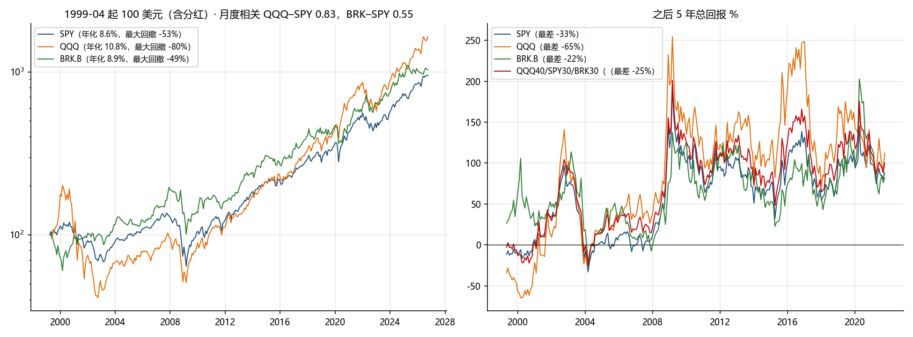

# BRK.B / QQQ / SPY / VOO 一起买，还是买一个就够（2026-10-26）

问题：不要黄金和债券，剩下的股票工具 BRK.B、QQQ、SPY、Vanguard 的标普基金是一起买还是挑一个。脚本 `etf_overlap.py`，数 `etf_overlap.json`，表 `etf_overlap_metrics.csv`，图 `fig/05_etf_overlap.png`。样本 1999-04 到 2026-09（QQQ 上市起，含 2000 年泡沫），月度再平衡，含分红。不是投资建议。

## 1. 四个东西其实是两个半

| 对 | 月度相关 | 说明 |
|---|---|---|
| SPY vs VOO | 0.9999 | 同一个指数。2010-10 起 SPY 年化 14.58%，VOO 14.62%，差的就是费率（0.0945% 对 0.03%）。两个都买等于买一个，买 VOO 更便宜。 |
| QQQ vs SPY | 0.83 | QQQ 对 SPY 的 beta 1.27，R² 0.69。QQQ 前 25 大里 16 个也在 SPY 前 25 大，这 16 个名字占 QQQ 的 59%、占 SPY 的 43%。QQQ 是 SPY 里科技那一半放大 1.3 倍。 |
| BRK.B vs SPY / QQQ | 0.55 / 0.24 | 四个里唯一和另外三个不一样的。beta 0.62，R² 0.30。BRK 在 SPY 里只占 1.5%。 |

## 2. 担保人指标（1999-04 起，5 年滚动）

| 组合 | 年化 | 最大回撤 | 2000–02 | 2022 | 5 年中位 | 5 年最差（起点） | 5 年为负 | 期望赔付 |
|---|---|---|---|---|---|---|---|---|
| SPY | 8.6% | −53% | −42% | −22% | +71% | −33%（2004-03） | 13% | 1.3% |
| QQQ | 10.8% | −80% | −80% | −32% | +104% | −65%（2000-03） | 12% | 4.5% |
| BRK.B | 8.9% | −49% | −40% | −22% | +64% | −22%（2004-03） | 2.6% | 0.2% |
| QQQ50/SPY50 | 9.9% | −64% | −64% | −27% | +88% | −43%（2000-04） | 12% | 2.7% |
| SPY50/BRK50 | 9.1% | −49% | −21% | −20% | +69% | −26%（2004-03） | 2.2% | 0.2% |
| **QQQ50/BRK50** | **10.8%** | **−47%** | −44% | −23% | +89% | **−22%**（2004-03） | 5.9% | 0.6% |
| 三者各 1/3 | 10.1% | −48% | −43% | −22% | +84% | −25%（2004-03） | 8.5% | 0.7% |
| QQQ40/SPY30/BRK30（你自己的定投比例） | 10.3% | −48% | −48% | −22% | +86% | −25%（2004-03） | 9.3% | 1.0% |
| QQQ60/BRK40 | 11.0% | −53% | −53% | −23% | +93% | −29%（2000-09） | 8.5% | 1.3% |

读法：
- QQQ + SPY 一起买，年化在两者中间，回撤和最差 5 年也在两者中间，没有产生任何一个比单买更好的数字。相关 0.83 的两样东西混在一起只是稀释。
- 加 BRK 是四个里唯一有效的分散：QQQ50/BRK50 年化和纯 QQQ 一样（10.8%），最大回撤从 −80% 降到 −47%，5 年最差从 −65% 变成 −22%，期望赔付从本金的 4.5% 降到 0.6%。它在这个样本里是用 QQQ 的 2000 年换 BRK 的 2008 年，两个顶不在同一年。
- 你自己的 40/30/30，本质上是"七成 QQQ 味的指数 + 三成 BRK"，指标和三者各 1/3 几乎一样；里面的 SPY 那 30% 可以并进 QQQ 或 BRK 任一边，数字不会变多少。

## 3. BRK 今天是什么

2026-06-30 的 10-Q：保险与其他业务持有现金和国库券 3,592 亿美元，股票和固定收益证券 3,408 亿；按 10-23 市值约 1.16 万亿美元估算（BRK-A 收盘价 × 约 143 万 A 股等价股数，stockanalysis 抓取失败），现金占市值约 **31%**，证券组合约 29%，其余是全资经营的公司。对一个不想买债券的人，BRK 自带了三成国库券，而且什么时候把它换成资产由巴菲特和阿贝尔决定，不用你来做。这也是它 beta 只有 0.6 的原因，将来现金用掉了 beta 会上去。

## 4. 注意

- BRK.B 在法律上是一只个股。协议第三条现在写"仅限宽基指数 ETF、禁止个股"，要放 BRK 得明写，第八条加上单一公司风险（继任：2026 年起阿贝尔任 CEO，巴菲特 96 岁；苹果等持仓集中；保险巨灾）。
- 1999 起的样本里 BRK 的 5 年最差 −22%（2004 年起算，吃到 2008）；它 2003–2020 有长段落后于 SPY，含分红年化 8.9% 对 SPY 8.6% 只是略胜。它的价值是相关性低，不是收益高。
- 一个资产只有一个国家一个样本的老问题不变。

## 5. 直接的答案

- SPY 和 Vanguard 的标普基金二选一，选 VOO。
- QQQ 和 SPY 二选一就够，两个都买不加任何东西；选哪个取决于你要不要科技那 1.3 倍的 beta。
- 真正值得"一起买"的组合是 **QQQ（或 VOO）+ BRK.B**，五五或六四。它替掉了你不想要的债券腿的一部分功能，代价是 BRK 的单一公司风险和协议要改。
