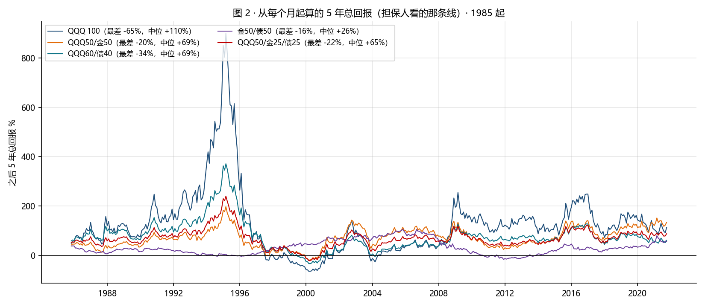
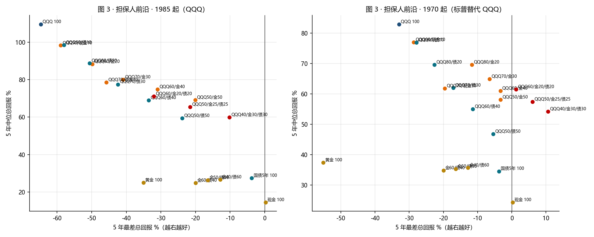
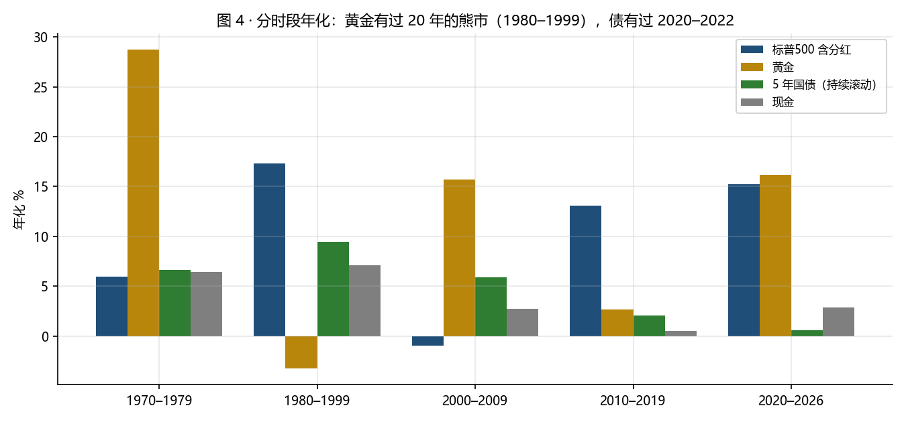

# 黄金 / QQQ / 国债，三选二（2026-10-26）

前提：基本放弃个股，不想买太多国债。问题变成三个资产挑两个怎么配。本文按担保人的读法算：每个组合从每个月起算的 5 年总回报的中位、最差、为负比例、期望赔付，加最大回撤和 2022 年。月度再平衡，不计费用税。脚本 `pairs.py`，表 `metrics_1985.csv`、`metrics_1970.csv`，数 `stats.json`。不是投资建议。

两个样本：**1985-10 起**（纳指100 价格接 1999 年起的 QQQ 含分红，是这笔钱真正要买的东西）；**1970 起**（标普含分红替代 QQQ，为的是把 1970 年代和 1980 年的黄金顶放进来）。黄金 = LBMA 午盘价接 COMEX；国债 = 用 5 年期收益率构造的持续滚动 5 年国债（不是持有到期），与 IEF 对照 2002–2026 月度相关 0.99、年化差 0.5 个百分点。

## 1. 先看今天的黄金在哪（10-23 体温读数）

| 指标 | 现值 | 1980 起分位 | 2007 顶 | 2021 顶 |
|---|---|---|---|---|
| 黄金实际价格（按今日 CPI 折算） | 4,202 | **98** | 1,197 | 2,171 |
| 黄金 / M2 | 181 | 90 | 100 | 84 |
| 黄金过去 3 年回报 | +105% | 92 | +78% | +44% |
| 黄金 / 标普500 | 0.55 | 42 | 0.48 | 0.38 |

现在买黄金，买在的是 1980 年那种实际价格的顶部区域。1980 年 2 月起算的 5 年黄金 −55%，1996 年起算 −35%；1980 到 1999 整整 20 年年化 −3.3%。黄金在组合里的价值是和 QQQ 相关 −0.04，不是它自己稳。

## 2. 1985 起（QQQ）：三个单资产与各种两两、三三

| 组合 | 年化 | 最大回撤 | 2022 | 5 年中位 | **5 年最差（起点）** | 5 年为负 | 担保人期望赔付 | 10 年最差 |
|---|---|---|---|---|---|---|---|---|
| QQQ 100 | 15.1% | −80% | −32% | +110% | −65%（2000-03） | 11% | 3.4% | −57% |
| 黄金 100 | 6.5% | −48% | −17% | +25% | −35%（1996-04） | 34% | 6.2% | −40% |
| 国债 5 年滚动 100 | 4.7% | −14% | −14% | +27% | −4%（2020-06） | 5% | 0.1% | −1% |
| QQQ70/金30 | 13.4% | −64% | −25% | +80% | −41%（2000-03） | 6% | 1.1% | −5% |
| **QQQ50/金50** | 11.9% | −49% | −20% | +69% | **−20%**（2000-03） | 2.8% | 0.3% | +50% |
| QQQ70/债30 | 12.6% | −61% | −25% | +78% | −42%（2000-04） | 7% | 1.4% | −26% |
| QQQ60/债40 | 11.7% | −53% | −23% | +69% | −34%（2000-04） | 5% | 0.9% | −13% |
| QQQ50/债50 | 10.6% | −44% | −21% | +59% | −24%（2000-04） | 4% | 0.5% | +0% |
| 金50/债50 | 5.9% | −22% | −15% | +26% | −16%（2011-12） | 13% | 0.7% | −1% |
| QQQ50/金25/债25 | 11.3% | −46% | −21% | +65% | −22%（2000-03） | 2.8% | 0.4% | +24% |
| **QQQ40/金30/债30** | 10.4% | −37% | −18% | +60% | **−10%**（2000-03） | 2.1% | 0.1% | +48% |
| 保本结构 IBTL 79% + QQQ 21%，按今天 4.83% | — | — | — | +44% | **+7%** | 0% | 0 | — |

## 3. 1970 起（标普替代 QQQ）：把 1980 年黄金顶放进去

| 组合 | 年化 | 最大回撤 | 5 年中位 | 5 年最差（起点） | 5 年为负 |
|---|---|---|---|---|---|
| 标普 100 | 11.1% | −53% | +83% | −33%（2004-03） | 8.5% |
| 黄金 100 | 8.8% | −63% | +37% | −55%（1980-02） | 29% |
| 标普50/金50 | 10.8% | −34% | +58% | −3%（1980-10） | 0.8% |
| 标普60/债40 | 9.3% | −31% | +55% | −11%（2004-03） | 0.5% |
| 金50/债50 | 7.8% | −27% | +35% | −16%（2011-12） | 9.5% |
| 标普50/金25/债25 | 9.9% | −25% | +57% | **+6%**（1998-04） | **0%** |
| 标普40/金30/债30 | 9.6% | −20% | +54% | **+11%**（1998-04） | **0%** |

## 4. 三选二的答案

1. **去掉国债（QQQ + 黄金）**：两个样本里都是两两组合中担保人指标最好的一对。50/50 的 5 年最差 −20%（1985 起）/ −3%（1970 起），期望赔付 0.3% 本金，约 160 美元；中位 +69%，比纯 QQQ 的 +110% 少四成。代价有三条：最大回撤仍有 −49%（2000–2002）；黄金单独看三分之一的 5 年窗口是负的，且今天在 98 分位；2000 年这个起点之所以只亏 20%，是因为 2001–2011 黄金涨了五倍，下一次不一定有。
2. **去掉黄金（QQQ + 国债）**：国债是持续滚动不是持有到期时，30–40% 的国债挡不住 2000 和 2022：60/40 最差 −34%，2022 年 −23%，期望赔付是 QQQ/金 的三倍。国债要么像保本结构那样占 79% 并持有到期，要么只占 30% 就是"一般"。你的直觉在这条上是对的。
3. **去掉 QQQ（黄金 + 国债）**：年化 6%，5 年最差 −16%，为负 13%。没有股票的组合既没有收益也没有更安全，被前两对完全压住。
4. **数据给的答案不是三选二，是三个都要但国债不多**：QQQ40–50 / 金25–30 / 债25–30。1985 起最差 −10% 到 −22%，1970 起从未有过负的 5 年；最大回撤 −37% 到 −46%；年化 10–11%。它比 QQQ/金 50/50 少的是中位收益（+60% 对 +69%），多的是在黄金不涨的那种十年里有第二条退路。

## 5. 套到 52,548 美元本金（5 年，1985 起样本）

| 组合 | 中位到期 | 最差到期 | 担保人最大赔付 | 期望赔付 | 期中最深浮亏量级 |
|---|---|---|---|---|---|
| QQQ 100 | 110,200 | 18,600 | 34,000 | 1,800 | −80%（2000）/ −32%（2022） |
| QQQ50/金50 | 88,900 | 42,000 | 10,500 | 160 | −49% / −20% |
| QQQ60/债40 | 88,900 | 34,900 | 17,600 | 470 | −53% / −23% |
| QQQ50/金25/债25 | 86,900 | 41,200 | 11,300 | 210 | −46% / −21% |
| QQQ40/金30/债30 | 84,100 | 47,200 | 5,400 | 50 | −37% / −18% |
| 保本结构 IBTL 79% + QQQ 21% | 75,700 | 56,400 | 0 | 0 | 约 −12% |

## 6. 附：巴菲特的比例（2026-10-26 补）

用户不喜欢黄金和债券，问巴菲特怎么配。

- **给妻子信托的指示（2013 年致股东信）**：现金的 90% 买一只极低费率的标普500 指数基金（他点名 Vanguard），10% 买短期政府债券；他预期这个做法长期胜过大多数用高费率经理的机构和个人。这是 90/10，不是 60/40，债券腿是短期国库券而不是长债。
- **对黄金（2011 年致股东信）**：他把全世界的黄金想象成一个边长约 68 英尺的立方体，当时值约 9.6 万亿美元，同样的钱可以买下全美国的农田加 16 个埃克森美孚还有剩；黄金不生产任何东西，持有者赌的是别人将来更害怕。他不碰。
- **伯克希尔自己**：2026-06-30 的 10-Q，保险与其他业务持有现金和国库券 3,592 亿美元，比股票和固定收益证券的 3,408 亿还多。但那是一个选股者等价格时的停车位（公司承诺现金不低于 300 亿），不是配置比例；他从不买长债和黄金。

把 90/10 放进本文的尺子里（90% 股票 + 10% 国库券，月度再平衡）：

| 样本 | 组合 | 年化 | 最大回撤 | 2022 | 5 年中位 | 5 年最差（起点） | 5 年为负 | 担保人期望赔付 |
|---|---|---|---|---|---|---|---|---|
| 1985 起 | QQQ90/现金10 | 14.1% | −75% | −29% | +98% | −59%（2000-03） | 11% | 2.8% |
| 1985 起 | QQQ 100 | 15.1% | −80% | −32% | +110% | −65%（2000-03） | 11% | 3.4% |
| 1970 起 | 标普90/现金10 | 10.6% | −49% | — | +77% | −29%（2004-03） | 7% | 0.5% |
| 1970 起 | 标普 100 | 11.1% | −53% | — | +83% | −33%（2004-03） | 8.5% | 0.7% |

套到 52,548 美元：QQQ 版 5 年最差到期约 21,500，担保人补约 31,000；标普版最差约 37,300，补约 15,200。10% 的国库券几乎不改变尾部，它的作用是给受益人几年的生活费，不是保本。

为什么这个比例对巴菲特成立、对这份协议不自动成立：他的信托没有保本条款；期限是"永远"（20 年窗口标普从未名义亏损，见 20 年期限备忘）；妻子的开销另有安排，那 10% 国库券就是好几年的生活费；他说的是标普500 不是纳指100。所以"巴菲特比例"在这里等于方案 C 加一层现金垫：配上 20 年期限和不设个人担保，它是自洽的；配上 5 年封闭和儿子个人保本，它就是 10-25 复核里 C1 那一行的尾部。

## 反方意见

- 两个样本都只有一个国家、一段黄金大牛市在尾部（2019–2026 +16%/年）。黄金 98 分位的实际价格意味着未来 5 年的黄金分布很可能比样本差。
- 国债用的是持续滚动的 5 年期，不是 IBTL 那种持有到期。两者 5 年期的差别不大，但前者在 2020–2022 亏过 14%，后者持有到期不亏。
- 月度再平衡在 Robinhood 要手动做；每年一次的版本结果略差，未算。
- 纳指 1985–1999 用的是价格不含股息，那段年化低估约 0.5–1 个百分点。

脚本：`python pairs.py`。不是投资建议。
