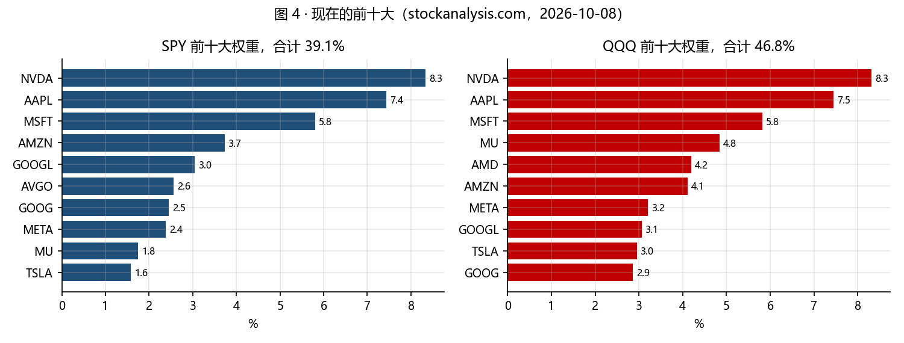
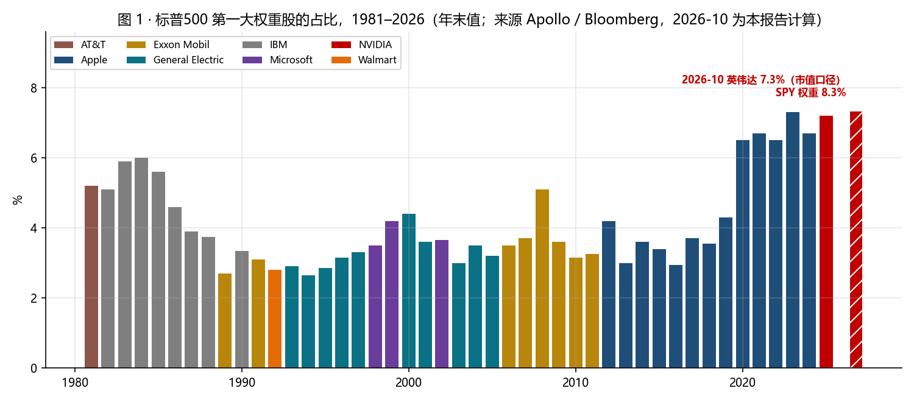
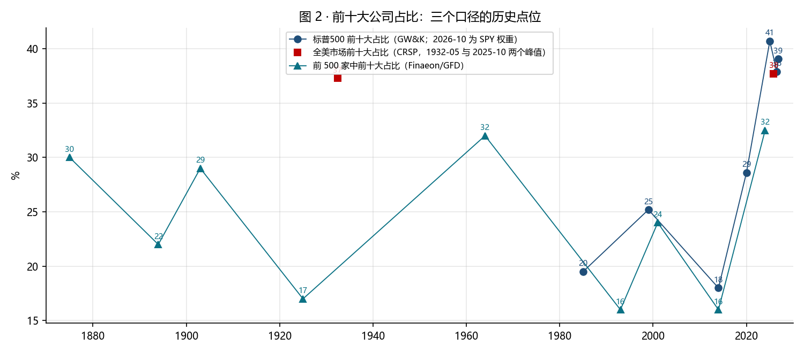
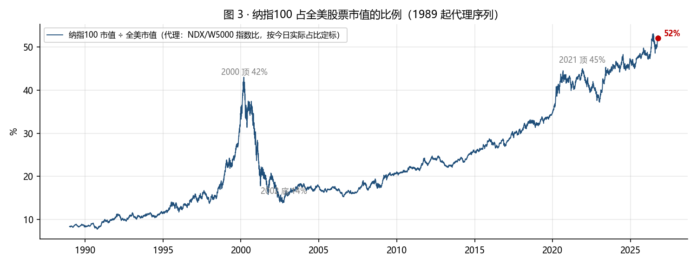

# 巨头市值占比：历史对照与过热标定（2026-10-12）

问题：英伟达现在占市场多大比例，历史上的巨头（标准石油、AT&T、IBM、通用汽车、微软、苹果）在各自顶峰时占多大比例，这个数字能不能当作过热的标定。附带两个相关口径：前十大公司占比，以及纳指100 占全美市值的比例。所有数字按口径分开列，口径不同的不并排比。

## 一页结论

1. **英伟达现在的占比，按口径分别是**：标普500 市值口径 {N['nvda_share_sp500_cap']:.1f}%（市值 {N['nvda_mcap_T']:.2f} 万亿 ÷ 标普500 合计 {N['sp500_total_T']:.1f} 万亿），SPY 权重 {N['nvda_weight_spy']:.1f}%；纳指100 市值口径 {N['nvda_share_ndx_cap']:.1f}%，QQQ 权重 {N['nvda_weight_qqq']:.1f}%（QQQ 对超大权重有封顶规则）；全美市值估算 {N['nvda_share_us_est']:.1f}%。你记的 15% 不对应上面任何一个口径，最接近的是纳指100 市值口径的 {N['nvda_share_ndx_cap']:.1f}%。
2. **按标普500 口径，这是 1981 年以来最高的单一权重。** Apollo 用 Bloomberg 数据排的年末序列里，前三位是苹果 2023 年 7.3%、英伟达 2025 年 7.2%、苹果 2024 年 6.7%；IBM 1984 年 6.0%，AT&T 1981 年 5.2%，埃克森 2008 年 5.1%，微软 1999 年 4.2%。英伟达今天 {N['nvda_share_sp500_cap']:.1f}% 高于这些全部。
3. **按全美市值口径，历史极值在百年前。** 1932 年 5 月 AT&T 约 13%（Jason Zweig，华尔街日报，经 Axios 转引），1900 年标准石油约 9%（Finaeon），1960 年最大公司 7%，1995 年只有 2%。英伟达估算 {N['nvda_share_us_est']:.1f}%，在百年尺度上属于第二梯队，不是极值。
4. **前十大占比是百年新高。** CRSP 全美口径：2025 年 10 月 37.7%，超过 1932 年 5 月的 37.3%。标普500 口径：1999 年 25.2%，2014 年 18.0%，2020 年 28.6%，2025 年 40.7%，现在 SPY 前十大 {N['top10_spy']:.1f}%（市值口径 {N['top10_sp500_cap']:.1f}%，Alphabet 两类股分列）。Kenneth French 数据的最大十分位占比 2025 年 11 月 78.5%，超过 1932 年 6 月的 73.8%。
5. **纳指100 占全美市值约 {N['ndx_share_us_est']:.0f}%**（市值 {N['ndx_total_T']:.1f} 万亿），是标普500 合计的 {N['ndx_over_sp500_cap']:.0f}%。代理序列显示 2000 年顶时约 {P['peak2000']:.0f}%，2002 年底 {P['low2002']:.0f}%，2010 年初 {P['at2010']:.0f}%，2020 年初 {P['at2020']:.0f}%。QQQ 前十大权重 {N['top10_qqq']:.1f}%，纳指100 市值口径前十大 {N['top10_ndx_cap']:.1f}%：买 QQQ 实际上是买十家公司。
6. **历史经验是一致的：集中度的顶都是被熊市打下去的。** Finaeon 的 200 年序列里，1920 年代末、二战后、1990 年代末三次集中度上升，各自之后的熊市把大部分增量抹掉；1964 年顶之后集中度下降到 1993 年，2001 年顶之后前十大从 24% 回到 2014 年的 16%。GW&K 整理的 Fama-French 数据：1932 年 6 月之后一年小盘跑赢大盘 49 个百分点，2000 年 3 月之后五年规模溢价每年约 6%、价值溢价每年约 17%。Mauboussin（摩根士丹利）：1950–2023 年，当时的第一大股票之后一年相对标普500 的平均超额回报是 -1.9%。
7. **作为过热标定的读法**：单一公司占比在标普口径是历史最高、在全美百年口径不是；前十大占比在所有口径都是历史最高或接近最高。集中度本身不预测时点，但它决定了「均值回归时谁跌得多」：历史上每一次都是第一梯队让出份额。

## 1. 现在的集中度（四个口径）

| 口径 | 英伟达 | 前三大 | 前十大 | 数据 |
|---|---|---|---|---|
| 标普500 市值合计（503 只，{N['sp500_total_T']:.1f} 万亿美元） | {N['nvda_share_sp500_cap']:.1f}% | {N['top3_sp500_cap']:.1f}% | {N['top10_sp500_cap']:.1f}% | stockanalysis.com，2026-10-10 |
| SPY 持仓权重 | {N['nvda_weight_spy']:.1f}% | {N['top3_spy']:.1f}% | {N['top10_spy']:.1f}% | 2026-10-08，自由流通调整 |
| 纳指100 市值合计（100 只，{N['ndx_total_T']:.1f} 万亿美元） | {N['nvda_share_ndx_cap']:.1f}% | — | {N['top10_ndx_cap']:.1f}% | stockanalysis.com |
| QQQ 持仓权重 | {N['nvda_weight_qqq']:.1f}% | {N['top3_qqq']:.1f}% | {N['top10_qqq']:.1f}% | 2026-10-08，修正市值加权（封顶） |
| 全美市值估算（{N['us_total_T_est']:.0f} 万亿美元） | {N['nvda_share_us_est']:.1f}% | — | — | 假设标普500 合计占全美市值 82%；Siblis 2026-06-30 的全美总市值 75.3 万亿（口径仅含美国注册公司、未经流通调整）用作量级核对 |

- 标普前十大里 Alphabet 的 GOOGL 和 GOOG 分列，按公司合并则「前十大」会再纳入一家，比例略高。
- Apollo 的 Mag 7 占标普500 市值序列：2023 年初 18%，2024 年中 31%，2025 年底约 32%。

## 2. 单一巨头的历史占比

**标普500 口径（1981 起，年末第一大权重，Apollo / Bloomberg）**：

| 公司 | 年份 | 占比 | 当时 PE |
|---|---|---|---|
{AP_ROWS}

**全美市值口径（更长的历史，口径与上表不同）**：

| 年份 | 公司 | 占全美市值 | 来源 |
|---|---|---|---|
| 1900 | 标准石油 | 约 9% | Finaeon（GFD 200 年序列） |
| 1929 | AT&T | 约 3% | Finaeon |
| 1932-05 | AT&T | 约 13% | Jason Zweig（华尔街日报），Axios 2026-03 转引；同期 7 家公司合计约三分之一（Bye, Kvaerner & Werker 2026） |
| 1960 | 最大公司（AT&T） | 7% | Finaeon |
| 1995 | 最大公司 | 2% | Finaeon |
| 2026-10 | 英伟达 | 约 {N['nvda_share_us_est']:.1f}% | 本报告估算 |

**你给的那张表，逐条核对**：

| 你的表 | 核对结果 |
|---|---|
| AT&T 1932 年 13% | 对，全美市值口径，Zweig 的数字；但 1929 年只有 3%，13% 是大萧条把其他公司市值打掉之后的结果 |
| 标准石油 1929 年 9.8% | 没找到 1929 年的数字；Finaeon 给的是 1900 年约 9%，1911 年已被拆分，1929 年不可能是单一公司 |
| 英伟达 2025 年 8.5% | 标普500 口径，年中峰值量级对；Apollo 年末值 7.2%，现在 {N['nvda_share_sp500_cap']:.1f}%（市值）/ {N['nvda_weight_spy']:.1f}%（SPY） |
| 通用汽车 1955 年 7.7%、IBM 1967 年 7.4% | 未找到独立来源；Finaeon 只给 1960 年最大公司 7%（当年最大是 AT&T，不是 GM 或 IBM） |
| 苹果 2024 年 7.1%、微软 2024 年 7.0% | 苹果 2024 年末 6.7%（Apollo）；微软 2024 年末不是第一大，7.0% 未核实 |
| 微软 1999 年 4.9%、思科 2000 年 4.2% | 微软 1999 年末 4.2%（Apollo）；思科 2000 年末不是第一大，4.2% 未核实 |
| 柯达 1972 年 2.9% | 未核实，量级合理（1972 年末柯达在前五） |

## 3. 前十大占比的历史

- 三条线口径不同：CRSP 是全美所有上市公司；GW&K 是标普500；Finaeon 是「前 500 家里的前十大」。只比各自序列内的高低。
- 标普500 口径 1985 年 19.5%、1999 年 25.2%、2014 年 18.0%、2020 年 28.6%、2025 年 40.7%，现在 {N['top10_spy']:.1f}%。1999 年的顶只有现在的六成。
- 前 500 家口径的百年峰值是 1963–64 年的 32%，2024 年 32.5% 已经持平，2025 年之后超过。

## 4. 纳指100 占全美市值

- 代理序列用 NDX 与 Wilshire 5000 两个指数之比，按今天的估算占比（{N['ndx_share_us_est']:.0f}%）定标。今天的占比本身带一个「标普500 占全美 82%」的假设，指数除数的变动也会带来误差，各年读数都应看作量级，相对高低可信。
- 2000 年 3 月顶约 {P['peak2000']:.0f}%，2002 年底约 {P['low2002']:.0f}%，2009 年初约 {P['low2009']:.0f}%，2010 年初 {P['at2010']:.0f}%，2020 年初 {P['at2020']:.0f}%，2021 年顶 {P['peak2021']:.0f}%，现在 {P['now']:.0f}%。
- 这条线说的是：纳指100 这 100 家公司占美国股市的份额已经超过 2000 年。它和前两份报告里「纳指盈利份额扩大 5.7 倍」是同一件事的两个侧面：市值份额和盈利份额一起涨。

## 5. 顶峰之后发生了什么

- Finaeon（200 年）：集中度在牛市上升、熊市下降；1920 年代末、二战后、1990 年代末三次上升各自被随后的熊市抹掉大部分；2020 和 2022 两次温和熊市没有改变集中度。
- GW&K（Fama-French 数据）：1932 年 6 月之后一年小盘跑赢大盘 49 个百分点，之后五年每年约 15 个百分点；2000 年 3 月之后五年规模溢价每年约 6%、价值溢价每年约 17%；1972 年 12 月（漂亮 50）之后十年小盘每年跑赢约 6.5 个百分点。集中度与小盘-大盘估值差的相关系数 0.83。
- Mauboussin & Callahan（摩根士丹利，2024）：1950–2023 年，第一大股票下一年相对标普500 的超额回报平均 -1.9%。
- 这些都是「第一梯队让出份额」的证据，不是「第一梯队必然下跌」的证据：2001 年之后微软横盘 16 年再创新高，IBM 1985 年之后横盘，AT&T 1984 年被拆分。份额回落的方式有三种：跌、横盘、被拆。

## 6. 作为过热标定怎么用

| 标定 | 现值 | 历史参照 | 读数 |
|---|---|---|---|
| 第一大权重（标普口径） | {N['nvda_share_sp500_cap']:.1f}% | 1981 起最高 7.3%（2023 苹果） | 历史最高 |
| 第一大占全美市值 | 约 {N['nvda_share_us_est']:.1f}% | 1932 AT&T 13%，1900 标准石油 9%，1960 7% | 高，但不是百年极值 |
| 前十大占标普500 | {N['top10_spy']:.1f}% | 1999 25%，2020 29%，2025 41% | 接近历史最高 |
| 前十大占全美（CRSP） | 37.7%（2025-10） | 1932 37.3% | 百年最高 |
| 纳指100 占全美 | 约 {N['ndx_share_us_est']:.0f}% | 2000 约 {P['peak2000']:.0f}% | 超过 2000 |
| QQQ 前十大权重 | {N['top10_qqq']:.1f}% | — | 买 QQQ = 买十家 |

- 集中度是「谁在顶上」的标定，不是「什么时候掉下来」的标定。它和前几份报告的价格、估值、GDP 读数叠在一起看：价格高位、盈利份额极高、集中度极高，三者是同一个现象。
- 对 QQQ 的含义：QQQ 的风险不是「科技股」的风险，是十家公司的风险；其中英伟达一家占 {N['nvda_weight_qqq']:.1f}%（市值口径 {N['nvda_share_ndx_cap']:.1f}%）。历史上第一大公司的下一年平均跑输指数，这是选 QQQ 还是选等权、选 SPY 时该放进算式的数。

## 数据与来源

- 现值：stockanalysis.com 的标普500 / 纳指100 成分市值列表与 SPY / QQQ 持仓权重（2026-10-08/10）；全美总市值按「标普500 合计 ÷ 0.82」估算（标普500 通常占全美市值八成多），Siblis Research 2026-06-30 的 75.3 万亿用作量级核对。
- 标普500 第一大权重 1981–2025：Apollo Global Management《The extreme weight of AI in the S&P 500》（2026-01，数据 Bloomberg），从图上读数，误差 ±0.1 个百分点；PDF 存 data/。
- 前十大：GW&K Investment Management《After the Peak》（2026-07）；CRSP / Morningstar（Dan Lefkovitz，2026-02）；Finaeon《200 Years of Market Concentration》。
- AT&T 1932 年 13%：Jason Zweig（WSJ），Axios 2026-03-23 转引；Bye, Kvaerner & Werker（2026）经 Elm Wealth 转引。
- 顶峰之后：GW&K（Fama-French 数据）；Mauboussin & Callahan《Stock Market Concentration: How Much Is Too Much?》（Morgan Stanley Counterpoint Global，2024-06）经二手转引，原文本次未能打开。
- 未能核实的数字（GM 1955、IBM 1967、柯达 1972、思科 2000、微软 2024）在第 2 节标明。
