# 市场体温计：三个节点与 1980 年以来的位置（截至 2026-10-09）

问题：现在的经济与市场是过热还是过冷。方法：把最大的几个盘子（标普500、纳指100、美国国债、黄金、CPI、M2、失业率）放在同一张表上，每个指标给出 1980 年以来的分位，再给出三个节点（2008、2015、2021 三轮周期）各自底部之后的分位，以及在三个顶和三个底当天的读数。读数不是预测，是体温。

## 一页结论

**资产价格过热，经济晚周期偏热，没有任何一项过冷。**

| 组 | 热度（1980 起分位，已按方向统一） | 读数 |
|---|---|---|
| 价格 | 82 | 偏热 |
| 黄金 | 81 | 偏热 |
| 估值 | 70 | 偏热 |
| 经济 | 69 | 偏热 |
| 流动性 | 62 | 中性 |

1. **价格比 2007 和 2021 两个顶都高，只低于 2000。** 标普500 高出 1980 起趋势线 +34%（89 分位）；2007 顶是 +20%，2021 顶 +19%，2000 顶约 +100%。过去 3 年标普涨 +83%、QQQ 涨 +112%，都在 93 分位以上。
2. **估值分裂，和前两份报告一致。** CAPE 41.8（97 分位，2007 顶 27.3，2021 顶 36.9），但股票相对债券没有溢价也没有折价：盈利收益率减 10 年国债 -0.5 个百分点，1980 起正好中位，2021 顶时是 +2.7。原因是 10 年国债 5.23%，2009 以来 100 分位。
3. **经济是晚周期的样子，不是衰退的样子。** 失业率 4.2%，1980 起只有 14% 的时间比现在低，但已从 2023 年的 3.4% 回升；Sahm 指标 +0.03，未触发。CPI 同比 3.7%，2021 顶时 7.5%，2007 顶时 3.5%。收益率曲线 +1.19 个百分点，已从 2022–2024 的倒挂恢复正常；历史上 1989、2000、2007 三次都是在曲线重新转正之后进入衰退，2007 顶当天是 +0.7。实际短期利率 +0.3 个百分点，政策不松不紧。
4. **黄金给出了最强的信号。** 按今日 CPI 折算的实际金价 4,202 美元，高于 1980 年的 2,872 和 2011 年的 2,689，是 1980 以来 98 分位；过去 3 年 +132%；黄金除以 M2 在 90 分位。股票和黄金同时在历史高位，1980 年没有（股票便宜）、2011 年没有（股票刚从底部出来）。两者一起涨，共同的分母是对货币的定价，而不是对经济的定价。
5. **三个节点各自的尺子。** 从 2009 底拟合的纳指趋势年化 18%，现在高出 +11%（89 分位）；从 2016 底拟合年化 19%，高出 +9%（82 分位）；从 2022 底拟合年化 26%，正好在线上（+1%）。换句话说，相对过去 4 年的斜率现在不算高，相对过去 10 年和 17 年的斜率都高。要相信「不高」，就要相信 26% 的年化能持续。
6. **和三个顶比，现在最像哪一个。** 价格偏离、CAPE、黄金三项都超过 2007 和 2021 两个顶；失业率、CPI、曲线形态更像 2007 年下半年；10 年国债 5.23% 高于三个顶中的任何一个。与 2021 顶的最大区别是利率：2021 顶时 10 年国债 1.6%、实际利率 -7.4，流动性是热的；现在利率 5% 以上、实际利率为零，流动性是中性的，热的是价格和黄金。

## 1. 价格：1980 年以来的位置

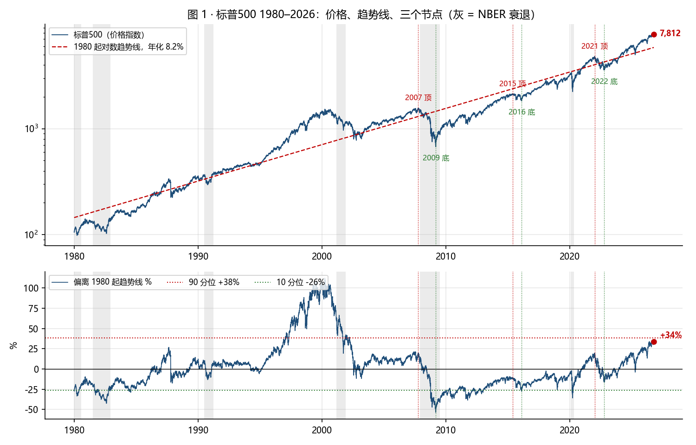

| 指标 | 现值 | 1980 起分位 | 2009 起 | 2016 起 | 2022 起 | 2007 顶 | 2015 顶 | 2021 顶 | 2009 底 | 2016 底 | 2022 底 |
|---|---|---|---|---|---|---|---|---|---|---|---|
| 标普500 偏离 1980 起趋势线 | +34% | 89 | 100 | 99 | 99 | +20% | -10% | +19% | -54% | -27% | -16% |
| 标普500 相对 200 日均线 | +8% | 69 | 67 | 66 | 52 | +6% | +5% | +9% | -36% | -10% | -14% |
| 标普500 过去 3 年价格回报 | +83% | 93 | 99 | 99 | 98 | +38% | +63% | +96% | -47% | +21% | +20% |
| 标普500 过去 5 年总回报(1993 起) | +93% | 58 | 60 | 53 | 46 | +118% | +112% | +135% | -35% | +54% | +53% |
| 标普500 距历史最高 | -0.1% | 90 | 87 | 83 | 85 | 0.0% | 0.0% | 0.0% | -56.8% | -14.2% | -25.4% |
| 纳指100 偏离 1985 起趋势线 | +55% | 90 | 100 | 99 | 98 | +1% | -14% | +45% | -59% | -31% | -14% |
| 纳指100 相对 200 日均线 | +12% | 72 | 74 | 72 | 65 | +15% | +7% | +11% | -31% | -11% | -18% |
| QQQ 过去 3 年总回报 | +112% | 95 | 94 | 91 | 88 | +50% | +87% | +173% | -36% | +47% | +40% |

- 三个节点：标普 2007 顶（2007-10-09）到 2009 底（2009-03-09）跌 -57%；2015 顶（2015-05-21）到 2016 底跌 -14%；2021 顶（2022-01-03）到 2022 底跌 -25%。纳指100 对应 -54%、-16%、-36%。
- 1980 起趋势线年化 8.2%。1995 到 2001 年标普在线上 50% 到 100%，2009 到 2020 年几乎一直在线下，2021 年以后回到线上，现在 +34%。
- 从各自底部拟合的标普趋势：2009 底起年化 11.8%，当前偏离 +13%（97 分位）；2016 底起年化 12.5%，偏离 +11%（91 分位）；2022 底起年化 19.9%，偏离 -1%。

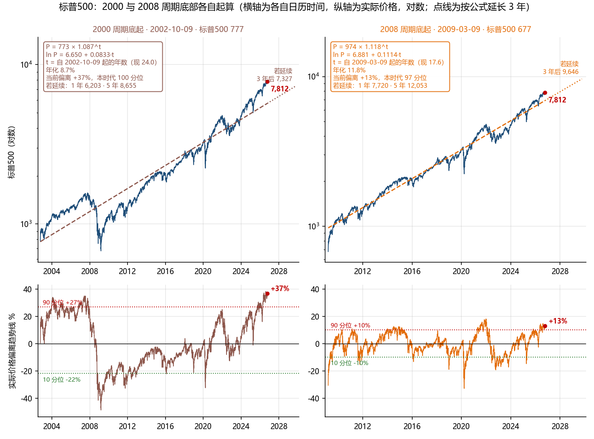

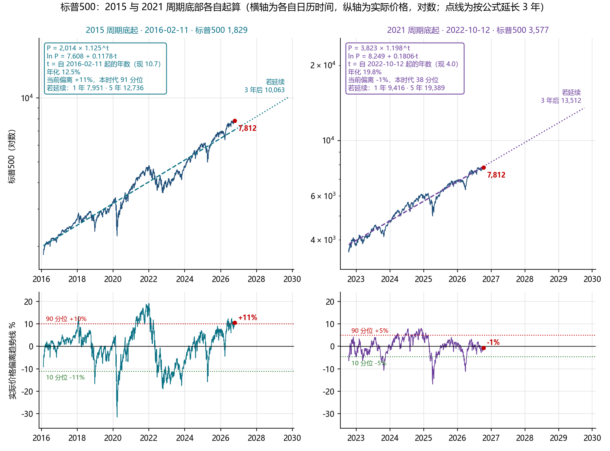

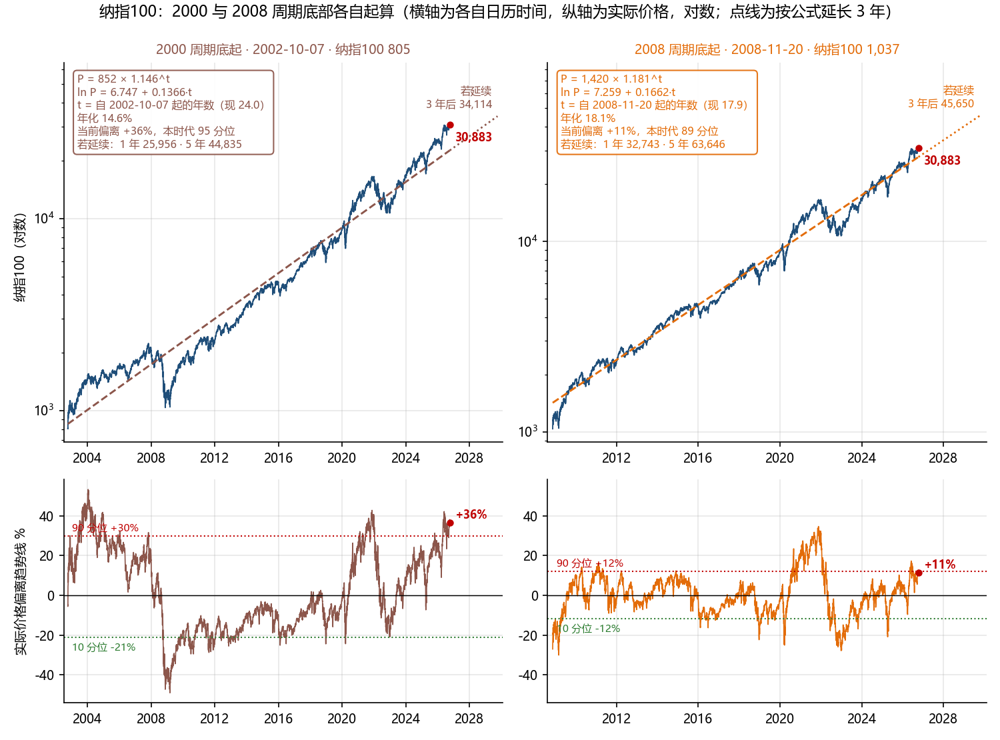

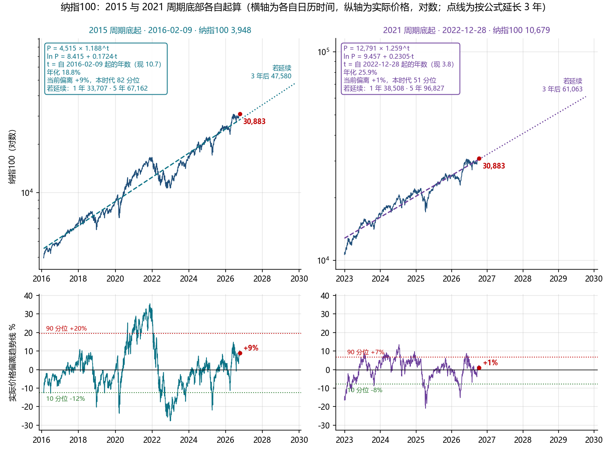

- 四张小图各自从自己周期的底部起算，横轴是各自的日历时间，纵轴是实际价格。每张图标出趋势线公式 P = a × (1+g)^t（t 为自底部起的年数）和按公式延长的 1、3、5 年隐含点位。2022 底起的尺子年化 26%，价格正好贴着线；2009 底起的尺子年化 18%，价格在线上 11%，刚过本时代 90 分位；2002 底起的尺子把 2008 装在里面，斜率最低。

## 2. 估值

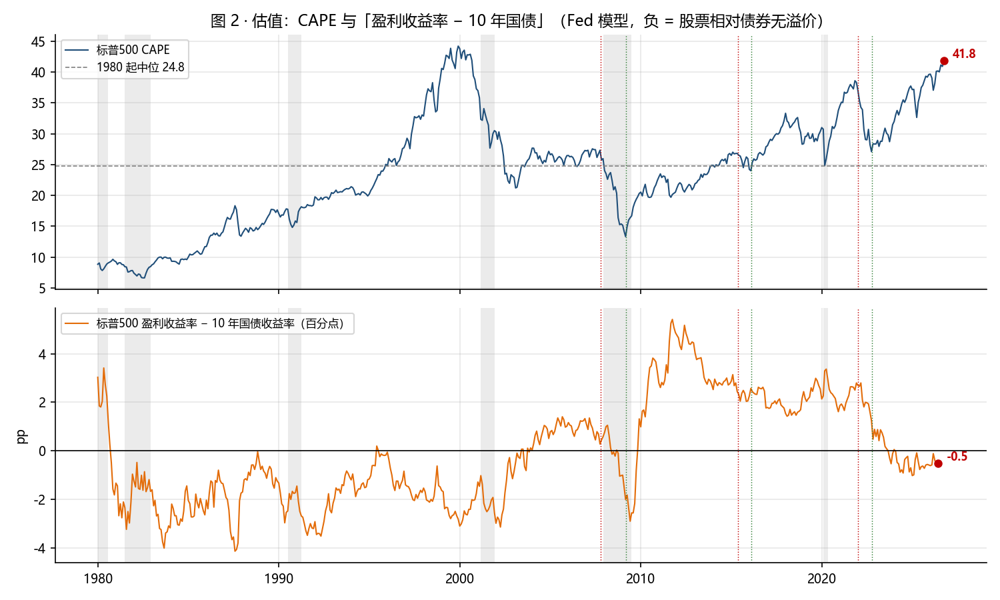

| 指标 | 现值 | 1980 起分位 | 2009 起 | 2016 起 | 2022 起 | 2007 顶 | 2015 顶 | 2021 顶 | 2009 底 | 2016 底 | 2022 底 |
|---|---|---|---|---|---|---|---|---|---|---|---|
| 标普500 CAPE | 41.8 | 97 | 100 | 99 | 98 | 27.3 | 26.8 | 36.9 | 13.3 | 24.0 | 27.1 |
| 标普500 滚动 PE | 25.2 | 76 | 74 | 63 | 36 | 20.7 | 21.9 | 23.1 | 110.4 | 22.0 | 20.4 |
| 标普500 盈利收益率 − 10 年国债(Fed 模型) | -0.5pp | 51 | 13 | 15 | 43 | +0.3pp | +2.5pp | +2.7pp | -2.0pp | +2.6pp | +1.2pp |
| 纳指100 前瞻 PE(2001 起) | 22.4 | 59 | 68 | 48 | 14 | 23.2 | 18.2 | 28.4 | 13.2 | 16.1 | 19.1 |

- CAPE 在三个底的读数是 13.3、24.0、27.1。现在 41.8，比 2022 底高 54%。
- Fed 模型的读法：正数表示股票的盈利收益率高于国债，股票相对便宜。2009 底的负值是盈利塌陷造成的假读数。2015 顶和 2021 顶都在 +2.4 到 +2.7，因为那时国债收益率 1.6% 到 2.2%。现在 -0.5，和 2007 顶（+0.3）一样是零附近。
- 纳指100 前瞻 PE 22.4 倍，2001 起 59 分位，2022 起 14 分位。它是估值组里唯一偏低的读数，前提是盈利预期兑现。

## 3. 经济温度

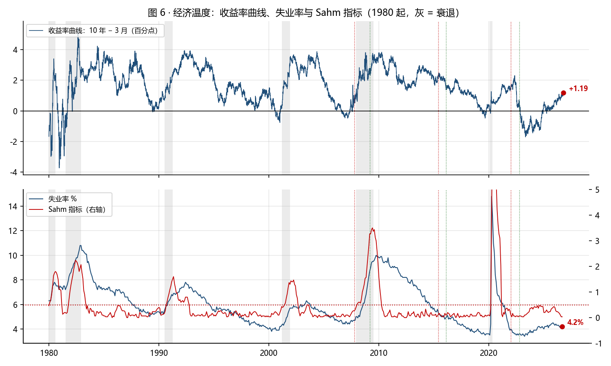

| 指标 | 现值 | 1980 起分位 | 2009 起 | 2016 起 | 2022 起 | 2007 顶 | 2015 顶 | 2021 顶 | 2009 底 | 2016 底 | 2022 底 |
|---|---|---|---|---|---|---|---|---|---|---|---|
| 失业率 | 4.2% | 14 | 32 | 52 | 59 | 4.7% | 5.6% | 4.0% | 8.7% | 4.9% | 3.6% |
| Sahm 指标(3 月均值 − 12 月最低) | +0.03pp | 5 | 11 | 10 | 7 | +0.27pp | +0.07pp | +0.10pp | +3.27pp | +0.10pp | +0.07pp |
| CPI 同比 | 3.7% | 71 | 84 | 75 | 73 | 3.5% | -0.0% | 7.5% | -0.4% | 1.0% | 7.8% |
| 收益率曲线 10 年 − 3 月 | +1.19pp | 38 | 42 | 70 | 99 | +0.74pp | +2.17pp | +1.58pp | +2.69pp | +1.37pp | +0.37pp |
| 实际短期利率(3 月国库券 − CPI 同比) | +0.3pp | 44 | 77 | 67 | 27 | +0.3pp | +0.0pp | -7.4pp | +0.6pp | -0.7pp | -4.6pp |
| 10 年国债收益率 | 5.23% | 56 | 100 | 100 | 99 | 4.65% | 2.18% | 1.63% | 2.89% | 1.64% | 3.90% |

- 失业率 4.2%：三个顶分别是 4.7%、5.6%、4.0%；三个底是 8.7%、4.9%、3.6%。失业率在顶部时总是低的，它是滞后指标，变化方向比水平重要：2023 年低点 3.4%，现在 4.2%，方向向上，幅度尚未到 Sahm 阈值。
- 收益率曲线：2022-10 到 2024 年倒挂最深 -1.9，现在 +1.19。曲线转正本身不是安全信号，1990、2001、2007 三次衰退都发生在转正之后。
- 实际短期利率 +0.3：2021 顶是 -7.4（极度宽松），2007 顶是 +0.3。现在和 2007 顶一样处于中性。

## 4. 通胀与流动性

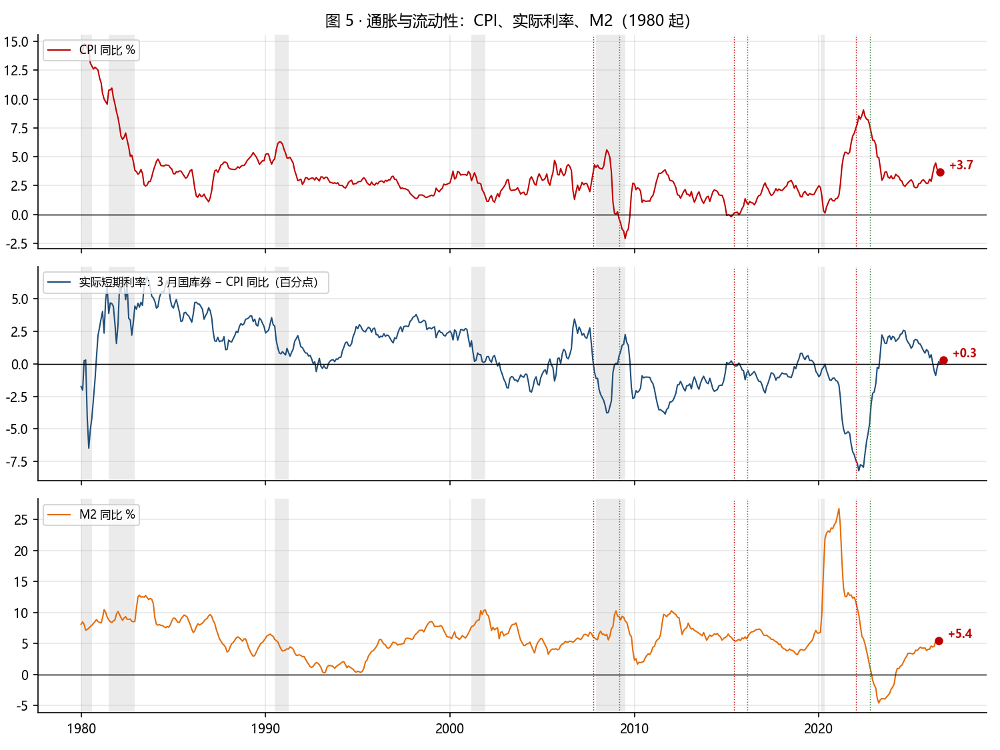

| 指标 | 现值 | 1980 起分位 | 2009 起 | 2016 起 | 2022 起 | 2007 顶 | 2015 顶 | 2021 顶 | 2009 底 | 2016 底 | 2022 底 |
|---|---|---|---|---|---|---|---|---|---|---|---|
| M2 同比 | 5.4% | 40 | 43 | 58 | 98 | 6.1% | 5.6% | 11.7% | 9.3% | 5.7% | 1.4% |
| VIX(1990 起) | 14.8 | 31 | 32 | 34 | 25 | 16.1 | 12.1 | 16.6 | 49.7 | 28.1 | 33.6 |
| 美元指数 DXY | 102.2 | 76 | 85 | 76 | 48 | 78.5 | 95.3 | 96.2 | 89.0 | 95.6 | 113.3 |

- CPI 同比 3.7%（2026-08），1980 起 71 分位，2009 起 84 分位。它从 2024 年的 2.5% 附近回升，方向是再加速。
- M2 同比 5.4%（2026-07），1980 起 40 分位，正常；2021 顶时是 11.7%。这轮资产上涨不是货币数量推的，与 10-09 报告里「纳指除以 M2 高出趋势」的结论互相印证。
- VIX 14.8，低波动；美元指数 102.2，1980 起 76 分位，偏强。

## 5. 黄金

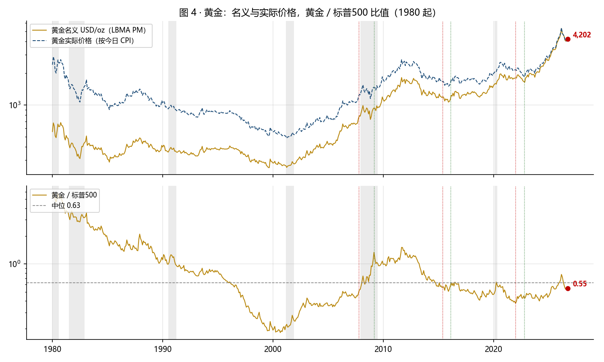

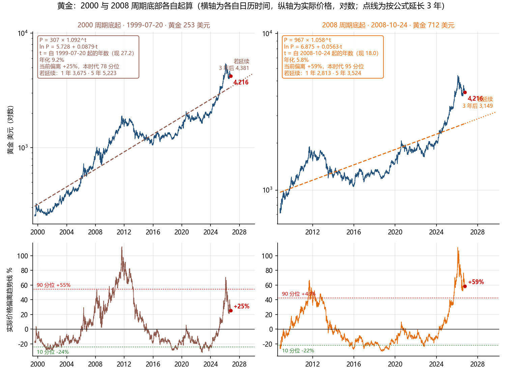

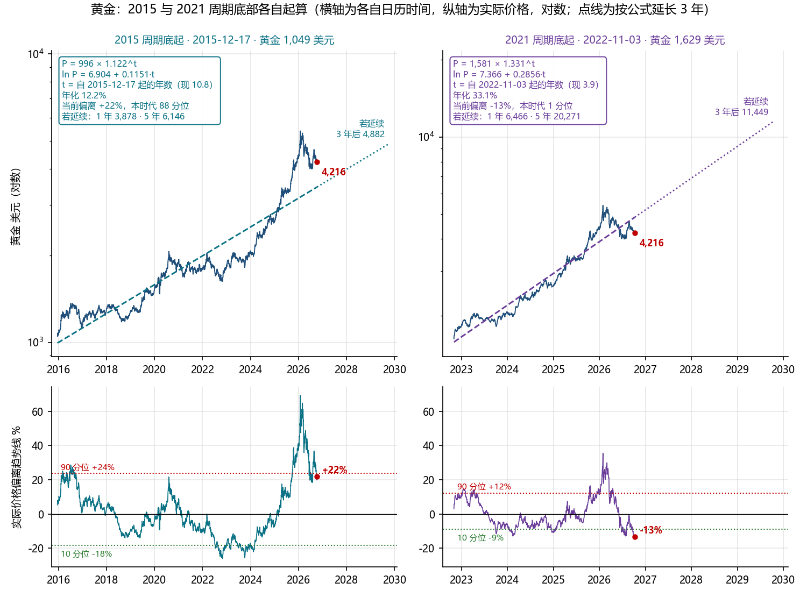

| 指标 | 现值 | 1980 起分位 | 2009 起 | 2016 起 | 2022 起 | 2007 顶 | 2015 顶 | 2021 顶 | 2009 底 | 2016 底 | 2022 底 |
|---|---|---|---|---|---|---|---|---|---|---|---|
| 黄金实际价格(按今日 CPI 折算) | $4,202 | 98 | 96 | 93 | 81 | $1,190 | $1,656 | $2,158 | $1,476 | $1,591 | $1,875 |
| 黄金 / 标普500 比值 | 0.55 | 42 | 48 | 76 | 71 | 0.48 | 0.56 | 0.38 | 1.34 | 0.58 | 0.45 |
| 黄金过去 3 年回报 | +132% | 95 | 96 | 94 | 85 | +78% | -23% | +44% | +64% | -26% | +11% |
| 黄金 / M2(美元每十亿美元 ×1000) | 180.990 | 90 | 95 | 93 | 81 | 99.950 | 98.140 | 83.680 | 111.840 | 89.370 | 77.730 |

- 名义金价 4,216 美元（2026-10-09，LBMA 数据到 2026-09-08 为 4,399，之后接 COMEX 近月期货）。1980-01 顶 850，2011-09 顶 1,895。
- 按今日 CPI 折算：1980 顶相当于 2,872，2011 顶相当于 2,689，现在 4,202。黄金处在 1980 年以来的实际价格最高点。
- 黄金除以标普500 为 0.55，42 分位，2009 底时 1.3。黄金涨得多，但没有跑赢股票，两者同步。黄金除以 M2 为 181，1980 起 90 分位；2007 顶 100，2009 底 112，2011 年附近更高。黄金相对货币存量已经不便宜。
- 读法：黄金和股票同时在高位，说明市场在给「货币」定价，不是在给「经济」定价。这与 CPI 再加速、10 年国债 5% 以上、美元偏强同时出现，是一组互相矛盾的信号：债券市场说通胀要来，黄金说货币要贬，股票说盈利会涨。三者不会同时对。

## 6. 体温计

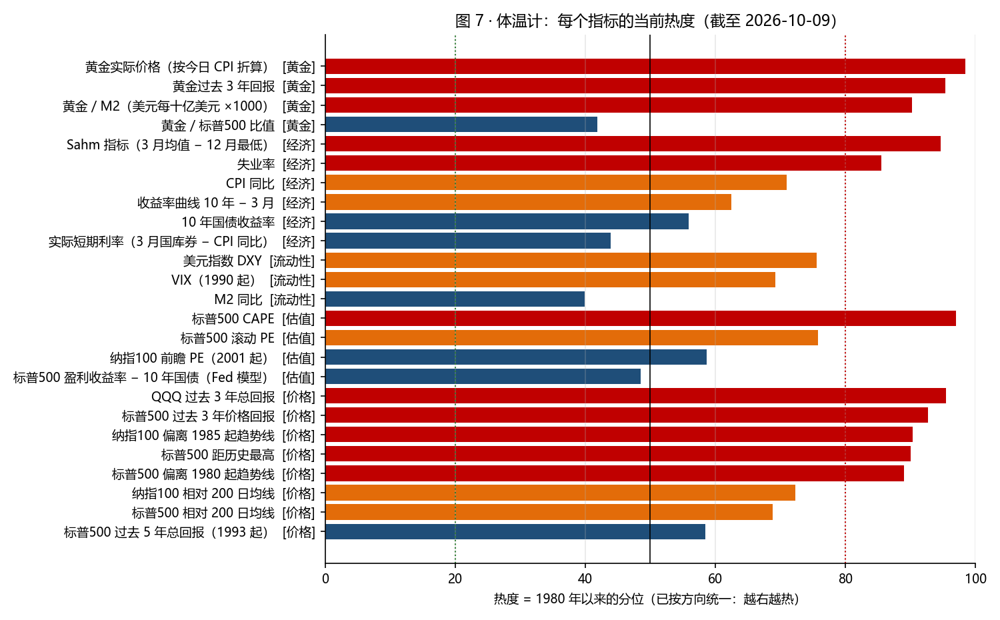

- 热度 = 1980 年以来的分位，方向已统一（失业率、曲线、VIX 等取反）。红 ≥80，橙 60–80，蓝 20–60，绿 ≤20。
- 过热的是价格和黄金，偏热的是估值和经济，中性的是流动性。没有一项在冷区。

## 7. 三个节点的尺子怎么用

| 基准 | 含义 | 纳指趋势年化 | 当前偏离 | 分位 |
|---|---|---|---|---|
| 1985 起 | 全历史 | 12.5% | +55% | 90 |
| 2009 底起 | 金融危机后的时代 | 18.1% | +11% | 89 |
| 2016 底起 | 2015 调整后的时代 | 18.9% | +9% | 82 |
| 2022 底起 | AI 时代 | 26.1% | +1% | 50 |

| 资产 | 基准 | 趋势线公式（t = 自底部起的年数） | 年化 | 当前偏离 | 本时代分位 | 若延续 3 年 / 5 年后 |
|---|---|---|---|---|---|---|
| 纳指100 | 2000 底起 2002-10-07 | P = 852 × 1.146^t | 14.6% | +36% | 95 | 34,114 / 44,835 |
| 纳指100 | 2008 底起 2008-11-20 | P = 1,420 × 1.181^t | 18.1% | +11% | 89 | 45,650 / 63,646 |
| 纳指100 | 2015 底起 2016-02-09 | P = 4,515 × 1.188^t | 18.8% | +9% | 82 | 47,580 / 67,162 |
| 纳指100 | 2021 底起 2022-12-28 | P = 12,791 × 1.259^t | 25.9% | +1% | 51 | 61,063 / 96,827 |
| 标普500 | 2000 底起 2002-10-09 | P = 773 × 1.087^t | 8.7% | +37% | 100 | 7,327 / 8,655 |
| 标普500 | 2008 底起 2009-03-09 | P = 974 × 1.118^t | 11.8% | +13% | 97 | 9,646 / 12,053 |
| 标普500 | 2015 底起 2016-02-11 | P = 2,014 × 1.125^t | 12.5% | +11% | 91 | 10,063 / 12,736 |
| 标普500 | 2021 底起 2022-10-12 | P = 3,823 × 1.198^t | 19.8% | -1% | 38 | 13,512 / 19,389 |
| 黄金 | 2000 底起 1999-07-20 | P = 307 × 1.092^t | 9.2% | +25% | 78 | 4,381 / 5,223 |
| 黄金 | 2008 底起 2008-10-24 | P = 967 × 1.058^t | 5.8% | +59% | 95 | 3,149 / 3,524 |
| 黄金 | 2015 底起 2015-12-17 | P = 996 × 1.122^t | 12.2% | +22% | 88 | 4,882 / 6,146 |
| 黄金 | 2021 底起 2022-11-03 | P = 1,581 × 1.331^t | 33.1% | -13% | 1 | 11,449 / 20,271 |

- 尺子越短，斜率越陡，当前读数越「不高」。2022 底起的尺子说正好在线上；但它只有 4 年，斜率 26% 是 1985 以来任何 4 年窗口里最陡的一批。
- 把「现在高不高」的争论翻译成一句话：你相信未来 5 年纳指的斜率是 12%、18% 还是 26%。前两份报告给的基准是：从 22 倍前瞻 PE 的起点，历史中位年化 7% 到 9%。

## 数据与方法

- 价格与利率：Yahoo Finance（^GSPC 1970 起价格指数，^SP500TR 1988 起总回报，^NDX 1985 起，QQQ 复权，^TNX ^IRX ^FVX ^VIX，DX-Y.NYB），截至 2026-10-09。
- CPI-U（未季调）与失业率（季调）：BLS 公开 API v1，10 年分段，CPI 到 2026-08，失业率到 2026-09。M2：美联储 H.6 经黄金批次缓存，到 2026-07。FRED 本机不可达。
- 黄金：LBMA PM 定盘价缓存到 2026-09-08（当日接口 403），之后用 COMEX 近月（GC=F）接续；两者在接续日相差小于 1%。
- CAPE 与标普滚动 PE：multpl.com（基于 Shiller）。纳指100 前瞻 PE：historyofmarket.com。
- 节点：顶 = 该年内收盘最高日，底 = 随后窗口内收盘最低日，由数据计算。NBER 衰退区间手工录入（1980、1981–82、1990–91、2001、2007–09、2020）。
- 分位 = 当前值在基准期全部观测中的百分位；热度按方向统一后取 1980 起分位。趋势线 = 对数价格对时间的最小二乘。
- 复跑：`python fetch_prices.py` → `python fetch_macro.py` → `python build_temperature.py` → `python build_report.py` → `python ../../scripts/md_to_pdf.py report.md <pdf>`。
