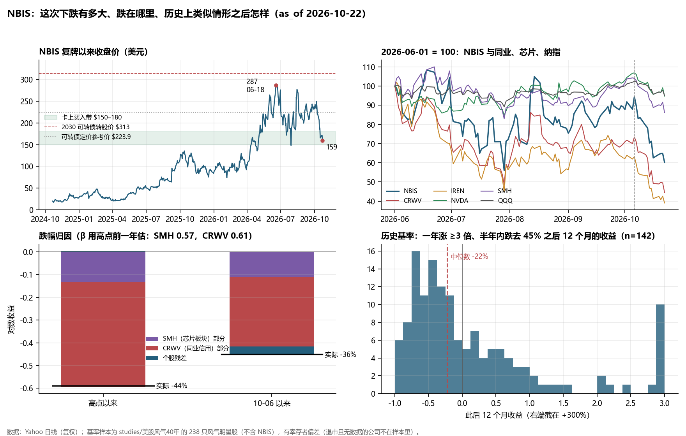
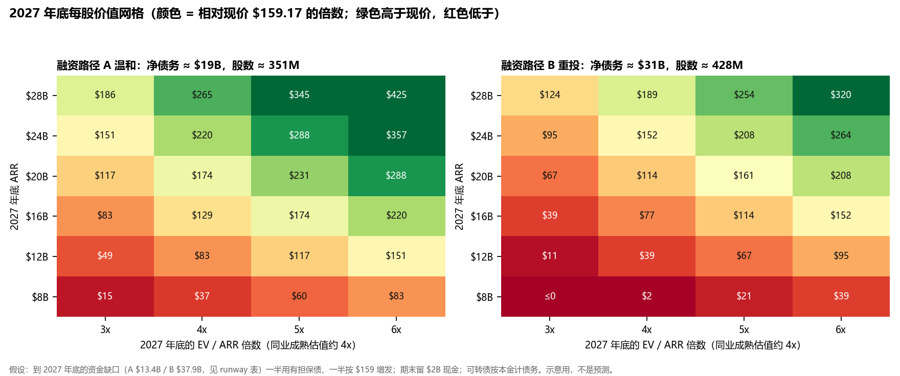

# NBIS：这次大跌是不是机会

**2026-10-23 · 价格截至 2026-10-22 收盘 $159.17 · Q3'26 财报未出（日期未公告，第三方日历写 11-10 或 11-11）**

这是研究，不是投资建议；我不是持牌顾问。下面的判断按 repo 里你自己的规则（`trading-desk/discipline.md`、NBIS 历次 decision card 和 monitor）来对照。

## 研究结论

**一句话：价格便宜了，公司本身也没变坏，变坏的是它要去借钱的那个市场。按修正后的口径，现价还在你规则的买入带上方，决定性的证据要等约三周后的 Q3 财报。**

1. **跌在哪里。** 从 6-18 收盘高点 $286.69 到 10-22，NBIS 跌了 44.5%。用芯片板块（SMH）和 CoreWeave（CRWV）两个因子去解释，个股残差约为 0。两个 −10% 以上的交易日（10-14、10-16），Nebius 都没有任何公告。同期 NBIS 跌得比同业少：CRWV −53%，IREN −58%，APLD −59%。
2. **公司本身没坏。**
   - 自家 GPU 挂牌价 10-01 起又涨了 17–21%，这一点有官网存档作一手确认；5 月以来累计涨了 52–56%。
   - 行业 H100 租价指数比 2025 年 9 月的低点高约 35%。
   - 6 月末 RPO 是 $37.5B，主要来自 Microsoft 和 Meta 两家投资级客户。
3. **但融资变贵了。**
   - 新云的信用市场在 10 月基本关门：CoreWeave 的 5 年 CDS 一度到 1,195bp。
   - Nebius 10-22 公告了一笔 $3.5B 的 Citi 过桥贷款：364 天，有担保，排在 $13.4B 无担保可转债前面，一年内必须再融资。
   - 到 2027 年底，外部资金缺口估计在 $13–38B，相当于现市值的 27%–77%。同样筹一块钱，按 $159 发股比按 8 月的参考价 $224 多稀释约 40%。
4. **它没有 repo 卡上写的那么便宜。** 10-19 卡少算了股数（274.1M，实际约 308.7M，含 NVIDIA 预融资认股权），也少算了债务（约 $6.7B，实际可转债本金就有 $13.4B）。修正后：
   - EV 约 $48.8B，不是 $37.3B。
   - EV/2026 年底 ARR 中值约 6.1x，不是 4.7x；扣掉 Q3 的现金消耗后约 6.5–6.9x。
   - 用原卡的同一套方法重算买入带，约 $126–151，现价 $159 在带上方。
5. **现价隐含了什么。** 如果想从现价起到 2027 年底拿到年化 12%，按成熟估值约 4 倍 EV/ARR 计，2027 年底 ARR 需要约 $21B。这大致就是公司的全部计划：2026 年底 $7–9B，2027 年再部署 1 GW 以上。所以这次下跌去掉的是 6 月那段"超出计划"的溢价（当时约 11 倍年底 ARR），但现价并没有给计划落空留出余地。
6. **历史基率不站在"跌多了就是机会"这边。** 在 40 年风气明星股里，找"一年内涨 3 倍以上、创新高后半年内跌去 45%"的情形，共 165 次：
   - 之后 12 个月收益的中位数是 −22%，约 70% 先再跌 25% 以上。
   - 其中"卖铲子"类公司好一些：12 个月中位数 +16%，但 24 个月中位数 −30%。
   - NBIS 按同一规则在 7-29（$148.22）就已经触发过，现在是同一轮回撤的第二段下跌。
   - 这些数字还有幸存者偏差：退市和被收购的公司大多不在样本里，所以真实情况更差。
7. **按你自己的规则。**
   - 新资金：WATCH；修正口径后，STARTER 的价格条件其实还没满足。
   - 已有仓位：HOLD；红灯仍是 1 个（K-G 杠杆分支，Citi 过桥让它更深），没到"2 红减仓"。
   - T0 单票真金上限是 $500，就算触发，量级也在这里。
8. **接下来看什么。** 决定在 Q3 财报：
   - active MW（2025 年底约 170 MW，之后两个季度没更新）；
   - ARR 是否 ≥ 约 $5B；
   - FY26 指引是否不变；
   - 2027 年融资怎么安排（Citi 过桥怎么接、ATM 用了多少、2027 年 capex 多少）。
   
   在那之前，10-28/29 的 MSFT、GOOGL、AMZN 财报和 Oracle 投资者日，以及 CoreWeave 的债券和 CDS，是外部信号。

## 1. 跌了多少、跌在哪里

**这次回撤对这只股票来说不算"异常"。** NBIS 近一年的年化波动是 107%，CRWV 96%，IREN 106%；NVDA 和 SMH 只有约 40%，QQQ 20%。从高点到现在 87 个交易日，对数跌幅只相当于 0.93 个标准差。复牌（2024-10）以来，NBIS 已经有过 6 次 ≥25% 的回撤，前 5 次都在谷底后 17–63 天收复了前高。所以对这只股票，"跌了很多"本身不是信号。

| 复牌以来 ≥25% 的回撤 | 顶 → 底 | 深度 | 用时 | 谷底后收复 |
|---|---|---|---|---|
| 2024-10 → 2024-11 | 23.75 → 17.60 | −25.9% | 18 天 | 17 天 |
| 2024-12 | 36.77 → 26.71 | −27.4% | 14 天 | 25 天 |
| 2025-01（DeepSeek） | 41.69 → 26.08 | −37.4% | 3 天 | 17 天 |
| 2025-02 → 2025-04 | 48.07 → 20.06 | −58.3% | 49 天 | 59 天 |
| 2025-10 → 2026-02 | 135.46 → 73.87 | −45.5% | 115 天 | 63 天 |
| **2026-06 → 至今** | **286.69 → 148.22（7-29）** | **−48.3%** | 41 天 | **未收复**；10-06 反弹到 249.87 后再跌到 159.17 |

**跌幅归因。** 模型系数用高点之前一年的日收益估计（不偷看下跌段），模型是 NBIS ≈ 0.57×SMH + 0.61×CRWV，R² = 0.47。

| 窗口 | NBIS 实际 | SMH 部分 | CRWV 部分 | 个股残差 |
|---|---|---|---|---|
| 6-18 高点 → 10-22（87 天） | −44.5% | −0.13（SMH −20.7%） | −0.46（CRWV −52.9%） | **+0.005（z = 0.0）** |
| 10-06 → 10-22（12 天） | −36.3% | −0.11（SMH −17.3%） | −0.31（CRWV −39.4%） | **−0.04（z = −0.2）** |

（各部分为对数收益。）

如果只用 SMH 一个因子，个股残差是 −0.31，而加入 CRWV 后基本归零。也就是说，NBIS 跟的是"新云信用"这个因子，不是芯片，也不是它自己的新闻。但要注意，这个因子本身就是 NBIS 的核心风险（见第 4 节），所以"不是个股问题"不等于"与 NBIS 无关"。

| 区间涨跌（复权） | NBIS | QQQ | SMH | NVDA | CRWV | IREN | ORCL | APLD |
|---|---|---|---|---|---|---|---|---|
| 6-18 高点以来 | −44.5% | −4.7% | −20.7% | +0.8% | −52.9% | −57.5% | −31.4% | −59.0% |
| 10-06 以来 | −36.3% | −7.3% | −17.3% | −11.3% | −39.4% | −38.2% | −13.0% | −24.7% |
| 年初以来 | +90.2% | +15.1% | +45.3% | +14.1% | −22.4% | −32.5% | −34.7% | −22.1% |

## 2. 为什么跌：三层叠加，没有单一触发

| 日期 | NBIS | 发生了什么 |
|---|---|---|
| 10-06 | 249.87（+7.4%） | 本轮最高；AI 基建股普涨 |
| 10-07 | −5.1% | 美 10 年期国债收益率盘中 5.365%，2002 年以来最高；FOMC 纪要显示还要加息 |
| 10-08 | −7.4% | FT 报道 OpenAI 告诉投资者年化收入约 $50B，而 9 月底流传的是 $68B（后者含合作方总收入，CNBC 确认是口径差） |
| 10-13 | −1.5% | 晚间 Chamath 贴出 CoreWeave 2032 年债收益率 15%，Musk 回 "yikes" |
| 10-14 | **−10.1%** | 9 月 CPI 偏热；Gartner 称 2030 年前超过 80% 的新云将失去独立地位；CRWV −15.5%。**NBIS 无公告** |
| 10-15 | +1.3% | PPI 同比 +6.3%；CRWV 5 年 CDS 收在约 1,038bp（盘中 >1,140bp） |
| 10-16 | **−12.2%** | Nasdaq −2.1%，CRWV −11.9%，债务传染担忧发酵。**NBIS 无公告** |
| 10-19～21 | 170.24 / 171.45 / 171.57 | 小幅反弹；Piper 把目标价从 $237 降到 $185，维持 Neutral |
| 10-22 | **−7.2%，159.17** | 盘前公告 $3.5B Citi 过桥贷款；Meta 财报后 −7%（Q3 FCF 转负，新设股票类别为 AI 融资）；黄仁勋在 CNBC 说新云面临 "scarcity of capital"；Brent $113；CRWV −10%，SMH −6% |

**三层分别是：**
- **利率和通胀**：美伊冲突推高能源价格，10 年期一度超过 5.3%，美联储在谈加息。
- **AI 需求成色**：OpenAI 收入口径、Anthropic 增速放缓、Gartner 报告、Meta 的 FCF 转负。
- **新云信用**：CRWV 的债券和 CDS 进入困境区间。

Nebius 自己的负面只有三件小事：COO 10-05 按 10b5-1 计划以约 $235 卖出 50 万股（计划已执行完毕），Piper 降目标价，以及过桥贷款。

**空头面：**
- 9-30 结算日空头 4,470 万股，约占自由流通股的 19.5%。
- Burry 9-28 在付费 Substack 上说把 NBIS 空头换成了 2027 年 6 月到期的看跌期权，没有监管文件可以核对。

来源：`research/news_and_drop_drivers.md`（逐日表和来源表）。

## 3. 公司本身变了吗

**变好的部分（一手证据）：**
- **定价。** Nebius 官网价格页的 Wayback 存档显示，10-01 起按需价调整如下，现网页面已经是新价：

| GPU | 旧价（$/GPU 小时） | 新价 | 涨幅 |
|---|---|---|---|
| H100 | 3.85 | 4.50 | +16.9% |
| H200 | 4.50 | 5.40 | +20.0% |
| B200 | 7.15 | 8.50 | +18.9% |
| B300 | 7.85 | 9.50 | +21.0% |

  这是第二次涨价，第一次在 5–7 月之间（H100 $2.95 → $3.85）。5 月以来累计涨了 52–56%。要注意，挂牌价只代表边际的按需客户，收入的主体是长约。
**合同：**

- 6 月末 RPO $37.49B，其中 36% 在 24 个月内确认，40% 在 25–48 个月。
- Microsoft：最高 $17.4B，不论使用量都要付，预付约 $7.0B。
- Meta 第一单：$2.9B。
- Meta 第二单：最高约 $27B，其中约 $12B 是 Vera Rubin 专用容量，2027 年上半年交付；另有最高 $15B 的"未售出容量兜底"。
- 2026 年预计收到超过 $9B 的客户预付款。

**经营：** Q2 收入 $582M，调整后 EBITDA 率 40.6%，6 月 ARR $3.0B（2025 年底是 $1.25B）。

**没变好、需要盯住的部分：**
- **交付指标。** active power（IT 设备实际用电，最接近"在产"）在 Q4'25 信里披露过：2025 年底约 170 MW，超过 100 MW 的目标。之后 Q1、Q2 两封股东信都没有更新这个数，**缺的是两个季度，不是 10-19 卡上写的四个**。与此同时，"合同电力"目标从 2.5 GW 一路提到 3、4、5 GW。在产量没更新、签约量不断涨，这正是 monitor 里"合同 → 连接 → 在产转化率"要盯的比值。
- **客户集中。** Q2 前三大客户分别占收入的 24%、21%、14%。按合同推算，Microsoft 加 Meta 约占 RPO 的 90% 以上（推算值，公司没有披露）。
- **会计与内控：** FY2024、FY2025 连续两年内控审计否定意见，涉及固定资产折旧起始日和资产盘点，以及 TripleTen。
- 6 月末有 $7.84B 的 PP&E（占原值 55%）尚未投入使用，正好落在这个缺陷范围内。
- 服务器折旧年限从 4 年延长到 5 年，H1 少提折旧 $86M。
- 审计师从 Reanda 换成 Deloitte，负责 FY2026。
- **H1 净利润靠非现金项目。** H1 净利润 $431M，主要来自 ClickHouse 的非现金重估收益 $781M；Q2 单季净亏损 $190M。

## 4. 钱够不够：债务、跑道、稀释

**债务结构**（一手来源：20-F、Q2 6-K、8 月可转债与 10-22 Citi 的 6-K）

| 层级（偿付从先到后） | 金额 | 条款 |
|---|---|---|
| ① ABF（资产担保贷款，MUFG） | $0.775B | SOFR+2.50%，2030-10 到期；DSCR ≥1.15x，有最低流动性约束；母公司基本无追索 |
| ② **Citi 过桥** | **$3.5B** | 2027-10-16 到期；SOFR+2.75%，每 90 天加 25bp，上限 3.50%；以母公司和两家主要子公司的几乎全部资产担保；有最低流动性约束；**提款状态未披露** |
| ③ 经营层面负债 | 租赁 $1.6B 等 | 另有已签未起租租约 $12.1B（未折现）、电力最低承诺 $5.3B |
| ④ 可转债（无担保） | **$13.4B 本金**（到期累积约 $15.7B） | 共 8 档，2029–2034 年到期，票息 0.5%–4.5%，年现金票息约 $263M；转股价 $51–325 |
| ⑤ 普通股 | 308.7M 股（含 PFW） | 2024 年底以来流通股 +22%，含 PFW +31% |

**跑道。** Pro-forma 流动性约 $14.5B，即 6 月末现金加 ABF 加 8 月可转债净额，含 Citi 则为 $18.0B。FY26 capex 指引 $20–25B（只在电话会摘要里，属二手），H1 已花 $8.13B。2027 年计划"每年部署超过 1 GW"。

| 我的估算（全部是假设） | A 温和 | B 重投 |
|---|---|---|
| FY26 capex / 2027 capex | $20B / $25B（$25M/MW） | $25B / $40B（$40M/MW） |
| 2026 年底流动性（不含 Citi） | $7.6B | $1.1B |
| 现金跌破零（不含 Citi） | 约 2027 年 Q2 | 约 2027 年 Q1 |
| 到 2027 年底需新增外部资金（留 $2B 底线） | **约 $13.4B** | **约 $37.9B** |
| 全用股权，按 $159 需增发 | 84M 股（+27%） | 238M 股（+77%） |
| 全用股权，按 8 月参考价 $224 需增发 | 60M 股（+19%） | 169M 股（+55%） |

预付款是最大的变量：H1 经营现金流 $4.50B 中，$4.40B 来自递延收入增加。Meta 第二单的预付条款没有披露。

**这一节的要点：**
- **过桥贷款两面看。** 一面是银行还愿意借；另一面是短期、有担保、利率逐级上调，一年内必须用资产担保融资（公司说可以用"超过 $400 亿的长期合同"作抵押）或股权接上。
- **新的无担保融资会更贵。** 母公司资产已经抵押，以后再发无担保债都要排在这 $3.5B 后面。
- **股价下跌直接抬高了融资成本。** 跌价不是"同一家公司打折卖"：它要发的股票也跟着打折了。

**SOTP（分部加总估值）托不住价格。**
- ClickHouse 账面值 $1.52B；持股比例 SEC 没有披露，按二手资料的 25–28% 计，上限约 $4.2B。
- Toloka 约 $0.1B；Avride 没有可靠估值。
- 合计约 $1.6–6.8B，即每股 $5–22，占股价的 3–13%。每股有形净资产约 $33。

$159 的价格主要靠合同现金流支撑，资产负债表本身不构成价格底。来源：`research/balance_sheet_financing_runway.md`。

## 5. 行业：利润池还在，资本在退

**租价在涨，不在跌。**
- Silicon Data 的 H100 租价指数：2025 年 9 月低点约 $2.13，2026-10-22 为 $2.88。
- B200 指数年初以来 +27.6%。
- 这一轮抛售不是租价下跌引起的。
- 一个边际风险：9 月 B200 的 12 个月期合约价比现货低约 5%，说明买方预期一年后价格略低。

**单位经济学取决于 GPU 能用几年。** 输入是每 MW（IT 负载）资本开支约 $47M，长约收入每年 $20–25M/MW，EBITDA 率 60%。不同折旧年限下：

| 折旧年限 | 6 年 | 5 年 | 4 年 | 3 年 |
|---|---|---|---|---|
| EBIT / 资本开支 | 15.0% | 12.6% | 8.8% | 2.6% |
| 税前利润/MW（CRWV 式：七成债，利率 9.5%） | $3.9M | $2.8M | $1.0M | **−$1.9M** |
| 税前利润/MW（NBIS 式：三成可转债，利率 2.5%） | $6.7M | $5.6M | $3.8M | $0.9M |

NBIS 长约的 $20–25M/MW 正好落在"GPU 能用 4–5 年才及格"的区间。合同到期后能以什么价格续租，是真正的风险变量。低息可转债让 NBIS 在同样的 GPU 寿命下比 CRWV 抗压得多，但过桥贷款和 2027 年的融资会把这个优势吃掉一部分。

**同业**（10-22 收盘；NBIS 已按修正口径，其余取自 stockanalysis 最近报告期）

| | NBIS | CRWV | ORCL | IREN | APLD |
|---|---|---|---|---|---|
| 距 2026 年收盘高点 | −44.5% | −59.7% | −49.4% | −62.4% | −61.6% |
| EV | $48.8B | $76.7B | $512.6B | $12.0B | $9.3B |
| 净债务 / EV | 约 0%（pro-forma，每季在升） | 60% | 26% | 16% | 38% |
| EV / 本年收入或指引 | 15.3x（FY26 中值） | 6.0x（FY26 中值） | 5.7x（FY27） | 3.0x（已签 ARR） | — |
| EV / 积压订单 | 1.30x（RPO $37.5B） | 0.74x | 0.77x | — | 0.26x |

市场把 NBIS 当成主要靠股权融资的成长股，把 CRWV 当成杠杆信用。**NBIS 跌得最少，现在也仍是同业里最贵的。** 它的溢价靠两样东西撑着：低杠杆和更快的增长。2027 年的融资如果偏向债务，第一样就会变薄。

**历史类比。**
- 2000–2002 年倒下的 Global Crossing、Exodus，都是举债建网而收入跟不上。
- 活下来的 Level 3、Equinix，在底部拿到了战略资本，或者做了债转股。
- 差别在于，光纤能用 20 年以上，过剩最终会被吸收；GPU 只有 3–6 年寿命，过剩只能靠减值出清。所以 GPU 云必须在合同期内把现金收回来。

来源：`research/gpu_cloud_economics_peers.md`。

## 6. 估值：修正口径，以及现价隐含了什么

| 口径 | 价格 | 市值 | EV | EV / 6 月 ARR | EV / 年底 ARR（$7–9B） | EV / RPO |
|---|---|---|---|---|---|---|
| 10-19 卡（274.1M 股，债务约 $6.7B） | 165.47 | $45.4B | $37.3B | 12.4x | 4.1–5.3x（中值 4.7x） | 0.99x |
| 修正：308.7M 股，可转债按本金 | 165.47 | $51.1B | $50.8B | 16.9x | 5.6–7.3x（中值 6.3x） | 1.35x |
| **修正，10-22 收盘** | **159.17** | **$49.1B** | **$48.8B** | **16.3x** | **5.4–7.0x（中值 6.1x）** | **1.30x** |
| 同上，扣掉 Q3 消耗（$3.4–6.7B） | 159.17 | $49.1B | $52–56B | — | 中值 6.5–6.9x | — |
| 对照：6-18 高点 | 286.69 | $88.5B | $88.2B | 29.4x | 中值 11.0x | 2.35x |

把经营租赁算进 EV，或者把价内可转债当股权，EV 在 $49.7–50.5B 之间，结论不变。

**原卡的买入带要重算。** 06-18 卡的方法是"买入价 ≈ 熊市 EV 加一点安全垫"，07-10 卡把带定在 $150–180。当时用的是约 255–260M 股、净现金约为零，对应 EV 约 $38.6–46.4B。用同样的 EV 重算：

| 计算基础 | 对应价格 |
|---|---|
| 修正股数、pro-forma 净债务约 0 | **$126–151** |
| 再计入 2026 年底的净债务（A 温和 $6.6B） | $104–129 |
| 再计入 2026 年底的净债务（B 重投 $13.1B） | $83–108 |

所以 10-16 "价格首次进带"，有一部分是旧股数造成的错觉。新带应等 Q3 公布净债务后再定，大致在 $105–150。

**网格怎么读。** 每一格是 2027 年底的每股价值，等于（年底 ARR × EV/ARR 倍数 − 净债务）÷ 股数。融资缺口按一半用有担保债、一半按 $159 增发来算。路径 B 多花钱，所以对应的应该是网格上方的行，不是同一行。"成熟估值约 4x"的来源是：EBITDA 率 60%、5 年折旧，EBIT 率约 26%，乘以 15 倍 EBIT，约 3.9 倍收入。

**现价隐含的 ARR。** 想从 $159 到 2027 年底（约 1.2 年）拿到年化 12%，目标价约 $182，需要的 2027 年底 ARR 如下：

| | 3x | 4x | 5x | 6x |
|---|---|---|---|---|
| 路径 A 温和 | $27.6B | **$20.7B** | $16.6B | $13.8B |
| 路径 B 重投 | $36.4B | $27.3B | $21.8B | $18.2B |

"按计划"粗算：2026 年底 ARR 约 $8B，加上 2027 年部署 1 GW、每 MW $20–25M、年底前约一半时间在产，合计约 **$18–23B**。

**解读：**
- 6 月高点时，价格隐含的是"计划超额完成，而且维持溢价倍数"。
- 现在隐含的是"计划大体按时完成，倍数正常"。
- 下行情形是融资受阻加交付延迟，比如路径 B、ARR $12B、3–4x，每股价值约 $11–39；中度熊市，比如路径 A、ARR $12B、4x，约 $83。
- 上行情形是 ARR $24B 加 5x，约 $208–288。
- 分布很宽，下跌并没有把它变成"错了也亏不多"的价格。

## 7. 历史基率

样本是 `studies/美股风气40年` 的 238 只风气明星股（日线，复权）。事件定义：创新高时价格是一年内最低点的 3 倍以上，且新高后 126 个交易日内收盘跌到高点的 55% 以下。从触发日起算：

| 组别 | 事件数 | 6 个月中位数 | 12 个月中位数 | 24 个月中位数 | 12 个月内再跌 ≥25% | 3 年内收复前高 |
|---|---|---|---|---|---|---|
| 全部 | 165 | −1% | **−22%** | −46% | **68%** | 42% |
| 纳指当时回撤 < 15%（像现在） | 108 | −4% | −34% | −52% | 70% | 40% |
| 纳指当时回撤 ≥ 15% | 57 | +18% | −9% | −20% | 63% | 46% |
| 卖铲子 / 基础设施角色 | 45 | +19% | **+16%** | −30% | 58% | 53% |
| 主题龙头 | 24 | +23% | +5% | +16% | 62% | 50% |
| 2009 年以后 | 106 | 0% | −34% | −56% | 70% | 39% |

- 12 个月四分位（全部事件）是 −54% 到 +50%，约四分之一的事件 12 个月内涨了 50% 以上。分布两头都很厚，中位数偏负。
- **幸存者偏差很重。** 原研究里 71 家已死公司只有 8 家有价格数据，55 家被收购的一家都没有，所以表里的数字比真实情况好。
- **NBIS 在 7-29 就已经按这个规则触发了**（收盘 $148.22，阈值 $157.68），之后反弹到 $250，又跌回来，比触发日只高 7%。
- 对 NBIS 更合适的参照是"卖铲子"和"主题龙头"两组，比全样本好，但样本小（24–45 个）、分布宽。
- 这张表只说明一件事："一年涨 3 倍后跌去 45%"本身不构成买入理由。

## 8. 按你自己的规则

| 项 | 10-19 卡 | 本轮（修正后） |
|---|---|---|
| business verdict | good | good（定价和合同都在变好） |
| new money | WATCH | **WATCH**；价格条件其实没满足：修正后的带约 $126–151，现价 $159 |
| existing position | HOLD | **HOLD**；你的成本约 $190–195（06-18 卡记录），现价约 −17% |
| 红灯 | 1（K-G） | **1（K-G，因 Citi 有担保过桥而加深）**；K-A 仍为黄（缺两个季度，不是四个）；K-C 黄（ATM 已用 $2.85B，但预付款在增长，不满足"ATM + 预付款下滑"）。**2 红减仓不触发** |
| STARTER 触发条件 | ① 价格 < $180 ② 披露 active MW | ① 价格低于修正后的带（Q3 后按净债务重定，约 $105–150）② Q3 更新 active MW，且与年底 800 MW–1 GW 连接电力一致，Q3 ARR ≥ 约 $5B，FY26 指引不变 ③（新增）2027 年融资路径可见：Citi 过桥的接续方案、ATM 用量、2027 年 capex |
| 仓位上限 | T0 单票真金 $500 | 同左 |

**10-19 卡需要更正的事实**（旧卡不改，更正记在本目录 `decision_card.md`）：
- 股数 274.10M → 流通股约 287.7M；含 PFW 约 308.7M。
- 市值（按 $165.47）$45.4B → $51.1B。
- 可转债：卡上按约 $6B 计 → 实际原始本金 $13.4B，共 8 档。
- EV $37.3B → $50.8B（按 $165.47）；EV/年底 ARR 中值 4.7x → 6.3x。
- RPO $33.6B 是 3/31 的数，6/30 为 $37.49B。
- active MW 2025 年底披露过（约 170 MW），缺两个季度。
- ATM（C-NEW-ATM）已对上一手：5–6 月卖出 12.73M 股，均价 $223.60，剩余 12.27M 股。
- 2029/2031 旧可转债各剩约 $87.5–90M。
- C110 已解决：两个递延收入数字分别是 3/31 和 6/30 的余额。
- CRWV CDS 约 1,038–1,195bp，不是 643bp。
- "10-06 以来 −45%"应为 −36.3%；−45% 是相对 52 周高点的跌幅。

## 9. 接下来三周看什么

| 日期 | 事件 | 看什么 |
|---|---|---|
| 10-27/28 | FOMC | 是否加息；10 年期能否稳在 5% 以下 |
| 10-28 | MSFT、GOOGL 财报；Oracle 投资者日 | 资本开支指引，Azure 产能是否仍受限，是否提到第三方或新云容量 |
| 10-29 | AMZN 财报 | 2027 年资本开支表述 |
| 持续 | CRWV 债券和 CDS；空头数据（10-15 结算日） | 信用传染是缓解还是加深；CDS 回到 1,000bp 以下是第一个缓和信号 |
| **约 11-10/11（未公告）** | **NBIS Q3'26** | ① active MW，以及与 170 MW 的差距（我的粗算：年底 $7–9B ARR 约需 400–500 MW 在产，Q3 末应在 300 MW 上下或更多）② ARR ≥ 约 $5B ③ FY26 指引（收入 $3.0–3.4B、年底 ARR $7–9B、连接电力 800 MW–1 GW）是否不变 ④ Citi 过桥是否提款、怎么接续，Q3 是否用了 ATM，2027 年 capex 多少 ⑤ 预付款是否在 2026 年超过 $9B 的轨道上 ⑥ 每 MW 收入、毛利率、客户集中度 |
| 约 11-19 | NVDA 财报 | 新云订单和融资；"资本稀缺"的说法是否持续 |

**什么情况下，这次下跌才算"证据上的机会"。** 三件事同时成立：

1. Q3 交出 active MW 和 ARR，交付路径可信；
2. 2027 年融资有低成本的落地方案，比如资产担保融资接走过桥贷款、稀释可控；
3. 价格在按 Q3 净债务重定的带内。

在第 1、2 条出来之前，下跌只降低了价格，没有降低不确定性。

## 10. 证据边界

- Q3'26 的全部数据都还没有；FY26 capex 指引 $20–25B 和 2027 年计划只见于电话会摘要（二手）。
- Citi 过桥和 ABF 的提款状态、最低流动性约束的金额都未披露。
- ClickHouse 持股比例、Avride 估值都未核实。
- 归因模型把 CRWV 当作因子，而 CRWV 本身就是同业，所以"个股残差约为零"的含义是 NBIS 和新云信用因子同涨同跌，不是说 NBIS 的风险与此无关。模型的 R² 只有 0.47。
- 历史基率有幸存者偏差（偏乐观），而且样本公司里有很多没有收入的泡沫股，NBIS 有真实收入和合同，可比性有限。
- 估值网格是示意，不是预测：倍数、ARR、融资结构全是假设；价内可转债按本金计入债务；已签未起租的 $12.1B 租约没有计入。
- 二手信息：Gartner 原文被人机验证挡住，内容来自转述；CRO 关于"2027 年产能可以卖光"的采访只看到转述；Burry 的仓位没有监管文件。
- 单人研究加子代理，没有独立 Checker；关键数字（股数、RPO、170 MW、6/30 债务、Citi 条款）我在 SEC 原文上复核过。

## 11. 文件

本目录：`companies/nbis/2026-10-23/`

| 文件 | 内容 |
|---|---|
| NBIS_大跌是不是机会_2026-10-23.pdf | 本报告 |
| report.md / render_pdf.py | 报告原文和渲染脚本 |
| decision_card.md | 本轮卡片：裁决和对 10-19 卡的更正 |
| quant_drawdown.py → quant_drawdown.png、data/quant_results.json、data/base_rate_events.csv | 回撤、波动、归因、历史基率 |
| valuation_corrected.py → valuation_grid.png、data/valuation.json | 修正口径、重算的买入带、稀释、情景网格 |
| research/news_and_drop_drivers.md | 下跌驱动与新闻（含逐日表、来源表） |
| research/balance_sheet_financing_runway.md | 债务、股本、跑道、SOTP、会计（SEC 一手） |
| research/gpu_cloud_economics_peers.md | GPU 租价、单位经济学、同业、历史类比 |
| data/yahoo_*.json | 行情原始数据 |
