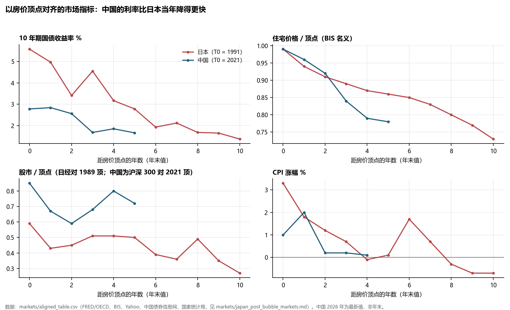
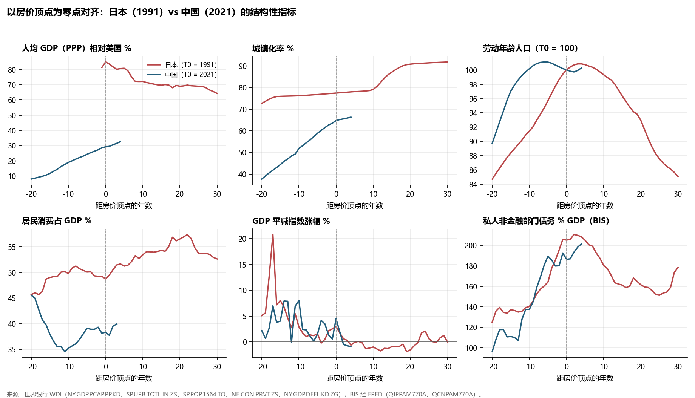

# 日本与中国

## 为什么路不一样，结局会不会不一样

**2026-10-16 · 数据截至 2026 年 10 月中旬**

**研究结论：中国不是在重演日本，而是“同一种病，不同的体质”。** 房地产泡沫破裂后的症状已经很像：内需疲弱，价格连续下跌，企业出清很慢，对外顺差引发贸易摩擦。但病因只像一半，体质差别很大。中国躲开了日本当年的几个触发点：广场协议式的被迫升值、股市泡沫、开放的资本账户；却背着更重的结构包袱：更早的人口转折、更高的债务起点、日本没有的土地财政。

**所以结局会分成两层。** 名义增长偏低、利率长期低、资产价格长期分化，这部分大概率和日本相同。危机的形态和真实收入的走势，大概率和日本不同。真正决定“像不像日本”的，是四件事做得快不快：确认坏账、财政转向家庭、让实际利率低于增长率、让房地产和城投真正出清。

本报告基于四份核查过原文的研究材料和三组自算数据，文件清单见第 8 节。研究资料，不构成投资建议。

<!-- PAGEBREAK -->

## 1. 先对齐：中国现在相当于日本哪一年

把两国的房价顶点放在同一个“零点”：日本是 1991 年（BIS 全国住宅价格峰值 1991Q1，日经顶点在 1989 年底），中国是 2021 年（BIS 全国住宅价格峰值 2021Q3）。

| 顶点后第 5 年 | 日本（1996） | 中国（2026） | 怎么读 |
|---|---|---|---|
| 10 年期国债收益率 | 2.78% | 1.66% | 中国这个水平，日本到第 8 年（1999）才到。**中国的利率比日本快约 3 年** |
| 政策利率 | 贴现率 0.5% | 7 天逆回购 1.40% | 中国还有一点空间，但离下限更近了 |
| 全国住宅价格 / 顶点 | 86% | 78% | 中国全国口径跌得更深；但日本大城市商业地价到 2012 年累计跌了 86.7%，全国指数掩盖了这一点 |
| 股市 / 顶点 | 日经为 1989 年顶点的 50% | 沪深 300 为 2021 年顶点的 72%；上证为 2007 年顶点的 61% | 中国股市没有日本 1989 年那样的估值泡沫 |
| GDP 平减指数 | 1995、1996 年小幅为负，1998 年起连续为负 | 2023Q2 到 2026Q1 连续 12 个季度为负，2026Q2 约 +1.4% 到 +1.6%（前者按统计局初步核算数自算，后者为机构数） | 中国进入通缩比日本快；2026 年的转正主要靠能源价格（见 3.6） |

来源：markets/aligned_table.csv（FRED/OECD、BIS、Yahoo、中国债券信息网、国家统计局）；policy_timeline_japan_china.md；china_japanification_literature.md。

**一句话：中国在利率和通缩上走得比日本快，在房价上跌得更深，在股市上浅得多。**

## 2. 为什么这个对比成立：两国的共同点

把中国和日本放在一起比，不是因为长得像，而是因为几条底层条件确实相同：

- **都是信贷推起来的地产泡沫。** 泡沫顶点时，私人非金融部门债务都在 GDP 的 190–210%（BIS：日本 1991 年 205%，中国 2021 年 186%）。
- **都是高储蓄、强出口的净债权国。** 2025 年末日本对外净资产 561.8 万亿日元，中国约 636 万亿日元（japan_carry_history.md，S18）。
- **都和美国有贸易摩擦。** 日本是 1980–90 年代的美日摩擦；中国是 2018 年以来的关税，目前休战到 2027-01-10（literature S56）。
- **都是用行政手段刺破的。** 日本是大藏省 1990 年的“总量规制”，限制房地产贷款；中国是 2020 年的“三道红线”和银行房贷集中度上限（policy_timeline）。
- **人口都在转折。** 日本劳动年龄人口 1995 年见顶；中国 2015 年见顶，总人口 2021 年见顶。

## 3. 八个分岔：路为什么不一样

### 3.1 汇率和资本账户：日本被迫急升，中国自己控制节奏

- **日本**：日元翻倍升值了两次。1985 年 2 月到 1988 年 11 月升值 117%（广场协议）；1990 年 4 月到 1995 年 4 月再升值 97%。资本账户开放，日元可以自由兑换（美联储 H.10，自算）。
- **中国**：2005–14 年人民币用 8.5 年升值 37%；2015–25 年反而贬值，到 2025 年 4 月贬到 7.35；之后再升值 9.8%，到 6.69。资本管制下，央行每天定中间价，现在持续定得比市场预期弱，是在主动压升值（cny_carry_2026.md）。
- **后果**：中国没有广场协议那种外部冲击，也没有资本外逃式的危机。但日本 1990–95 年“泡沫破裂 + 本币急升 + 通缩”这个组合要警惕。IMF 估计人民币仍被低估约 16%（literature S1），升值压力还在。

### 3.2 怎么刺破的：日本加息，中国降息

- **日本**：贴现率 15 个月从 2.5% 加到 6.0%（1989-05 到 1990-08），同时实施总量规制，到 1991 年末解除（policy_timeline）。
- **中国**：基本不靠加息，靠“三道红线”和集中度上限，同期利率一直在降（policy_timeline）。
- **后果**：中国的问题暴露得快得多。日本从资产见顶到第一家大机构倒下用了 7–8 年（1997 年 11 月北海道拓殖银行、山一证券）；中国从规则出台到恒大违约约 16 个月。问题早暴露的好处是能早处理，代价是利率更早逼近下限：10 年期国债跌破 1.7%，中国用了 3.5 年，日本用了 7.7 年（markets 报告）。

### 3.3 泡沫在哪里：日本在股市和土地，中国在房子和土地财政

- **日本**：1989 年末股市市盈率约 55 倍、市净率约 5 倍。日经从顶点最多跌了 81.9%（2009-03），用了 34.1 年才回到 1989 年的高点（2024-02-22）（markets 报告）。
- **中国**：沪深 300 市盈率约 12.9 倍，MSCI 中国市净率约 1.4 倍，股市本身没有估值泡沫。泡沫在房地产：2021→2025 年新建商品房销售面积 −51%，新开工 −71%（markets 报告）。还多了一条日本没有的放大渠道，土地财政：2025 年土地出让收入约 4.15 万亿元，比 2021 年峰值少约 52%（literature S34）。
- **后果**：中国股市未必重演日经那样的估值崩塌。但房地产、土地财政，以及依赖它们的地方政府和银行，更像日本的地价。

### 3.4 发展阶段：中国最大的有利条件

- **日本 1991 年**：人均 GDP（按购买力）是美国的 85%，城镇化 77.5%，已经站在技术前沿，追赶空间基本用完（世界银行，自算）。
- **中国 2021 年**：人均 GDP 是美国的 29%（2025 年 33%）；城镇化 64.7%（世界银行口径），国家统计局口径 2025 年为 67.89%。
- **后果**：这是反方最强的论据（literature §10.1）。收入只有美国三分之一，意味着靠技术扩散、城镇化和产业升级还有实际增长空间。IMF 预计 2030 年增长约 3.5%（literature S1）。日本 1990 年代没有这个空间。

### 3.5 人口：中国最大的不利条件

- **日本**：泡沫顶点后第 4 年（1995）劳动年龄人口见顶，总人口 2010 年才见顶；生育率 1.5（世界银行）。
- **中国**：劳动年龄人口 2015 年就已见顶，比房价顶点早 6 年；总人口 2021 年见顶，已连降四年；生育率约 1.0；2025 年出生 792 万，总人口减少 339 万（literature S29）。
- **后果**：中国在更低的收入水平上更快地老龄化，即“未富先老”，这是正方最强的论据（literature §10.1）。人口下降直接压低住房需求，所以房地产调整更可能是长期的。

### 3.6 增长结构和债务：日本是企业在还债，中国是居民在还债

- **消费与投资**：日本泡沫顶点时居民消费约占 GDP 的 49%，投资约 37%；中国消费约 38–40%，投资约 43%（世界银行）。中国更依赖投资和出口，转向消费的路更长。
- **谁在去杠杆**：日本是企业在还债，企业债务/GDP 从 1991 年的 138% 降到 2011 年的 101%，私人部门总债务从 205% 降到 162%（BIS，自算）。中国是居民在还债，2026 年前三季度住户贷款净减少 1.03 万亿元；但企业还在加杠杆，同期企业贷款增加 12.55 万亿元，企业债务/GDP 从 126% 升到 142%，私人总债务从 186% 升到 201%（BIS；literature S9）。
- **政府债务起点**：IMF WEO 口径，中国 2025 年 98.6%，日本 1990 年 54.8%（literature S21）。IMF 把城投算进去的“增扩口径”2025 年为 126.6%（policy_timeline）。
- **后果**：辜朝明式的“资产负债表衰退”在中国只成立一半。私人部门总债务还没有转负，这既是反方的论据（问题没那么严重），也说明去杠杆还没开始（literature §10.2）。日本的去杠杆伴随了 15 年以上的名义零增长。

### 3.7 银行和政策工具：中国处理更快，但可能慢性僵尸化

- **日本**：坏账拖了很多年才承认。1997–98 年连续倒闭，1998、1999 年两轮公共资金注资（1.8 万亿、7.5 万亿日元），2002 年竹中方案，2003 年理索纳注资 1.96 万亿日元。主要行不良率 2002 年 3 月达 8.4%，2005 年降到 2.9%（policy_timeline）。
- **中国**：银行国有，存款稳定。2025 年给四家大行注资 5,000 亿元，2026 年 9 月又注资 3,600 亿元，六大行全部完成；白名单项目贷款 6.7 万亿元；2026 年 10 月起中央财政给首套房贷每年贴息 1 个百分点（policy_timeline）。官方不良率 1.52%，但 IMF 提醒，宽容措施可能“掩盖真实资产质量、推迟损失确认”，资产管理公司可能变成长期“仓库”（literature 结论 3）。
- **后果**：中国大概率不会有日本 1997–98 年式的银行危机，但可能出现日本式的慢性僵尸化：企业不退出，坏账靠展期续命（IMF Box 8 把中国和日本归为“企业退出很少”的同一类）。世界银行的批评是，财政支出的结构在“强化已有失衡”，钱更多流向供给侧而不是家庭（literature S13）。

### 3.8 外部环境：中国更强，也更受限

- **日本 1990 年代**：多数行业是被追赶的一方，电子产业后来被韩国和台湾地区超越。
- **中国现在**：在电动车、电池、光伏处于主导地位，2025 年贸易顺差 1.189 万亿美元，规模超过日本当年的峰值（literature S60）。但关税、技术封锁和汇率压力，比当年美日摩擦更全面。欧洲央行担心价格战会输出到海外（literature S62）。
- **后果**：外需是中国的缓冲，也是风险。若被迫较快升值，同时通缩还没消除，就是日本 1990 年代的组合（literature 结论 6）。

## 4. 结局会不会不一样

路不同，结局只会部分不同。泡沫怎么破、走哪条路，决定了危机的形态和速度；人口、债务、房地产存量这些硬约束，决定了结局的大轮廓。

### 4.1 大概率和日本相同的部分

1. **名义增长偏低、利率长期偏低。** 中国 10 年期国债已经比日本同期低，政策利率离下限不远。核心 CPI 只有 1.0%，食品价格还在跌（literature §10.3）。
2. **房地产长期消化。** 有研究估计，建设规模可能稳定在峰值的 40–50%（Logan Wright，literature S76）。人口在减少，消化期只会更长。
3. **资产价格分化，而不是整体上涨。** 日本 1990–2012 年，股市含分红总回报 −53%；10 年期国债估算约 +152%；现金 +34%；同期 CPI 只涨 8.7%。股市内部，价值股 +167%、成长股 −82%，高股息股 +10%、低股息股 −79%（markets 报告）。中国从 2021 年顶点算，已经出现同样的分化：中证红利含分红 +61.7%，沪深 300 含分红 −17.3%（markets 报告）。

### 4.2 大概率和日本不同的部分

1. **危机的形态。** 银行国有、资本管制、汇率由央行管理，所以不太可能出现日本 1997–98 年那样的连串银行倒闭，也不会有广场协议式的汇率冲击（literature §10.1）。
2. **股市的跌幅。** 中国股市没有 55 倍市盈率的起点，日经那种“跌 80%、34 年回本”的估值崩塌，缺少前提。
3. **真实收入的走势。** 收入只有美国的三分之一，实际增长维持 3–4% 是可能的（IMF 2030 年约 3.5%）。有研究指出，日本按劳动年龄人口算的人均实际增长其实并不差（Fernández-Villaverde，literature S26）。“失去的几十年”主要失去的是名义增长和资产价格，不是生活水平。

### 4.3 可能比日本更难的部分

1. **人口。** 转折比日本早、收入比日本低。
2. **债务起点和土地财政。** 政府债务起点约是日本的两倍，地方政府还失去了一半的土地收入。
3. **转型难度。** 消费占比比日本低约 10 个百分点，要转向消费，需要更大的财政和社保改革。
4. **利率更早碰到下限。** 日本到 1999 年才实行零利率，中国走到同样的位置可能更快。

### 4.4 三种情景（按来源归纳，加上我的判断）

| 情景 | 是什么样 | 会看到的信号 | 我的判断 |
|---|---|---|---|
| A. 日本式债务通缩 | 私人总债务长期零增长或负增长；能源回落后价格重新转负；实际利率持续高于增长率；开发商和城投靠展期续命；资产多年阴跌 | 核心 CPI 和平减指数在油价回落后跌回负值；10 年期国债跌破 1.5% | 风险真实存在，在名义增长和资产价格上会部分出现 |
| B. 慢速减速 | 没有日本式的债务通缩，但人口和投资回报下降，增长逐步降到 3–4%（BBVA 称之为“中等收入陷阱”的风险） | 房价止跌但不涨；政府加杠杆替代私人部门；通胀在 0–2% | **最可能的主线**，叠加 A 的部分特征 |
| C. 较快出清、再通胀 | 快速确认损失，财政转向家庭，实际利率降到增长率以下，类似美国 2009 年或北欧的路径 | 剔除能源的价格持续为正；居民贷款恢复增长；消费占比上升；10 年期国债回升 | 需要政策明显转向，目前证据不足 |

这个判断的理由：中国的制度能避免急性危机，所以 A 的极端版本不太可能。但人口、债务和土地财政这些约束都还在，内需型通缩也没有消除（2026 年的转正主要靠能源，世界银行、惠誉、BBVA 都这样判断），所以 C 还缺证据。B 是最多来源指向的方向（IMF、BBVA、Kirkegaard、西班牙央行）。

## 5. 观察清单：怎么判断走向哪一种结局

| 指标 | 怎么判断 | 最新读数（来源：literature §10.3） |
|---|---|---|
| 私人部门总债务增速 | 转为负增长，说明真正进入日本式去杠杆 | 居民贷款前三季度 −1.03 万亿元，企业 +12.55 万亿元；BIS 口径居民债务 58.0% 在降，企业 142.8% 在升 |
| 剔除能源后的价格 | 油价回落后，核心 CPI 和平减指数能否守住正值 | 9 月 CPI 0.9%，核心 1.0%，食品 −1.7%；PPI +5.0%（采掘业 +25.4%） |
| 实际利率和增长率 | 实际利率高于增长率是日本的特征 | 7 天逆回购 1.4%、LPR 3.0%，已 16 个月没动 |
| 企业退出和坏账确认 | 退出越慢，累计损失越大 | 不良率 1.5%，但损失类约占四成；开发商过半仍处困境 |
| 房地产量价 | 新开工能否稳定，房价能否止跌 | 新开工较峰值约 −70%；实际房价 −23% |
| 消费占比与财政方向 | 财政是否转向家庭（社保、户籍） | 消费占 GDP 40%（2024）；2026 年财政脉冲约 0.3% GDP |
| 土地出让收入 | 地方政府收入缺口能否被替代 | 2025 年 4.15 万亿元，较 2021 年峰值约 −52% |
| 汇率 | 升值过快、同时通缩未除，是日本 1990 年代的组合 | 人民币 2026 年至今对美元 +4.5%，自 2025 年 4 月 +9.8% |
| 人口 | 出生和劳动年龄人口 | 2025 年出生 792 万，总人口 −339 万 |
| 增长数据 | 官方和独立估计的差距 | 2025 年官方 5%，Rhodium 估计 2.5–3% |

## 6. 对投资者的含义（历史观察，不是建议）

1. **日本化的主要代价是名义增长和资产价格。** 日经用了 34.1 年回到 1989 年的高点；含分红按估算约 31 年。
2. **在日本，赢家是国债、现金、价值股和高股息股，以及走向全球的企业；输家是银行、地产、建筑和高估值成长股。** 中国从 2021 年起已经出现同样的分化。
3. **中国的泡沫在房地产，不在股市估值。** 所以“房子和地产链像日本地价”比“A 股像日经”更贴切。
4. **和前面套息交易的讨论连起来：** 日本的日元套息，是在 1995 年日元见顶转贬、利率降到接近零之后才起来的。中国利率正在逼近下限，但人民币还在升值，所以日元式的人民币套息还没到时候。对以人民币为本位、持有美元资产的投资者来说，人民币升值本身就是一项成本。

## 7. 证据边界

- 所有数字都来自四份研究材料里打开过的原文，或世界银行、BIS、FRED、Yahoo 的原始数据。各文件末尾列有未核实清单，正文没有采用未核实的说法作为证据。
- **口径差异**：
  - 城镇化率，世界银行与国家统计局不同；
  - 政府债务，WEO 口径、官方口径与 IMF 增扩口径不同；
  - 增长率，官方与 Rhodium 不同。
  - 日本的“全国住宅价格”指数远比大城市地价温和。
- **2026 年最新动向（物价转正、注资、房贷贴息）只有几个月的数据**，是否持续需要继续观察。
- 情景判断是推理，不是预测，没有给出概率。

## 8. 资料与复跑

本文件夹 `macro/carry_trade_cny_vs_jpy_2026-10-15/` 中：

| 文件 | 内容 |
|---|---|
| policy_timeline_japan_china.md | 两国政策时间线，按日期排列，附关键原文 |
| china_japanification_literature.md | “中国会不会日本化”正反文献，按机制整理，96 条来源 |
| markets/japan_post_bubble_markets.md | 日本泡沫后各类资产的结局，以及和中国的对照 |
| cny_carry_2026.md、japan_carry_history.md | 人民币套息核查、日元套息历史 |
| structural_alignment.py、japan_china_sequence.py、market_alignment_chart.py、analyze_carry.py | 计算与作图脚本，数据在 data/、markets/data/ |
