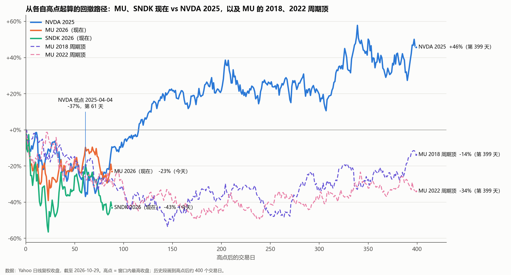
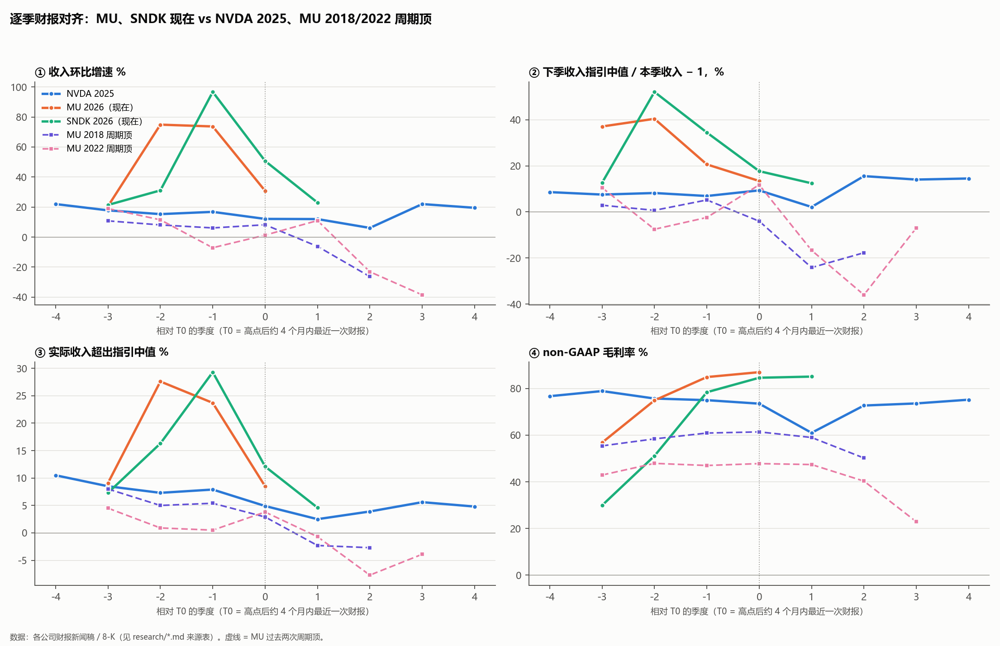

# 存储股现在 vs NVDA 2025 年 4 月：像不像？

**2026-10-30 · 价格截至 10-29 收盘 · SanDisk FQ1 FY27 已于 10-29 盘后发布**

**问题**：今天的 SanDisk（SNDK）和美光（MU），是不是就是 2025 年 4 月的英伟达：业绩还很强，股价却深度回撤，之后一路新高？下面把 NVDA 当年前后几个季度的财报，和 MU、SNDK 最近几个季度逐季对齐来比。同时加入第二个参照：美光自己 2018 年、2022 年的两次周期顶。

## 结论

**表面很像，机制不像。** 股价回撤的形态、"业绩还在超预期、指引还在往上"这些表面特征，现在的存储股和 NVDA 2025 年 4 月确实很像。但决定 NVDA 后来能涨回去的那几样东西，存储股大多不具备：

- 增长靠出货量，不靠涨价；
- 毛利率在自己的常态区间；
- 没有竞争对手能大量补货；
- 下跌是大盘带下来的。

在这几项上，存储股更像美光自己 2018 年、2022 年的周期顶。

但这次有一样以前没有的东西：take-or-pay 长约和 HBM 订单。它可能让这次见顶更晚、更缓。到底是哪一种，**看下一份指引**：

- 美光 FQ1 FY27，约 12 月中旬；
- SanDisk FQ2 FY27，约 1 月底。

2018 年和 2022 年，超指引幅度都是先收窄到 0，再转负，下季指引也跟着转负。NVDA 2025 年则是超指引保持为正，指引重新加速。

1. **股价形态分不出来。** 从各自高点起算第 88 个交易日（也就是今天），几段走势都在 −20% 到 −28% 附近：MU 2026 −23%，NVDA 2025、MU 2018、MU 2022 也都在这个区间。SNDK 更深，−43%。
2. **同期大盘不一样。**
   - NVDA 从高点跌到低点那段，QQQ −19%、SMH −30%，是关税冲击下的全市场下跌。
   - 现在 MU 高点以来 QQQ 0%、SMH −12%，是存储板块自己在跌。
   - 2018 年的头 88 天，QQQ 还涨了 10%，MU 却跌了 27%。
   - 现在更像 2018。
3. **财报的表面特征都像。** 收入还在环比增长，下季指引还是两位数（MU +13%、SNDK +12%；NVDA 当时 +9%），超指引幅度在收窄，客户的资本开支还在上调。但这些特征在 MU 2022 年的 T0 也全都有：当时指引 +12%，是创纪录的数字，下一季就转成了 −17%。
4. **增长来源不一样。** NVDA 靠 Blackwell 放量，价格由自己定。存储靠涨价，而且涨幅正在快速衰减：
   - 美光 DRAM 价格环比：中 60% 区间 → 高十几%。管理层原话是 FY27 "more moderate rate of price increases"。
   - SanDisk 均价环比：+140% → 约 +8–9%。管理层说下季只有 "modest like-for-like price increases"。
5. **毛利率在历史上的位置不一样。**
   - NVDA 12 个季度都在 71–79% 之间，2025 年的下滑来自新产品的成本，不是降价。
   - MU 87%、SNDK 85%，比以往任何周期顶都高 25 个点以上：MU 2018 年 61%，2022 年 48%。而且已经走平。
6. **供给不一样。**
   - NVDA 被先进封装（CoWoS）产能卡住，没有人能大量补货。
   - 存储方面：美光 FY27 资本开支超过 $500 亿（+80%），SK 海力士 2027 年资本开支"大幅"增加，三星 P5、长鑫也在扩产。新产能大约在 2027 年下半年到 2028 年释放。
7. **估值不一样。**
   - NVDA 在低点时的前瞻 P/E 约 21 倍，从 34 倍跌下来，跌的全是估值，EPS 预测只降了 1.5%。
   - MU 现在的运行率 P/E 约 6.1 倍，SNDK 约 5.9 倍（运行率 = 下季 EPS 指引 × 4）。
   - 存储股在顶部本来就是低 P/E：MU 2018 年顶部 3.9–4.5 倍，2021–22 年顶部 8.3–10.5 倍。低 P/E 不是安全边际。

## 1. 股价：从各自高点起算

| | 高点 | 最大回撤 | 现在 / 后来 | 同期 QQQ / SMH（高点→低点） |
|---|---|---|---|---|
| NVDA 2025 | 2025-01-06 $149.43 | −36.9%（04-04，第 61 天） | 06-25 收复前高；低点后 6 个月 +97% | −19.3% / −30.5% |
| MU 2026 | 2026-06-25 $1,213.56 | −39.1%（07-29） | **今天 −23.0%**（第 88 天） | 高点→今天：0.0% / −11.8% |
| SNDK 2026 | 2026-06-25 $2,335.00 | −56.5%（07-29） | **今天 −43.0%**；10-30 盘前约 −7.7% | 同上 |
| MU 2018 周期顶 | 2018-05-29 $62.62 | −53.7%（第 145 天） | 2020-11 才收复 | −14.5% / −23.2%（头 88 天 QQQ +10.4%） |
| MU 2022 周期顶 | 2022-01-14 $97.36 | −49.6%（第 174 天） | 2024-03 才收复 | −27.4% / −38.1% |

MU 和 SNDK 同一天见顶（6-25），同一天见底（7-29），这是板块行情。10 月以来 MU −12%、SNDK −24%，主要节点：
- 10-12：长鑫发布新 DRAM 设计。
- 10-13：韩国存储股暴跌，SK 海力士 −10%。
- 10-28：SK 海力士财报称"到 2029 年基本售罄"，存储股反弹。
- 10-29：SNDK 发财报，次日盘前再跌。

## 2. 逐季财报：对齐到"同一时刻"

T0 取"股价高点后约 4 个月内最近一次财报"，也就是和今天处在同一个位置的那一季：
- NVDA：Q4 FY25（2025-02-26）
- MU 2018：FQ4 FY18（2018-09-20）
- MU 2022：FQ2 FY22（2022-03-29）
- MU 现在：FQ4 FY26（2026-09-30）
- SNDK 现在：FQ4 FY26（2026-08-05）；昨晚的 FQ1 FY27 就是 T+1。

| 系列 | T−1 | **T0** | T+1 | T+2 |
|---|---|---|---|---|
| **超指引中值** NVDA 2025 | +7.9% | **+4.9%** | +2.5% | +3.9%，之后回到 +5% 左右 |
| MU 2018 | +5.4% | **+2.9%** | **−2.3%** | −2.7% |
| MU 2022 | +0.5% | **+3.8%** | **−0.7%** | −7.7% |
| MU 现在 | +23.7% | **+8.5%** | 12 月中旬 | |
| SNDK 现在 | +29.3% | **+12.1%** | **+4.6%**（昨晚） | |
| **下季指引环比** NVDA 2025 | +7% | **+9%** | +2%（扣掉 H20 后更高） | +16% |
| MU 2018 | +5% | **−4%** | −24% | −18% |
| MU 2022 | −2% | **+12%** | **−17%** | −36% |
| MU 现在 | +21% | **+13%** | | |
| SNDK 现在 | +34% | **+18%** | **+12%** | |
| **毛利率** NVDA 2025 | 75.0% | **73.5%** | 61.0%（扣掉 H20 后 71.3%） | 72.7% |
| MU 2018 | 60.9% | **61.4%** | 59.0% | 50.2% |
| MU 2022 | 47.0% | **47.8%** | 47.4% | 40.3% |
| MU 现在 | 84.9% | **87.0%** | 指引约 86.25% | |
| SNDK 现在 | 78.4% | **84.6%** | **85.1%**，指引 84.5–85.5% | |

**怎么读：**
- **超指引在收窄，这本身不区分。** NVDA 当时也在收窄：+7.9% → +4.9% → +2.5%。区分的是收窄之后：NVDA 停在 +2–6% 又回升，MU 2018 和 2022 都在一个季度内转负。SNDK 昨晚 +4.6%，还在正区间，但收窄速度比 NVDA 快得多：+29% → +12% → +4.6%。
- **下季指引还是两位数，这一点像 NVDA，但也像 MU 2022 的 T0。** 2022 年的 T0 指引 +12% 是当时的历史纪录，下一季就是 −17%。所以"指引还在往上"不能证明是 NVDA 式。
- **毛利率走平在 85–87%。** NVDA 的毛利率波动是成本和产品组合造成的，价格没动。存储的毛利率完全由价格决定，价格涨幅一旦归零，毛利率就没有往上的空间了。

## 3. 相似度打分

| 维度 | NVDA 2025（T0） | MU / SNDK 现在 | MU 2018 / 2022（T0） | 像谁 |
|---|---|---|---|---|
| 股价形态（高点后 88 天） | 约 −20% | −23% / −43% | −27% / −28% | **都像，不区分** |
| 同期大盘 | 全市场下跌（关税） | 大盘平，存储自己跌 | 2018：大盘涨，存储跌 | **像 2018** |
| 收入还在环比增长 | +12% | +31% / +23% | +8% / +1% | 都像 |
| 下季指引 | +9% | +13% / +12% | −4% / +12% | 像 NVDA，也像 2022 |
| 超指引幅度 | 收窄后停在 +2–6% | 快速收窄，SNDK 已到 +4.6% | 收窄后一季内转负 | **待定**：看下一次 |
| 增长靠量还是价 | 量（新产品放量） | 价为主，涨幅快速衰减 | 价，价格见顶 | **像周期顶** |
| 毛利率的历史位置 | 常态区间 71–79% | 85–87%，比以往顶部高 25 个点以上，已走平 | 当时的历史最高，随后回落 | **像周期顶** |
| 供给 | 产能卡住，没有对手补货 | 美光 capex +80%，SK 海力士、三星、长鑫扩产 | 2018 年三星大扩产 | **像周期顶** |
| 估值 | 前瞻 21 倍（跌的全是估值） | 运行率 6 倍 | 4 倍 / 8–10 倍 | **像周期顶** |
| 客户资本开支 | 在上调 | 仍在上调，近端增量放缓 | 2018 年服务器需求仍强 | 都像 |
| 资产负债表 | 库存和供应承诺都在扩张 | SNDK 存货周转 166–178 天，应收增速快于收入，两季回购 $95 亿；MU 存货天数 120 → 129 | 存货开始累积 | 偏周期顶 |
| 长约和可见度 | 没有长约，需求远超供给 | MU 26 份 take-or-pay、RPO 约 $1,500 亿、客户预付 $127 亿；SNDK 长约覆盖 FY27 一半比特；SK 海力士称到 2029 年售罄。但最大客户的合同设了上限价 | 没有 | **新东西**，是多方最强的论据 |

**合计：**
- **只像 NVDA 的：0 项。** "指引还是两位数"一项 MU 2022 也有。
- **像周期顶的：6 项。** 同期大盘、增长来源、毛利率位置、供给、估值、资产负债表。
- **不区分的：3 项。** 股价形态、收入环比增长、客户资本开支。
- **待定：1 项。** 超指引幅度，看下一次。
- **新东西：1 项。** 长约和可见度。

## 4. 为什么长约是"多方最强论据"，又为什么还不够

**多方：**
- 美光 26 份 take-or-pay 长约，预计占 2030 年前收入 35% 以上，未履约合同额（RPO）约 $1,500 亿，客户预付 $127 亿。
- SanDisk 长约覆盖 FY27 约一半、FY28 约三分之二的比特。
- SK 海力士 14 家客户的长约覆盖 2027–28 年一半以上产能。
- TrendForce 9-30 把 4Q26 常规 DRAM 合约价预测从 +3–8% 上调到 +10–15%，2027 年 HBM 均价预测同比 +121%（二手）。

以前的周期没有这些，这次的下行可能来得更晚、更浅。

**还不够的原因：**
- **长约抬的是地板，锁不住天花板。** 美光最大客户的合同上限价是 2026 年第二季度的市价，SanDisk 均价涨幅（约 +8–9%）已经明显低于 TrendForce 的 NAND 合约价预测（+15–20%）。上涨空间被封顶，下跌时的价格保护有多大，还没有经过一个下行季检验。
- **供给在路上。** 2027 年下半年到 2028 年新产能陆续释放，正好在长约覆盖率开始下降的时候。
- **管理层自己在降预期。** 美光说 FY27 涨价节奏放缓，下调了服务器单机内存含量增速，PC 和手机出货可能两位数下滑，PC 厂商在消化上半年囤的库存。SanDisk 说下季只有温和涨价。

## 5. 接下来看什么

| 时间 | 事件 | 像 NVDA 2025（之后上涨） | 像 2018 / 2022（之后再跌） |
|---|---|---|---|
| 10-30 收盘 | SNDK 财报后首个交易日 | 盘前 −7.7% 被收回 | 继续走低 |
| 11 月中 | TrendForce 1Q27 合约价预测 | DRAM / NAND 仍为正，HBM 涨价确认 | 预测走平或转负，现货继续走软 |
| 11-20 | SNDK 1 拆 8 生效 | （不影响基本面） | |
| 约 12 月中 | **MU FQ1 FY27** | 超指引仍 ≥ 约 3%，FQ2 指引环比仍为正，毛利率守住 85% 以上 | **超指引接近 0 或转负，FQ2 指引环比转负，毛利率指引下降** |
| 约 1 月底 | **SNDK FQ2 FY27** | 同上，且长约价格没有重设 | 同上，存货周转天数继续上升 |
| 持续 | 三星、SK 海力士、美光的资本开支和新厂进度 | 新产能推迟 | 新产能提前，或客户开始去库存 |

**一句话：现在这个时点上，NVDA 2025 和存储周期顶的财报看起来几乎一样，真正把两者分开的，是下一份指引。** 以前每次分开时，存储股都走向了周期顶那一边。这次有长约，概率可能比以往高一些，但还没有证据。

## 6. 证据边界

- 所有季度数字来自各公司 8-K 新闻稿和 prepared remarks（一手）。2018 年三条收入指引、NAND 和 HBM 价格预测、长鑫扩产、部分卖方观点是二手。
- SNDK 长约的未履约合同额两个来源冲突（$889 亿和 $598 亿），本报告没有使用。
- "到 2029 年售罄""2028 年 DRAM 价格同比 −23%"这类说法只见于搜索摘要，没有用于打分。
- 对齐用的 T0 是"高点后约 4 个月内最近一次财报"，选法不同，T±1 会差一个季度，但结论不变：区分点仍然是"超指引和指引转负没有"。
- SNDK 10-30 收盘价和 FQ1 FY27 的次日反应还没出来。
- 这是研究，不是投资建议。MU 和 SNDK 在 repo 里的卡片都是 WATCH。

## 7. 文件

本目录：`studies/存储_vs_NVDA2025_相似度_2026-10-30/`

| 文件 | 内容 |
|---|---|
| 存储_vs_NVDA2025_相似度_2026-10-30.pdf / report.md | 本报告 |
| price_paths.py → price_paths.png、data/price_paths.json | 从高点起算的回撤路径和同期大盘 |
| earnings_compare.py → earnings_compare.png、data/earnings_aligned.csv | 逐季对齐 |
| data/{sndk,mu,nvda}_quarters.csv | 各季度数字（含来源列） |
| research/sndk_quarters.md | SanDisk 五个季度、昨晚财报、NAND 价格与供给 |
| research/mu_quarters_and_past_peaks.md | 美光近四季、2018 / 2022 周期顶、DRAM 和 HBM 价格与供给 |
| research/nvda_2025_episode.md | NVDA 2024–2026 各季度、2025 年 1–5 月那段行情、估值 |
